

  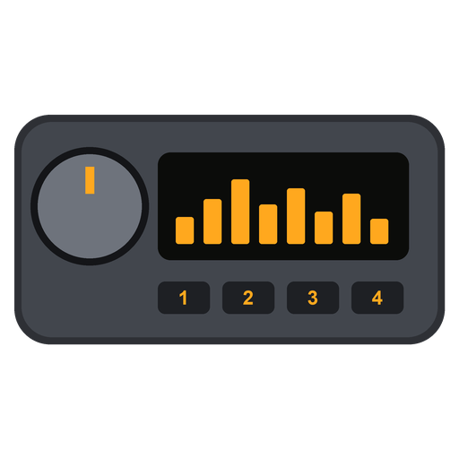

  <strong>A retro car stereo for Android head units, branded to match your own vehicle</strong>

  
  
  
  

<h1>RetroDeck</h1>

RetroDeck is an open-source virtual car stereo for Android head units. It plays your music on a period-correct faceplate (seven of them, from a 1984 hi-fi deck and 1990 and 1994 factory units to a modern glass screen), drawn to look like the real thing, and its Vehicle Branding module lets you make it yours: your car's manufacturer and model, your own logos on the faceplate and LCD, a startup sequence that lights up your badge, and illumination that matches your dashboard.

Everything works offline. There is no account and no cloud service; the only time RetroDeck goes online is while you search GIPHY for a visualizer animation. It needs no root and no Google Play Services. RetroDeck ships with no car logos: you import your own.

<h2>Screenshots</h2>

Recorded on a TV playing a song: the visualizer follows the music, the display shows the song's own title and artist, and the knob turns as the volume goes up and back down. Each clip starts by day and fades to night. Every skin has its own page in <a href="themes/">themes</a>, with more screenshots and day and night renders.

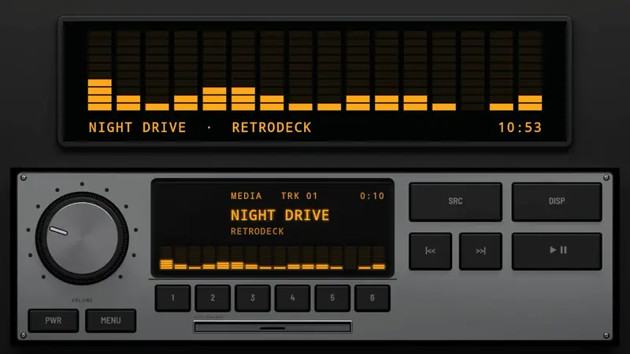 Classic 1985, a single-DIN radio set into the dash, with the visualizer screen above it: brushed aluminium, a spun-metal knob, a fluorescent display and a cassette door

<h3>Single DIN</h3>

<table>
  <tr>
    <td width="50%">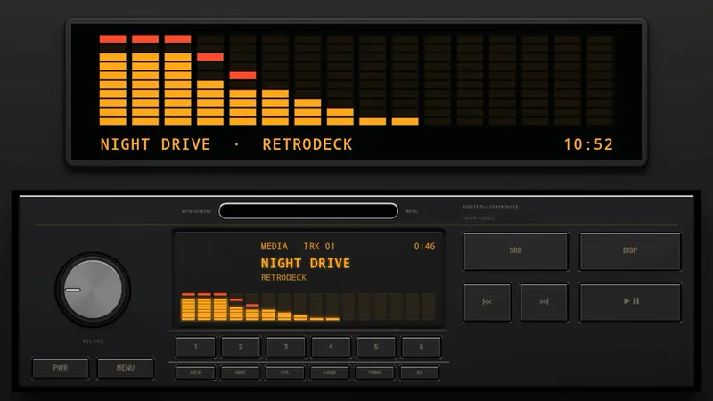 Hi-Fi 1984: black anodised aluminium, champagne print, slim keys and tape switches</td>
    <td width="50%">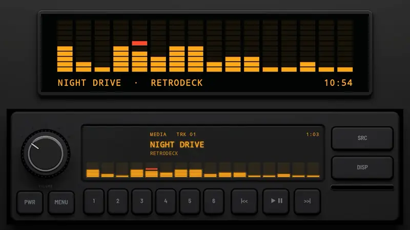 Digital 1996: grained plastic, rubber keys and a dot-matrix display</td>
  </tr>
  <tr>
    <td width="50%">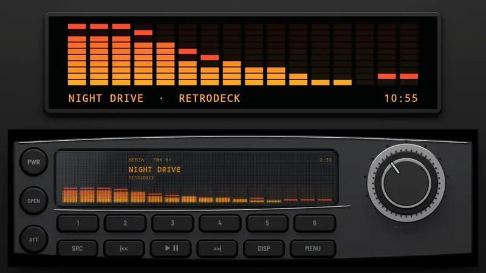 Detachable 1998: curved graphite with chrome trim, a big encoder and bars that shade into the accent colour</td>
    <td width="50%"></td>
  </tr>
</table>

<h3>Double DIN</h3>

<table>
  <tr>
    <td width="50%">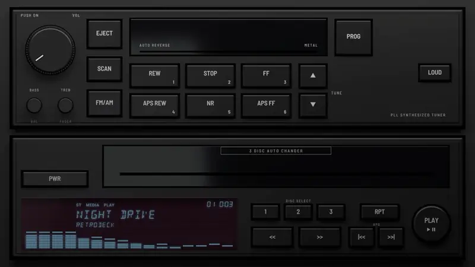 Z32 Factory 1990: satin black plastic and gloss doors by day; at night backlit legends, and the display's icy blue behind smoked plum glass</td>
    <td width="50%">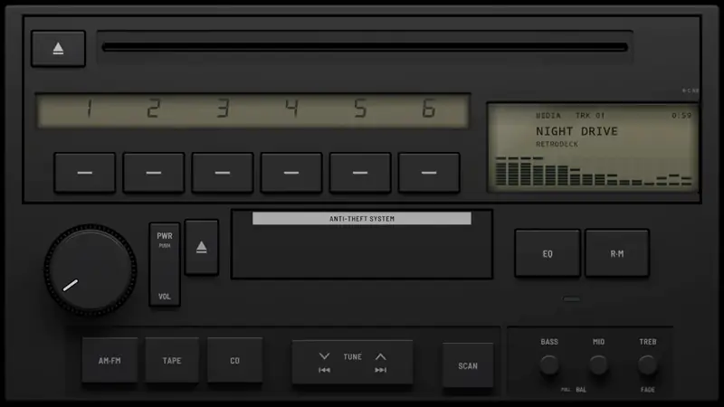 A80 Factory 1994: charcoal plastic and olive grey displays by day; at night the displays and legends lit lime green</td>
  </tr>
  <tr>
    <td width="50%">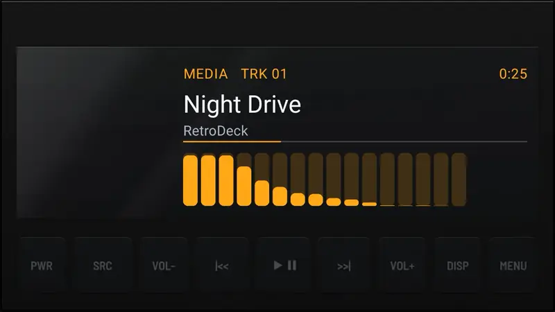 Modern Glass: one sheet of black glass over the display</td>
    <td width="50%"></td>
  </tr>
  <tr>
    <td colspan="2">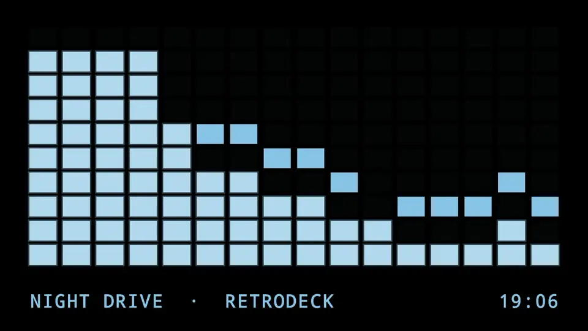 Full screen: hold DISP, or leave it playing, and the visualizer takes the whole screen in the display's own lettering. Here it steps through Z32 Factory 1990's icy blue, A80 Factory 1994's lime and Modern Glass, following the song.</td>
  </tr>
</table>

<h3>Settings</h3>

<table>
  <tr>
    <td width="50%">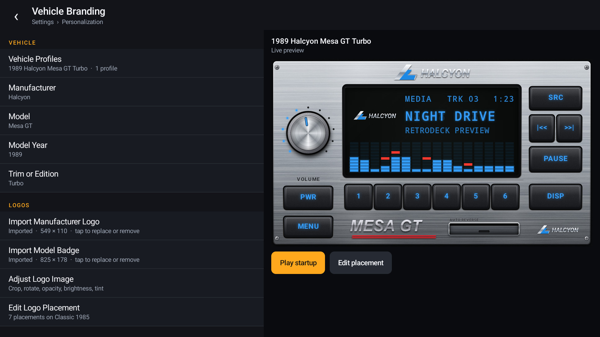 Settings → Personalization → Vehicle Branding, with the live preview</td>
    <td width="50%">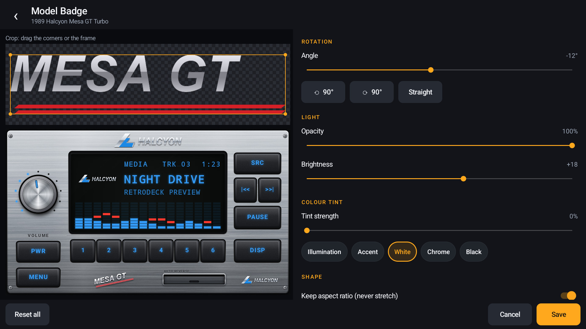 Adjusting the model badge: rotation and brightness, shown on the stereo as you go</td>
  </tr>
  <tr>
    <td width="50%">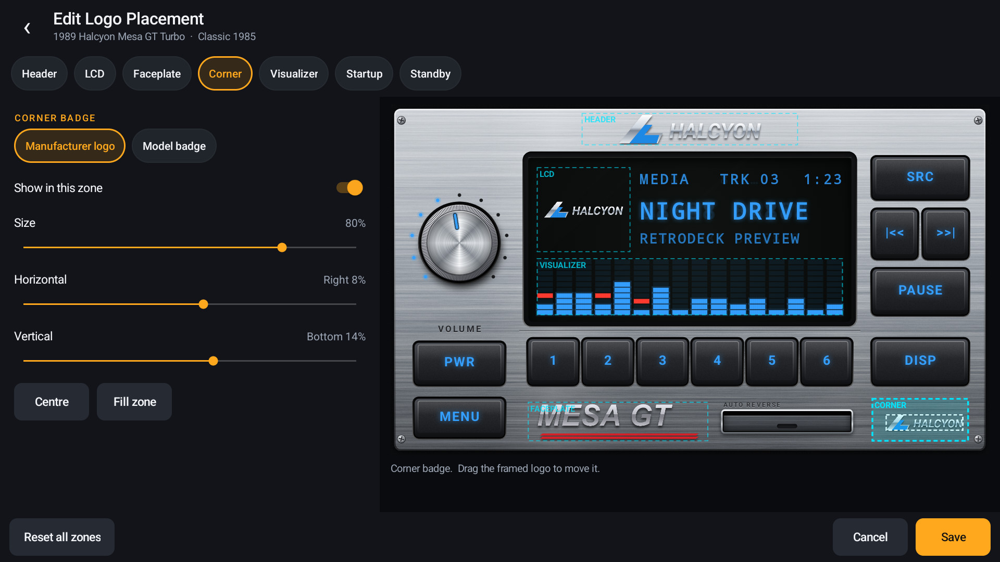 Placing logos in the skin's branding zones (the dashed boxes)</td>
    <td width="50%">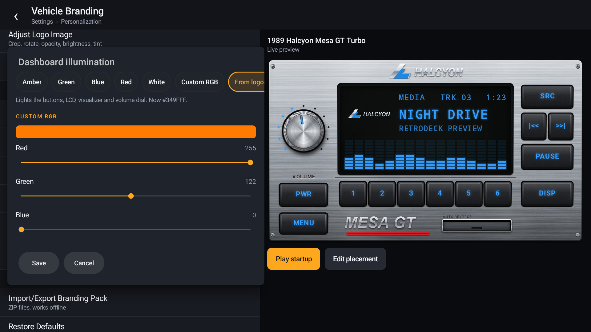 Dashboard illumination: "From logos" takes the blue from the Halcyon logo</td>
  </tr>
  <tr>
    <td width="50%">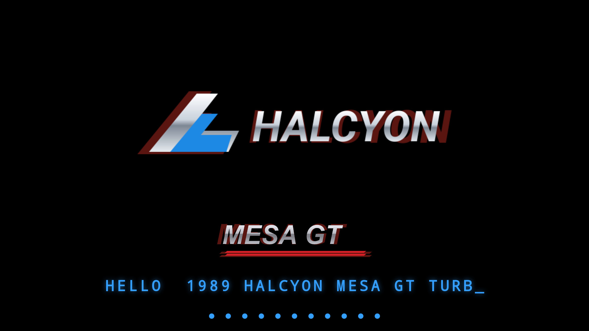 The incandescent-glow startup, partway through</td>
    <td width="50%">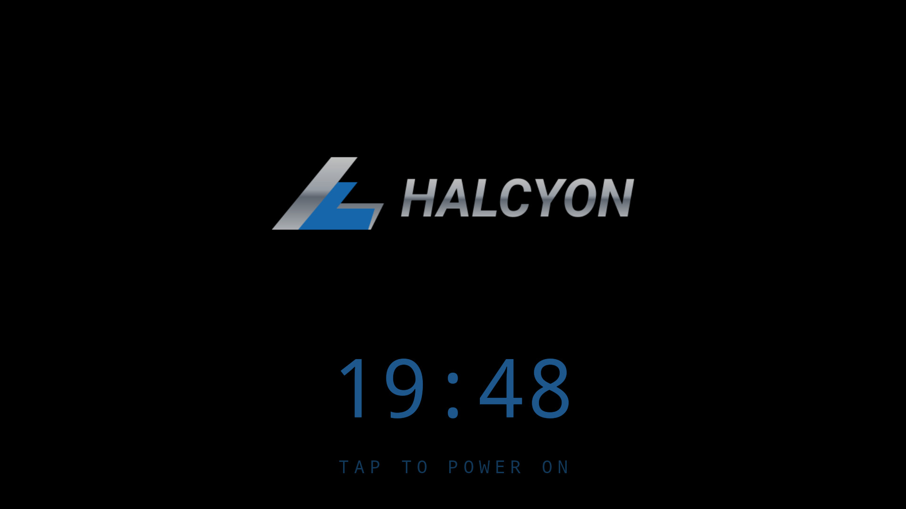 The standby screen</td>
  </tr>
  <tr>
    <td width="50%">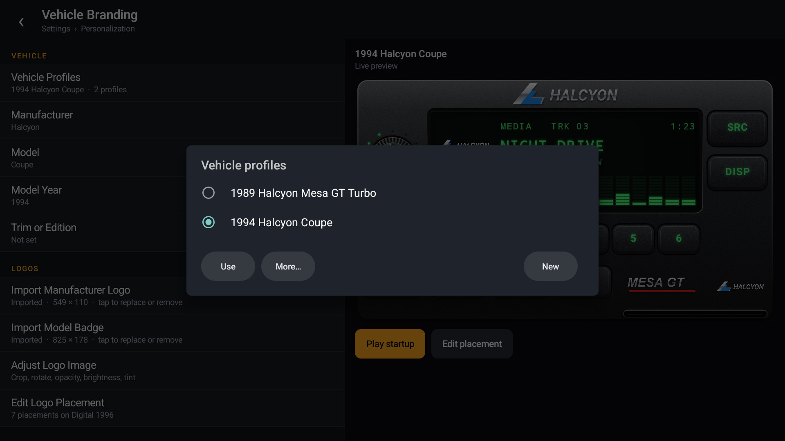 Two vehicle profiles, one imported from a branding pack</td>
    <td width="50%">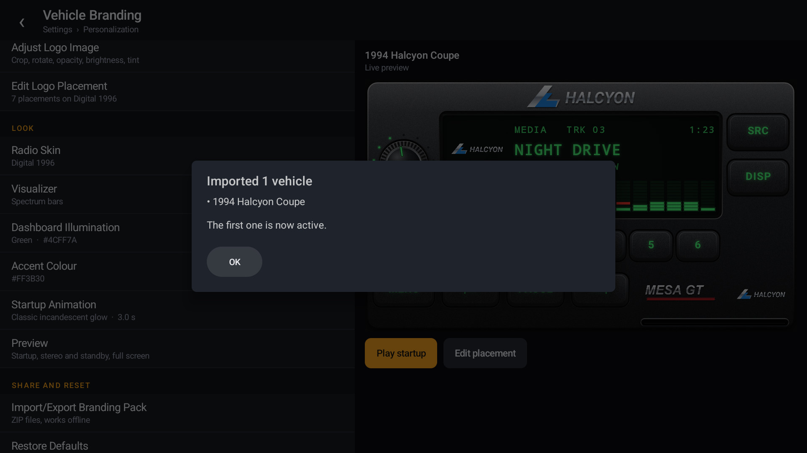 Importing a branding pack</td>
  </tr>
</table>

Screen grabs from the running app on an Android TV box set to 1920×1080 at 240 dpi, like a 1280×720 HD head unit. Nothing is mocked up or retouched. "Halcyon Motor Co." and the "Mesa GT" are made up for these screenshots; their artwork is in <a href="docs/demo/">docs/demo</a>, with more made-up brands (Takane Motors, MIZAR, Kazetone, ryusei) and <a href="docs/demo/demo-brands.zip">a branding pack</a> that puts them on the Z32, Hi-Fi and Detachable skins.

<h2>Features</h2>

<ul>
  <li><strong>Thirteen skins</strong>, modelled in 3D after the stereos of their era, with no brand names on them.
     Single DIN. On a single-DIN head unit's own wide screen (about 8:3, such as 1280×480 or 1920×720) the radio fills the screen. On a bigger screen it sits at its real slim shape across the lower half, set into the dash, with a screen above it for the visualizer, the song and the clock:
    <ul>
      <li>Hi-Fi 1984: a black anodised Japanese hi-fi deck with champagne print, slim keys, an amber display and tape switches</li>
      <li>Classic 1985: brushed aluminium, a spun-metal knob, a fluorescent display and a cassette door</li>
      <li>Digital 1996: grained plastic, rubber keys and a dot-matrix display</li>
      <li>Detachable 1998: a curved graphite faceplate with chrome trim, a big encoder and a colour display</li>
      <li>Bluetooth 2016: gloss black, a big knob in a lit ring, keys edged with light strips and a blue segment display</li>
    </ul>
    Double DIN, filling the screen:
    <ul>
      <li>EQ Stack 1989: a silver graphic equaliser, its bars yellow under blue with red peaks, over a CD unit with an orange fluorescent display and mint green keys</li>
      <li>Z32 Factory 1990: a car maker's tuner and tape deck over a three-disc changer, set into a carbon-look dash, with a fluorescent display behind black glass; the tape keys double as presets</li>
      <li>Level Meter 1991: a black unit with one big window, an orange readout over a cyan spectrum analyser</li>
      <li>Trio Stack 1993: three black units, an equaliser with green bars, a disc changer controller and a head unit, with mint green keys</li>
      <li>A80 Factory 1994: a car maker's CD and tape unit in charcoal plastic, with a strip display numbering the presets and a reflective LCD, olive grey by day; at night the displays and legends glow lime green</li>
      <li>Spectrum 1997: a silver receiver over a CD player whose window is a spectrum analyser, white bars under a green line and blue above</li>
      <li>Multi Control 2000: nearly all display, a big blue fluorescent window whose bars fan round a half circle</li>
      <li>Modern Glass: one sheet of black glass over the display</li>
    </ul>
    Keys a real unit had but RetroDeck doesn't need (FM/AM, TUNE, DISC SELECT, tape switches) are there for the look and do nothing.</li>
  <li><strong>Vehicle profiles</strong>: any manufacturer, model, year and trim, typed in (no online database); create, duplicate, switch and delete profiles without reinstalling</li>
  <li><strong>Your own logos</strong>: a manufacturer logo and a separate model badge, imported as PNG, JPEG, WebP or SVG, transparency kept</li>
  <li><strong>Logo editor</strong>: crop, rotate, opacity, brightness and colour tint, all non-destructive; aspect ratio always kept unless you turn it off</li>
  <li><strong>Placement</strong>: put each logo in the radio display header, the LCD, the faceplate, a corner badge, behind the visualizer, on the startup screen or on the standby screen; drag it or use sliders, with a live preview before saving</li>
  <li><strong>Branding zones</strong>: every skin declares where branding may go, and a logo can never leave its zone, so it never covers a button or the track text</li>
  <li><strong>Startup sequence</strong>: black screen, your logo lights up, the model badge appears, the dial lamps power on and the LCD types a greeting, then the stereo; six styles (incandescent glow, 1980s green LCD, 1990s digital scan, CRT power-on, modern fade, minimal instant), 1–6 seconds or off; a tap skips it</li>
  <li><strong>Key lighting</strong>: the key legends light up at night and are plain printed paint by day, like keys that come on with the headlights. At night the faceplate goes dark around them. Auto switches by the clock (lit from 19:00 to 07:00); Always on and Off are there too. On Z32 Factory 1990 the legends are white, printed by day and backlit at night</li>
  <li><strong>Animation visualizer</strong>: any GIF on the display, like the animated displays of late-1990s head units. Search GIPHY from the head unit, or import a GIF file (up to 800 pixels a side, 500 frames and 8 MB). It runs faster when the visualizer is busy and stops when the music is paused; it can glow in the display's own colour or keep its colours, and fill the visualizer strip or the whole display behind the track text. GIFs travel in branding packs</li>
  <li><strong>Dashboard illumination</strong>: amber, green, blue, red, white, any RGB colour, or a colour taken from your logos, on the buttons, LCD, visualizer and volume dial; plus an accent colour</li>
  <li><strong>Your own colours</strong> for the visualizer, the background behind it, and the radio itself: the radio's greys and blacks take the colour keeping their shading, while its displays, lamps and print keep theirs</li>
  <li><strong>Branding packs</strong>: export one or all profiles with their logos as a ZIP and import them on another head unit, offline; packs are checked before anything is imported</li>
  <li><strong>Music</strong>: plays audio files from the device; SRC adds files (or songs from the music folder), the knob sets the media volume</li>
  <li><strong>Full-screen visualizer</strong>: the visualizer (or your GIF) over the whole screen, with the song and clock along the bottom. Hold DISP or press a key set to it, or let it come on by itself after a while without a touch while music plays (Settings → Display; off until you choose a time). A touch or key brings the stereo back; media keys and presets keep working while it shows</li>
  <li><strong>Melody box</strong>: a short station chime, like the melodies Japanese train platforms play, when the stereo comes on. Four original tunes (Departure, Morning Line, Harbour, Last Train) on a synthesized bell, or your own sound files. A shut-down chime can be switched on too (Settings → Audio)</li>
  <li><strong>Presets 1–6</strong>: a favourite song on each. Tap to play it; hold for a moment to save the song that's playing, like saving a radio station</li>
  <li><strong>Buttons</strong>: every key on the stereo works by touch, and any head-unit, steering-wheel or remote key can be given any action (play/pause, next, previous, volume, mute, a preset, SRC, DISP, the full-screen visualizer, power, Settings) under Settings → Buttons. Media keys, Menu and the number keys 1–6 work out of the box; any key wakes the stereo from standby</li>
  <li><strong>Old head units</strong>: Android 4.4 and newer, large images downsampled on import, 512 px logos on low-memory devices, the static faceplate drawn once and cached</li>
</ul>

<h2>Requirements</h2>

<ul>
  <li>An Android head unit, tablet or phone on <strong>Android 4.4 (KitKat) or newer</strong>, landscape; designed for 1024×600 and scales up</li>
  <li>Your own logo images, if you want logos (names alone work too)</li>
  <li>To install: the APK on a USB stick or SD card and a file manager on the head unit, or a computer with <a href="https://developer.android.com/tools/releases/platform-tools">ADB</a></li>
</ul>

<h2>Installation and Setup</h2>

<h3>From a release (recommended)</h3>

<ol>
  <li>Download <code>RetroDeck-x.y.z.apk</code> from the <a href="../../releases/latest">latest release</a>.</li>
  <li>Copy it to the head unit and open it with the file manager (allow installing from unknown sources if asked), or install it from a computer:
<pre>
adb install RetroDeck-0.1.0.apk
</pre>
  </li>
</ol>

<h3>From source</h3>

JDK 17 and Android SDK platform 35:

<pre>
./gradlew assembleDebug                       # app/build/outputs/apk/debug/app-debug.apk
./gradlew testDebugUnitTest :app:lintDebug    # JVM tests, and lint for anything newer than Android 4.4
</pre>

<h2>Usage</h2>

<h3>The stereo</h3>

<table>
  <tr><th>Control</th><th>What it does</th></tr>
  <tr><td><strong>PWR</strong></td><td>Standby: a black screen with the clock and your standby logo. Tap anywhere to turn it back on.</td></tr>
  <tr><td><strong>SRC</strong></td><td>Adds music files from the device.</td></tr>
  <tr><td><strong>|&lt;&lt; PLAY &gt;&gt;|</strong></td><td>Previous (or back to the start of the track), play/pause, next.</td></tr>
  <tr><td><strong>1–6</strong></td><td>Jump to tracks 1 to 6.</td></tr>
  <tr><td><strong>Knob</strong> or <strong>VOL−/VOL+</strong></td><td>Drag the knob up or down, or tap its top or bottom half. Sets the device's media volume.</td></tr>
  <tr><td><strong>DISP</strong></td><td>Cycles the visualizer: spectrum bars, level ladder, oscilloscope, off. The choice is saved in the vehicle profile.</td></tr>
  <tr><td><strong>MENU</strong></td><td>Settings.</td></tr>
</table>

<h3>Settings → Personalization → Vehicle Branding</h3>

<table>
  <tr><th>Row</th><th>What it does</th></tr>
  <tr><td><strong>Vehicle Profiles</strong></td><td>Switch, create, duplicate or delete profiles.</td></tr>
  <tr><td><strong>Manufacturer, Model, Model Year, Trim or Edition</strong></td><td>Any names you like; the year is four digits.</td></tr>
  <tr><td><strong>Import Manufacturer Logo / Import Model Badge</strong></td><td>Pick an image, then adjust it. Tap again to replace, adjust or remove it.</td></tr>
  <tr><td><strong>Adjust Logo Image</strong></td><td>Crop, rotation, opacity, brightness, tint and aspect ratio.</td></tr>
  <tr><td><strong>Edit Logo Placement</strong></td><td>Choose a zone and a logo, then show it, size it and drag it into place.</td></tr>
  <tr><td><strong>Radio Skin, Visualizer</strong></td><td>The profile's preferred skin and visualizer.</td></tr>
  <tr><td><strong>Dashboard Illumination, Accent Colour</strong></td><td>Preset colours, RGB sliders or the colour of your logos.</td></tr>
  <tr><td><strong>Visualizer Colour, Visualizer Background, Radio Colour</strong></td><td>RGB sliders or the colour of your logos, or the skin's own. The background is behind the full-screen visualizer and the screen above a single-DIN radio.</td></tr>
  <tr><td><strong>Startup Animation</strong></td><td>Style, length, the power-on and LCD steps, or off. Plays as you choose.</td></tr>
  <tr><td><strong>Preview</strong></td><td>The whole thing full screen: startup, stereo and (with PWR) standby.</td></tr>
  <tr><td><strong>Import/Export Branding Pack</strong></td><td>ZIP files with profiles and logos.</td></tr>
  <tr><td><strong>Restore Defaults</strong></td><td>Reset this profile's layout, colours, skin and startup (names and logos stay), or delete everything.</td></tr>
</table>

<h3>Head units without a file picker</h3>

Some head units and Android TV builds have no working file picker, or one that only shows photos (so SVG logos and ZIP packs can't be picked). RetroDeck then also lists the images, GIFs and packs in its own import folder, and songs in its music folder (press SRC). Neither needs a storage permission:

<pre>
Android/data/com.maxhayim.retrodeck/files/import/
Android/data/com.maxhayim.retrodeck/files/music/
</pre>

The import folder appears the first time you open an import list, and the music folder the first time you press SRC. Copy files into it with a file manager or a USB cable. On Android 11 and newer, file managers may not show <code>Android/data</code>, and <code>adb push</code> straight into it can fail, so push to Download first and copy from there:

<pre>
adb push halcyon-logo.svg /sdcard/Download/
adb shell cp /sdcard/Download/halcyon-logo.svg /sdcard/Android/data/com.maxhayim.retrodeck/files/import/
</pre>

Without a picker, exports go to <code>Download/RetroDeck/</code> on Android 10 and newer, and to <code>files/export/</code> beside the import folder on older versions.

<h2>How It Works</h2>

RetroDeck is three Gradle modules:

<table>
  <tr><th>Module</th><th>What's in it</th></tr>
  <tr><td><code>core</code></td><td>Skins and their branding zones, the photoreal faceplates (<code>Faceplate</code>, drawn once at screen resolution), the stereo renderer (<code>StereoView</code>), illumination colours, the <code>RetroDeckModule</code> interface and the shared settings look.</td></tr>
  <tr><td><code>branding</code></td><td>The Vehicle Branding module: profiles and storage, logo import and editing, placement, the startup sequence and branding packs. It draws into the stereo through <code>StereoView.Overlay</code>, so the stereo doesn't depend on it.</td></tr>
  <tr><td><code>app</code></td><td>The shell: the stereo screen, the music player, and Settings, which lists the rows each registered module asks for.</td></tr>
</table>

<strong>Branding zones.</strong> Each skin lays out its controls and zones as fractions of the screen. A logo is fitted into its zone with its aspect ratio kept, scaled by at most 100 % and clamped inside the zone. A unit test checks that no zone of any skin touches a button, the knob, the presets or the track text.

<strong>Images.</strong> An imported file is copied to a temporary file (25 MB limit), recognised by its content, decoded with a power-of-two sample size so a huge photo never loads at full size, turned upright from its EXIF data, scaled to 1024 px (512 px on low-memory devices), trimmed of transparent margins and saved as PNG in the profile's folder. SVGs are drawn by AndroidSVG at that size. Crop, rotation and colour edits are applied when drawing and cached, so the stored image never changes.

<strong>Storage.</strong> Profiles are one JSON file in the app's private storage, written atomically; logos are PNG files next to it. Animations are GIF files next to them, checked when they come in and kept as they are. Nothing is sent anywhere except by GIPHY search: while its screen is open, the words you search for and RetroDeck's API key go to GIPHY, and the pictures come from GIPHY's servers over HTTPS. That is the only use of the <code>INTERNET</code> permission.

<strong>Startup.</strong> The sequence is a pure function of time (<code>StartupTimeline</code>), drawn over the stereo, which is already running underneath; a tap skips it and it never runs longer than six seconds. Each frame only draws the cached logo bitmaps with alpha and colour filters on a hardware layer.

<h3>Branding pack format</h3>

<pre>
my-vehicle.zip
├── manifest.json        {"format": "retrodeck-branding-pack", "formatVersion": 1, "name": ..., "profiles": [...]}
└── assets/
    ├── p0-manufacturer.png
    └── p0-model.png
</pre>

Each profile in <code>profiles</code> holds the names, palette (illumination, custom and accent colours, and the visualizer, screen and body colours when set), skin, visualizer, startup settings, logo adjustments, placements per zone, and <code>"assets": {"manufacturer": "assets/...", "model": "assets/..."}</code>. Unknown fields are ignored, so newer packs of format 1 still import; a newer format version is refused. Before importing, RetroDeck checks:

<ul>
  <li>only <code>manifest.json</code> and <code>assets/*.png|jpg|jpeg|webp|svg</code>; anything else (a script, an APK) fails the pack, and nothing in a pack is ever run</li>
  <li>no <code>..</code>, absolute paths, backslashes or drive letters (zip slip)</li>
  <li>sizes counted while unpacking (24 MB packed, 8 MB a file, 32 MB in all, 40 files), so a zip bomb stops early</li>
  <li>each image's real format matches its extension, and its header says at most 4096 pixels a side</li>
  <li>SVGs have no DOCTYPE or entities, scripts, embedded HTML or external links</li>
  <li>every value is put back in range; unknown skins, presets and colours get defaults</li>
</ul>

Logos from a pack are decoded and saved again as new PNG files, like a picked image. More in <a href="SECURITY.md">SECURITY.md</a>.

<h2>Logos and Trademarks</h2>

Car makers' names and logos are their trademarks, and the logo artwork is usually also protected by copyright. RetroDeck is not affiliated with, endorsed by or sponsored by any car maker or stereo brand.

<ul>
  <li><strong>Your own logos, for your own car</strong>: import whatever logo you like into your own head unit. That's what the Vehicle Branding module is for.</li>
  <li><strong>RetroDeck ships no real logos</strong>, and its skins carry no brand names. The places where a maker's badge sat on the real units are branding zones that you fill yourself.</li>
  <li><strong>Screenshots and demos use made-up brands</strong>, like Halcyon and the Mesa GT, Takane Motors, and the stereo makers MIZAR, Kazetone and ryusei, all in <a href="docs/demo/">docs/demo</a>. They are original designs, not copies or look-alikes of real badges: a logo that's confusingly similar to a real one can infringe too.</li>
  <li><strong>Branding packs</strong> include the logos you imported. Only share a pack publicly if you have the right to share its logos, for example ones you made yourself. RetroDeck reminds you of this when you export.</li>
  <li><strong>Skins modelled on real units</strong> copy the period look (materials, layout, key shapes), never brand names or logos. A skin may name a car in plain words to say what it's modelled on.</li>
</ul>

This is not legal advice; the rules differ between countries.

<h2>Known Limitations</h2>

<ul>
  <li><strong>The visualizer is simulated.</strong> It moves while music plays but doesn't follow the audio (nor does an animation's speed): reading the output mix on Android needs the microphone permission, which a car stereo shouldn't ask for.</li>
  <li><strong>Media from SRC</strong> is a list of files. There is no radio tuner, Bluetooth audio or folder browsing yet.</li>
  <li><strong>GIPHY search</strong> uses a free key that allows 100 searches an hour for everyone using the same copy of RetroDeck. If it runs out, wait an hour, paste your own free key from GIPHY's developer site, or import a GIF file instead.</li>
  <li><strong>Animated WebP and GIF</strong> logos aren't supported (a GIF can be the visualizer animation instead); WebP files with transparency need Android 4.3 or newer, which RetroDeck's minimum already covers.</li>
  <li><strong>SVG support</strong> is AndroidSVG's: text uses the device's fonts, and filters and some CSS are ignored. For an exact look, export the logo as PNG.</li>
  <li><strong>Some head units</strong> keep their own status bar or volume overlay on top of full-screen apps.</li>
</ul>

<h2>Tested On</h2>

MOKA R8G (Android 14, 32-bit ARM), an Android TV box, using the signed v0.1.0 release APK and driven with a mouse and adb taps. It ran at 1024×600 and 160 dpi, like a 7-inch head unit, and at 1920×1080 and 240 dpi, like an HD one. Checked:

<ul>
  <li>Typing a manufacturer, model, year and trim.</li>
  <li>Importing an SVG logo and a PNG badge from the import folder. This device's document picker is an empty stub, which is why the import folder exists.</li>
  <li>Crop, rotation and brightness on a logo. Opacity and tint were not changed.</li>
  <li>Dragging logos in the header and corner zones, and the show/hide switch. The default placements filled the LCD and faceplate zones.</li>
  <li>The Amber and Green illumination presets, and "From logos".</li>
  <li>The glow, green LCD, digital scan and CRT startup styles in the editor, and the glow style when the app opens. Modern fade and minimal instant startup were not watched.</li>
  <li>Classic 1985, Digital 1996 and Modern Glass, at both sizes, and the standby screen.</li>
  <li>Z32 Factory 1990, modelled in 3D (v0.4.0): Auto at 19:24 (night look), Off (day look), and a pressed key by day and night.</li>
  <li>The other five skins, modelled in 3D (v0.5.0): Auto at 20:10 with the dash lit blue (night look, legends tinted blue), Off (day look), and a pressed key at night. Always on has only been drawn by the render tests.</li>
  <li>Hi-Fi 1984, Z32 Factory 1990 and Detachable 1998 at 1920×1080 only, imported from a pack, with the round PLAY key, PROG as the menu key and the encoder's volume taps. Tapping RPT, a design-only key, did nothing.</li>
  <li>Exporting a pack to Download/RetroDeck and importing an edited copy as a second profile.</li>
  <li>A pack holding a <code>../</code> path, which was refused.</li>
</ul>

Not tried:

<ul>
  <li>A real car head unit.</li>
  <li>Android below 14. Lint checks every call against minSdk 19, but nothing older has run it.</li>
  <li>WebP and JPEG logos on a device. They are covered by the JVM tests.</li>
  <li>Playing your own music, which needs a file picker.</li>
  <li>A real file picker.</li>
</ul>

The JVM tests cover:

<ul>
  <li>zone layout and overlap;</li>
  <li>placement and crop maths;</li>
  <li>colours and colour extraction;</li>
  <li>image format sniffing;</li>
  <li>startup timing;</li>
  <li>profile JSON;</li>
  <li>pack validation: paths, sizes, formats, dimensions and SVG content.</li>
</ul>

<code>./gradlew :core:testDebugUnitTest :branding:testDebugUnitTest -Prender</code> also draws every skin with Android's own graphics on your computer (add <code>-Prender.size=1920x1080</code> for HD) and writes PNGs to <code>core/build/skin-renders</code> and <code>branding/build/branding-renders</code>. It's for checking skin changes without a device; the first run downloads Robolectric's Android runtime.

<h2>License</h2>

This project is licensed under the MIT License.

See the [LICENSE](LICENSE) file for details.
Full license text: https://opensource.org/licenses/MIT

<h2>Contributing</h2>

Pull requests are welcome, and new skins especially. Open an issue first to discuss ideas or report bugs. See <a href="CONTRIBUTING.md">CONTRIBUTING.md</a> and the <a href="CODE_OF_CONDUCT.md">Code of Conduct</a>.

<h2>Related Projects</h2>

<ul>
  <li><a href="https://github.com/maxhayim/ShackScreen">ShackScreen</a>: a dashboard for the screen in your radio shack</li>
  <li><a href="https://github.com/maxhayim/corner-player">Corner Player</a>: picture in picture for Android TV</li>
  <li><a href="https://github.com/BigBadaboom/androidsvg">AndroidSVG</a>: the SVG renderer inside</li>
</ul>

<h2>Acknowledgments</h2>

SVG rendering by <a href="https://github.com/BigBadaboom/androidsvg">AndroidSVG</a> by Paul LeBeau (Apache License 2.0). Segment display characters by <a href="https://github.com/keshikan/DSEG">DSEG</a> by keshikan (SIL Open Font License 1.1, included in <code>core/src/main/assets/fonts</code>). Key legends of the rendered skins are set in <a href="https://github.com/jpt/barlow">Barlow</a> (SIL Open Font License 1.1) and rendered with <a href="https://www.blender.org/">Blender</a>. RetroDeck is not related to RetroDECK, the emulation front end. 
Android™ is a trademark of Google LLC, used here solely to describe compatibility.
Vehicle manufacturer and model names and logos are the property of their respective owners; RetroDeck includes none, and you import only images you have the right to use.
All other trademarks are the property of their respective owners.

