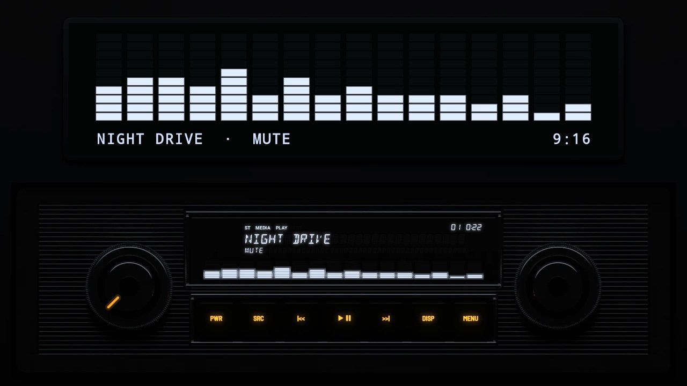

# The 1960s

## [Chrome 1965](chrome-1965/)

A radio in the style of the 1960s, in one DIN: a thick chrome frame, a black face ribbed in silver, two big chrome knobs, fluted chrome push-buttons, a blue-white window with the song centred in it, and no visualizer.

## [Chrome 1965 Modern](chrome-1965-modern/)

The same radio as made again today for classic cars, with black keys and a visualizer: bars under the song in its window, and on the screen above.
