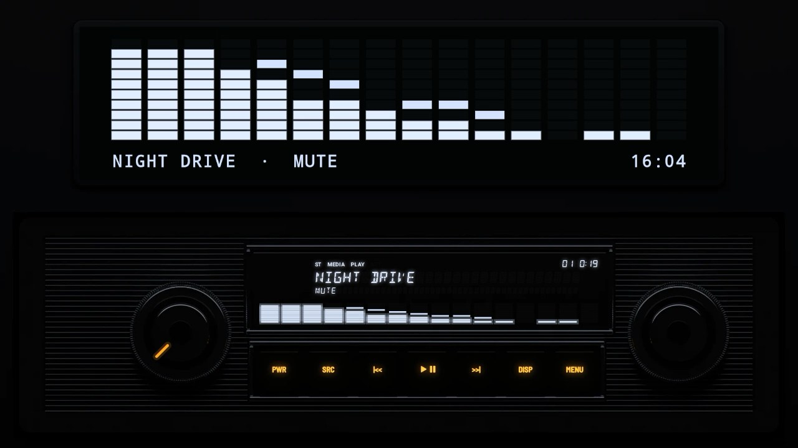

# The 1960s

## [Chrome 1965](chrome-1965/)

A radio in the style of the 1960s, as made again for classic cars, in one DIN: a chrome frame round a ribbed black grille, two chrome knobs, a small blue-white display and a row of chiclet keys.
