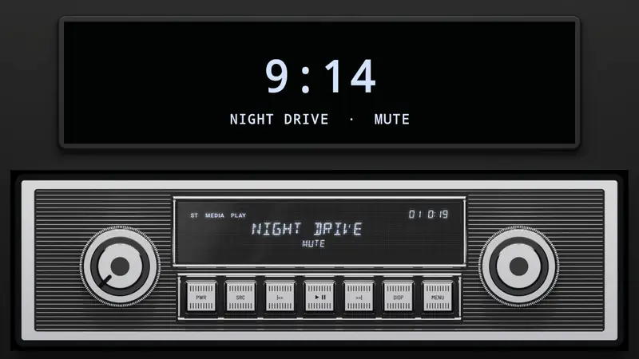
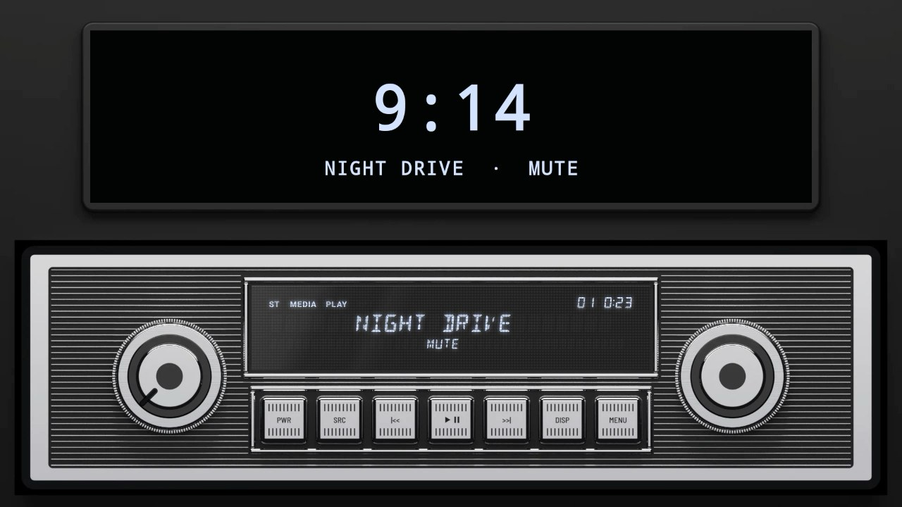
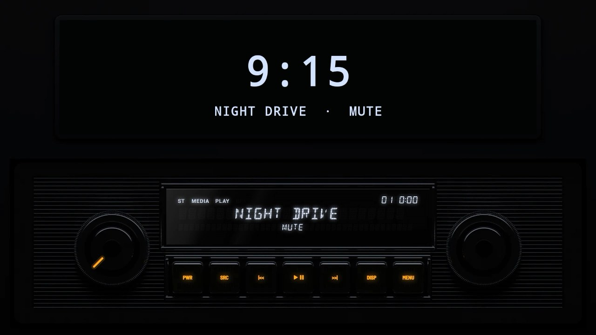
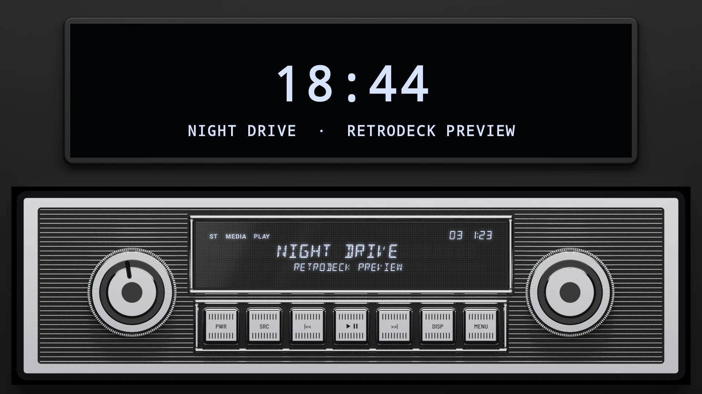
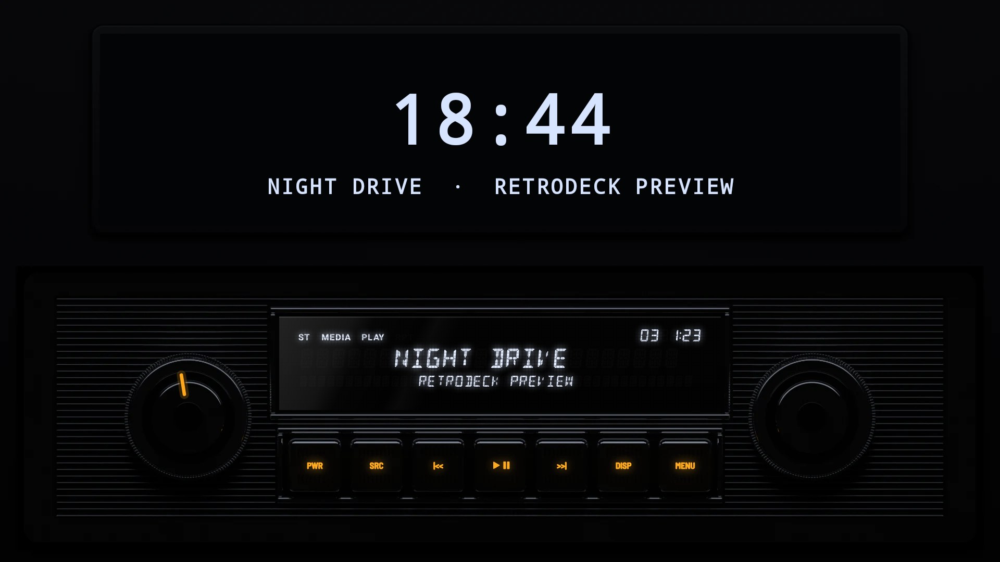
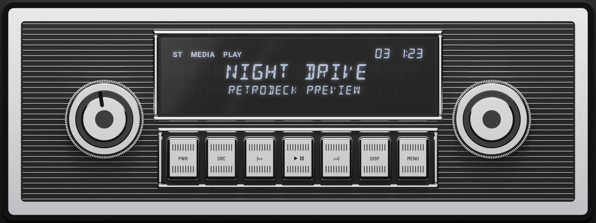
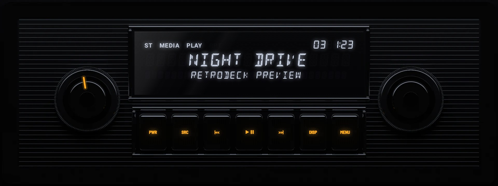

# Chrome 1965

**Era:** 1960s  ·  **Size:** Single DIN  ·  **Display:** Segment display lit blue-white, whatever the dash lighting  ·  **Skin id:** `chrome65`

A radio in the style of the 1960s, in one DIN: a thick chrome frame round a black face ribbed in silver, a big knurled chrome knob either side, a window lit blue-white with the song centred in it, and a bank of fluted chrome push-buttons stamped in black under it, as on a 1950s radio. A radio of the 1960s had no visualizer, so this one shows none, whatever the Visualizer setting; [Chrome 1965 Modern](../chrome-1965-modern/) is the same radio with one. Modelled in 3D and rendered with Blender (tools/blender/skins.py). Like every RetroDeck skin, it copies no real unit and has no brand names on it.

On a single-DIN head unit's own wide screen (about 8:3) the radio fills the screen; on a bigger one it sits across the lower half under a screen showing the clock, with the song under it. DISP still opens the full-screen visualizer, as it was asked for.

## Screenshots

Recorded from the running app (v0.16.0) on an Android TV box at 1920×1080 (240 dpi), playing a song with the TV muted: no visualizer, the song centred in the window and the clock on the screen above, and the display shows MUTE where the artist would be. The faceplate is the 3D render; the display and knob pointer are drawn live on top.

By day (Key Lighting Off)

At night (Key Lighting Always on)

## Day and night

Rendered, not taken on a device: the faceplate is modelled in 3D in Blender, and the display and knob pointer are drawn by the app on top in the render tests (no logos).

| Day | Night |
|---|---|
|  |  |

On a single-DIN unit's own wide screen (1920×720):

| Day | Night |
|---|---|
|  |  |

## Keys

**Working:**

- The knob on the left: volume
- PWR, SRC, |<<, PLAY/PAUSE, >>|, DISP and MENU (the chrome push-buttons)

**For the look only** (they do nothing):

- The tuning knob on the right

## Branding zones

Header (the top of the frame, above the display), faceplate (under the left knob), corner (under the right knob), LCD and visualizer (both along the foot of the window, under the song). A logo stays inside its zone and never covers a key.
