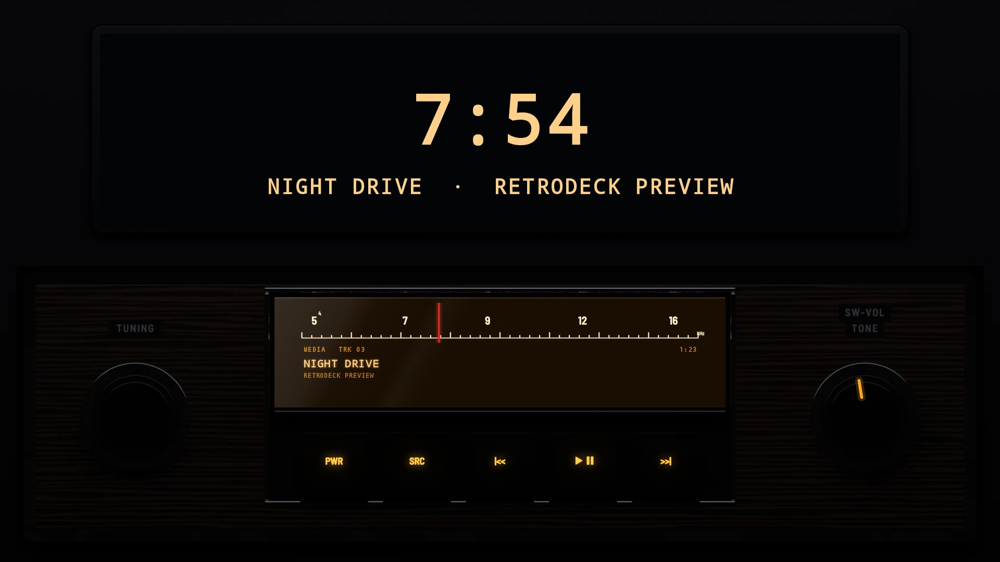
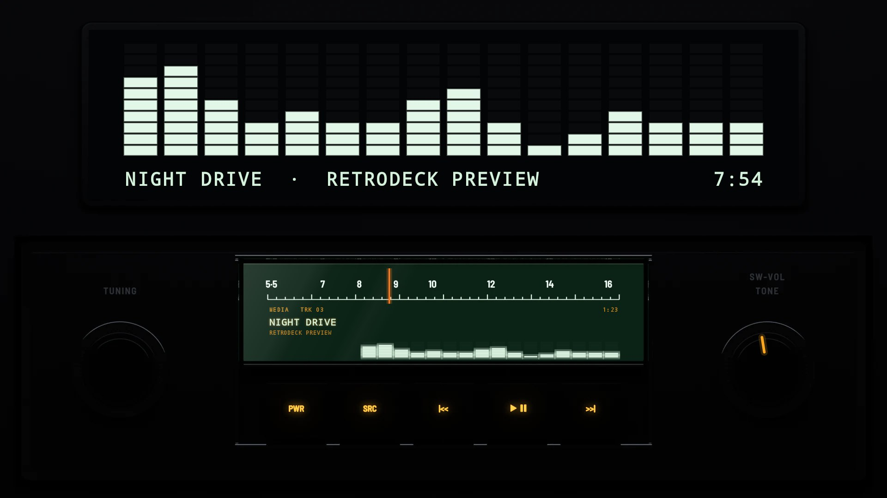

# The 1970s

## [B110 Factory 1971](b110-factory-1971/)

The factory radio of an early-1970s small saloon, in one DIN: a woodgrain face in a chrome edge, a slide-rule dial lit warm behind its glass, five black push-buttons under it and a black knob at each end, TUNING and SW-VOL. The dial's red needle moves along the scale as the song plays. No visualizer, as in 1971.

## [B110 Factory 1971 Modern](b110-factory-1971-modern/)

The same radio as made again today for classic cars: a black face, a pale green dial with an amber needle, and a visualizer under the song.
