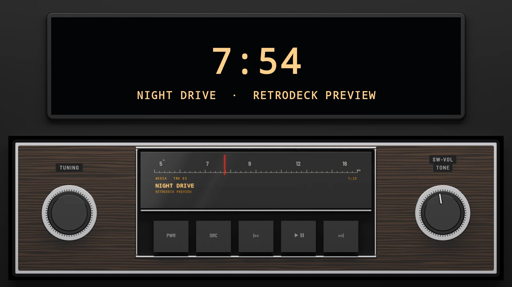
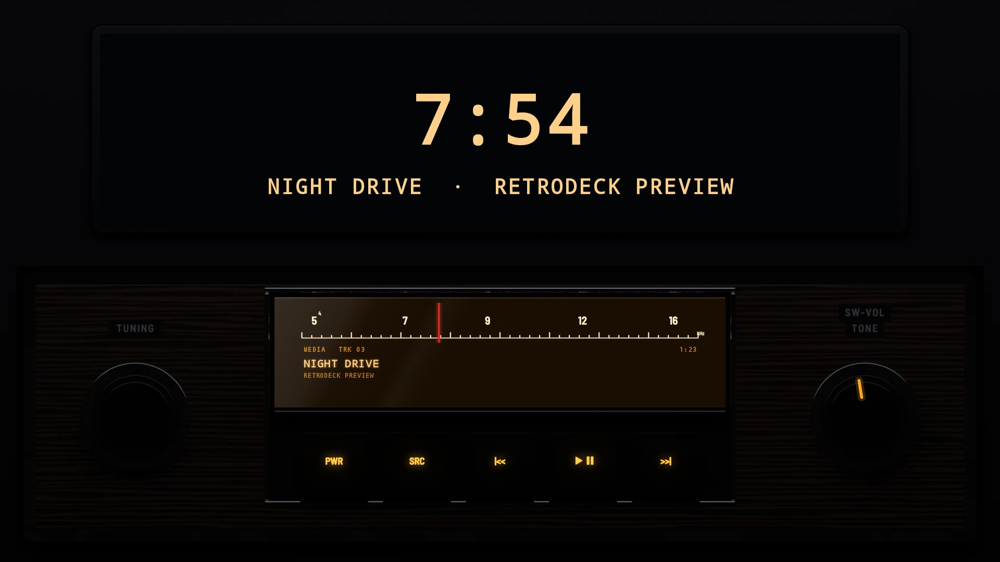
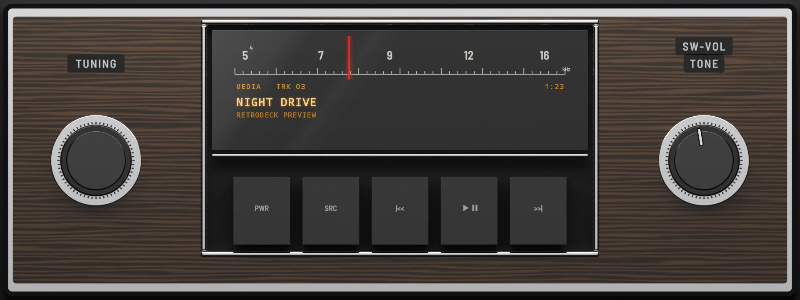
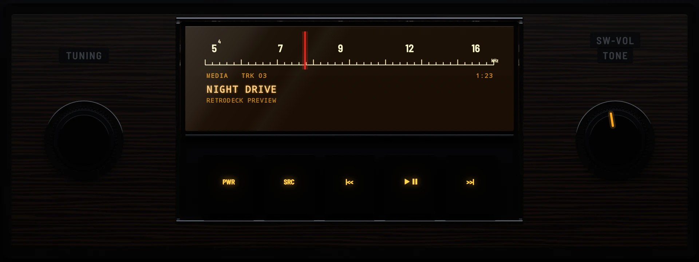

# B110 Factory 1971

**Era:** 1970s  ·  **Size:** Single DIN  ·  **Display:** A slide-rule dial lit warm white, whatever the dash lighting, with a red needle  ·  **Skin id:** `b110factory71`

The factory radio of an early-1970s small saloon, in one DIN: a woodgrain face in a chrome edge, a slide-rule dial behind glass with its medium-wave scale printed on it and lit warm at night, five tall black push-buttons under it in the same chrome frame, and a black knob on a chrome skirt at each end, TUNING and SW-VOL on small black name plates. A radio of 1971 had no visualizer, so this one shows none, whatever the Visualizer setting; [B110 Factory 1971 Modern](../b110-factory-1971-modern/) is the same radio with one. Modelled in 3D and rendered with Blender (tools/blender/skins.py). Like every RetroDeck skin, it copies no real unit and has no brand names on it.

The needle shows how far the song has played: at the left of the scale when it starts, at the right when it ends. On a single-DIN head unit's own wide screen (about 8:3) the radio fills the screen; on a bigger one it sits across the lower half under a screen showing the clock, with the song under it. DISP still opens the full-screen visualizer, as it was asked for.

## Day and night

Rendered, not taken on a device: the faceplate is modelled in 3D in Blender, and the dial's song, needle and knob pointer are drawn by the app on top in the render tests (no logos). Not yet recorded on a device.

| Day | Night |
|---|---|
|  |  |

On a single-DIN unit's own wide screen (1920×720):

| Day | Night |
|---|---|
|  |  |

## Keys

**Working:**

- The SW-VOL knob on the right: volume
- The TUNING knob on the left: the menu (MENU)
- The five push-buttons: PWR, SRC, |<<, PLAY/PAUSE and >>|
- The dial's scale: touch it to change the visualizer (DISP)

## Branding zones

Header (the middle of the face, under the push-buttons), faceplate (under the TUNING knob), corner (under the SW-VOL knob), LCD and visualizer (both along the foot of the dial, under the song). A logo stays inside its zone and never covers a key.
