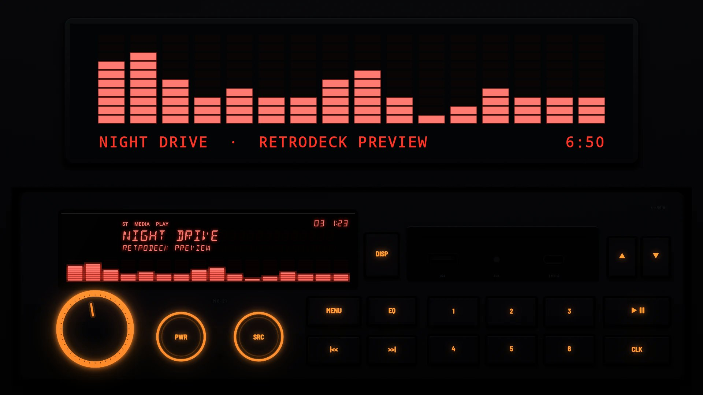
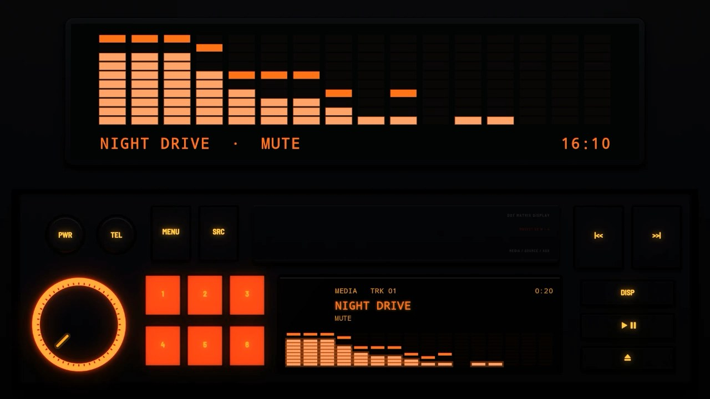
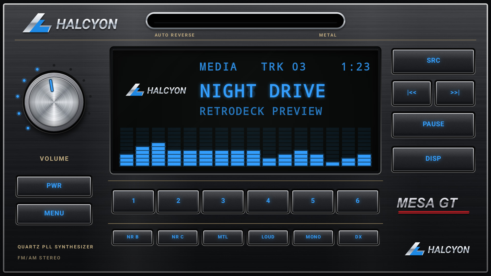
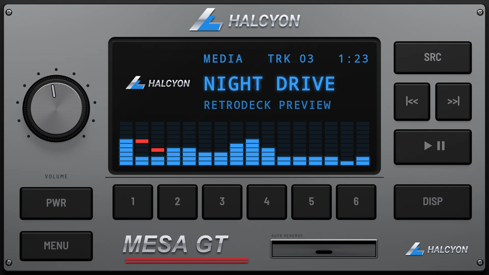
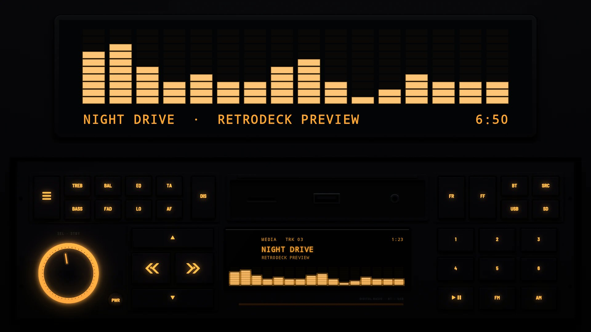
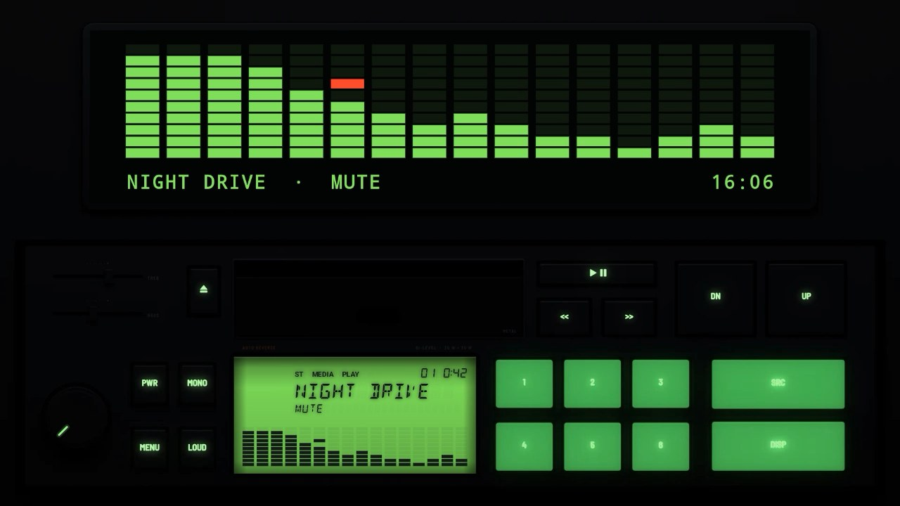
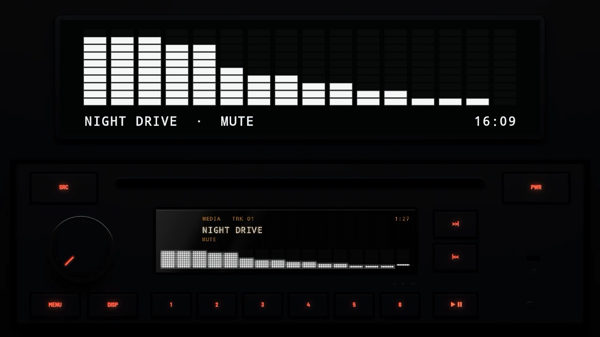
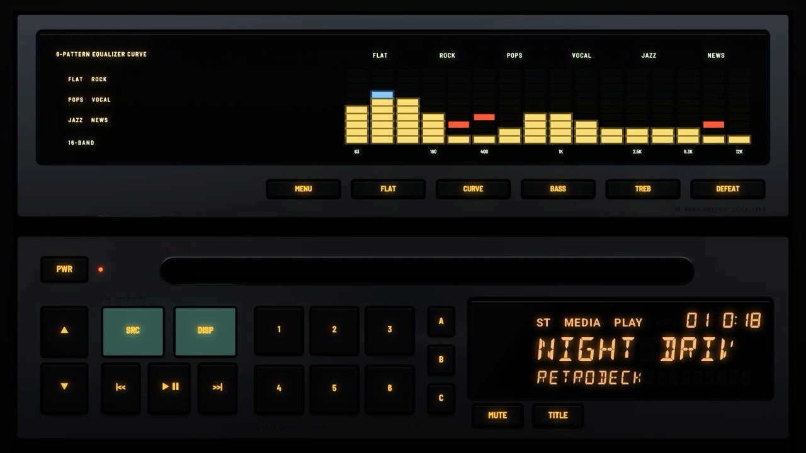

# The 1980s

## [Amber Glow 1982](amber-glow-1982/)

A media unit in one DIN, in the style of the early 1980s: matt black, a red segment display, a panel of ports beside it, a knob in a ring lit orange and keys whose legends glow orange.

## [Heritage 1983](heritage-1983/)

A unit in one DIN in the style of the early 1980s: square keys, a knob in a ring lit red, presets in clear red that glow, and a flip-down cover above an orange dot-matrix display.

## [Hi-Fi 1984](hi-fi-1984/)

A Japanese hi-fi car deck from the mid-1980s: a black anodised aluminium plate with diamond-cut bright edges, champagne pinstripes and print, slim keys, a small spun-aluminium volume knob, an amber fluorescent display and a chrome-lipped tape slot.

## [Classic 1985](classic-1985/)

A brushed-aluminium single-DIN unit with black keys, a big spun-metal volume knob, a fluorescent display and a cassette door with AUTO REVERSE printed above it. Corner screws hold the plate.

## [Split Tone 1986](split-tone-1986/)

A unit in one DIN in the style of the mid-1980s: split tone keys, an open cover over a card slot and USB port, a knob in a ring lit amber, a four-way pad and an amber dot-matrix display.

## [Tape Deck 1987](tape-deck-1987/)

A late-1980s cassette deck in one DIN: black, a tape door with treble and bass sliders beside it, a green-lit LCD with dark digits, and presets in clear plastic that glow green.

## [Matte CD 1988](matte-cd-1988/)

A CD unit in one DIN, in the style of the late 1980s: matt black, a CD slot, a knob in a chrome ring, a white dot-matrix display and keys with red legends.

## [EQ Stack 1989](eq-stack-1989/)

A late-1980s silver stack: a graphic equaliser, its bars yellow under blue with red peaks, over a CD head unit with an orange fluorescent display, a volume rocker and mint green keys.
