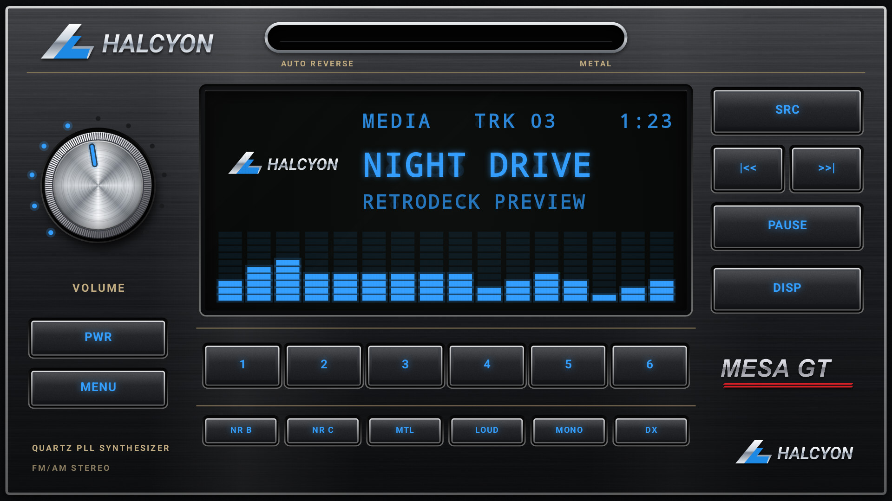
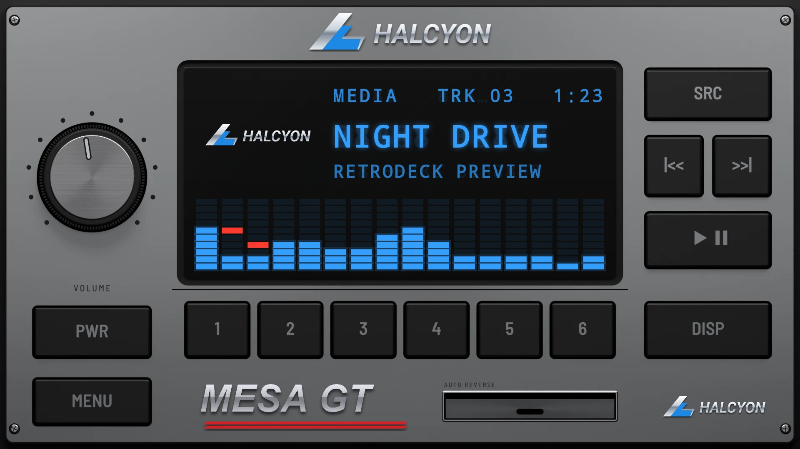
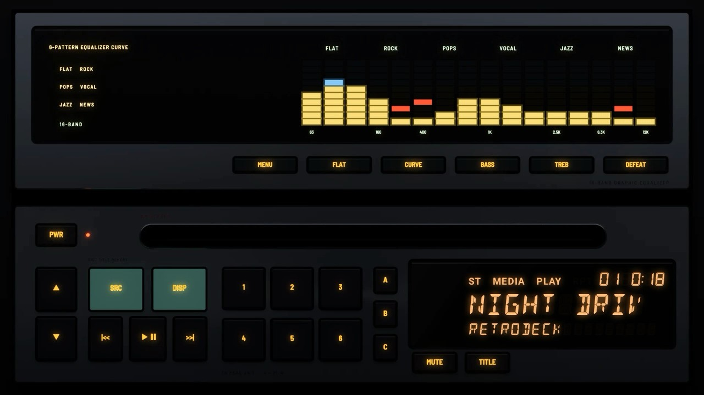

# The 1980s

## [Hi-Fi 1984](hi-fi-1984/)

A Japanese hi-fi car deck from the mid-1980s: a black anodised aluminium plate with diamond-cut bright edges, champagne pinstripes and print, slim keys, a small spun-aluminium volume knob, an amber fluorescent display and a chrome-lipped tape slot.

## [Classic 1985](classic-1985/)

A brushed-aluminium single-DIN unit with black keys, a big spun-metal volume knob, a fluorescent display and a cassette door with AUTO REVERSE printed above it. Corner screws hold the plate.

## [EQ Stack 1989](eq-stack-1989/)

A late-1980s silver stack: a graphic equaliser, its bars yellow under blue with red peaks, over a CD head unit with an orange fluorescent display, a volume rocker and mint green keys.
