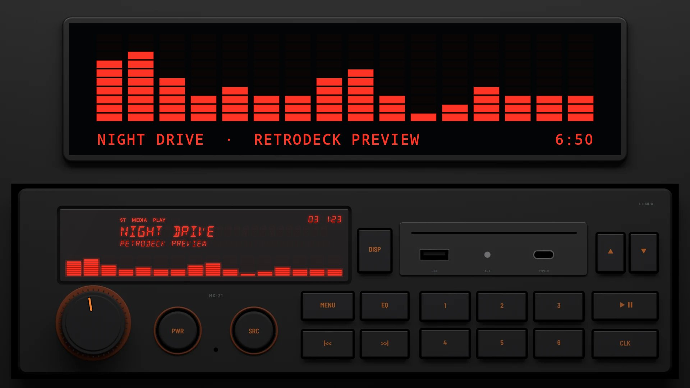
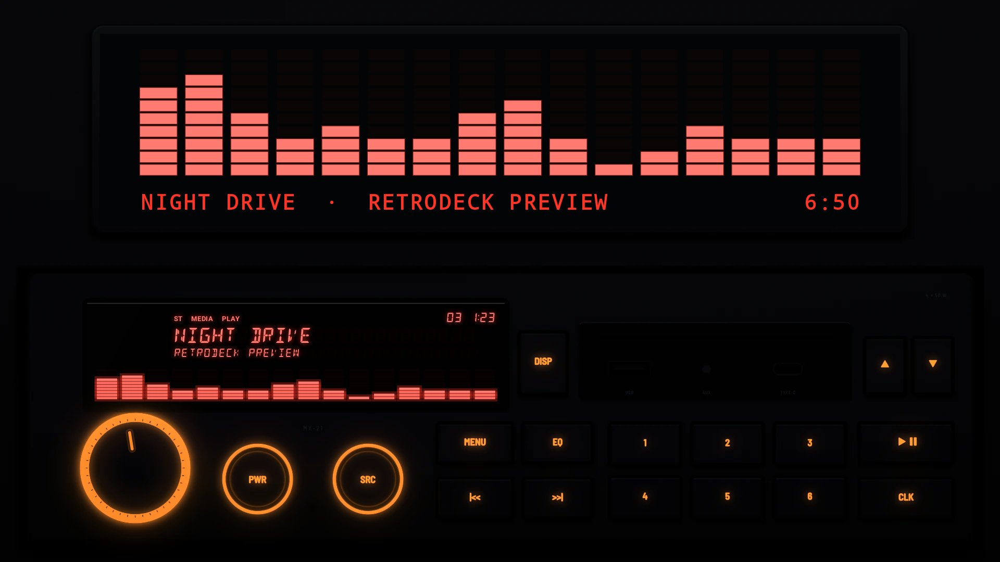
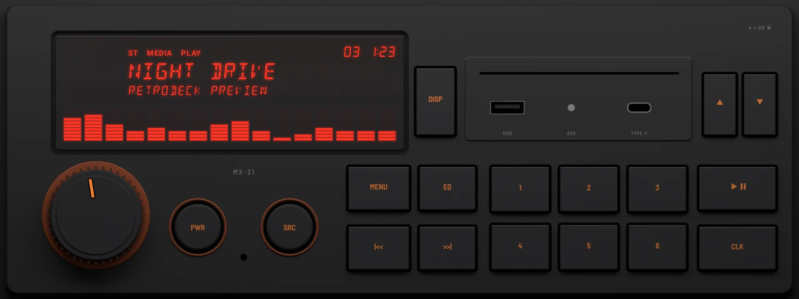
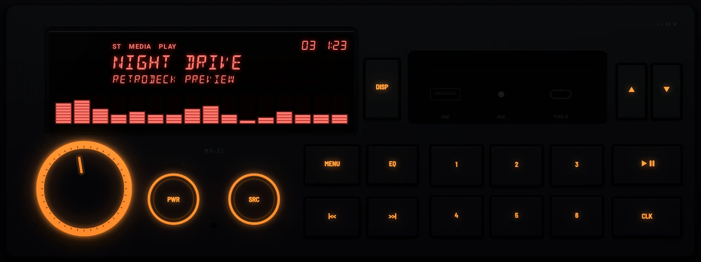

# Amber Glow 1982

**Era:** 1980s  ·  **Size:** Single DIN  ·  **Display:** Segment display lit red, whatever the dash lighting  ·  **Skin id:** `amber21`

A media unit in one DIN, in the style of the early 1980s: matt black, a red segment display, and a gloss panel beside it with a card slot, a USB port, an aux jack and a USB-C port. The knob sits in a ring lit orange, the round PWR and SRC keys are ringed in orange, and the rows of keys have orange legends that glow at night. Modelled in 3D and rendered with Blender (tools/blender/skins.py). Like every RetroDeck skin, it copies no real unit and has no brand names on it.

On a single-DIN head unit's own wide screen (about 8:3) the radio fills the screen; on a bigger one it sits across the lower half under a screen for the visualizer, the song and the clock.

## Day and night

Rendered, not taken on a device: the faceplate is modelled in 3D in Blender, and the display and knob pointer are drawn by the app on top in the render tests (no logos).

| Day | Night |
|---|---|
|  |  |

On a single-DIN unit's own wide screen (1920×720):

| Day | Night |
|---|---|
|  |  |

## Keys

**Working:**

- The knob: volume
- PWR and SRC (round, ringed in orange)
- DISP (beside the display)
- MENU, |<< and >>|
- Presets 1 to 6
- PLAY/PAUSE (right)

**For the look only** (they do nothing):

- ▲ and ▼ (top right), EQ and CLK

## Branding zones

Header (over the round keys), faceplate (under them), corner (above the ports), LCD, visualizer. A logo stays inside its zone and never covers a key.
