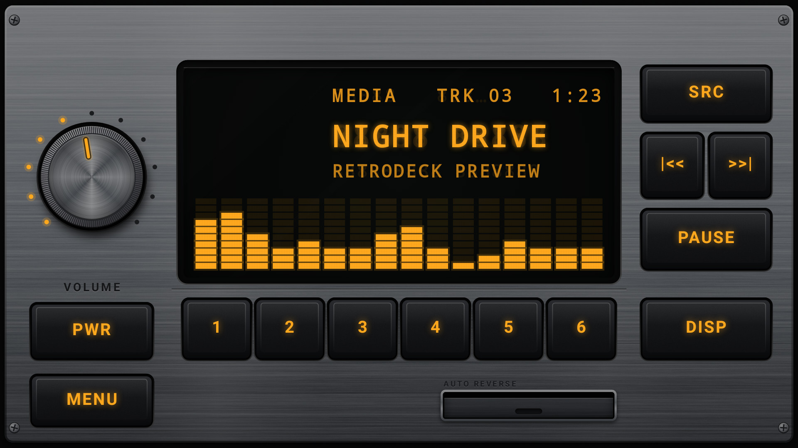
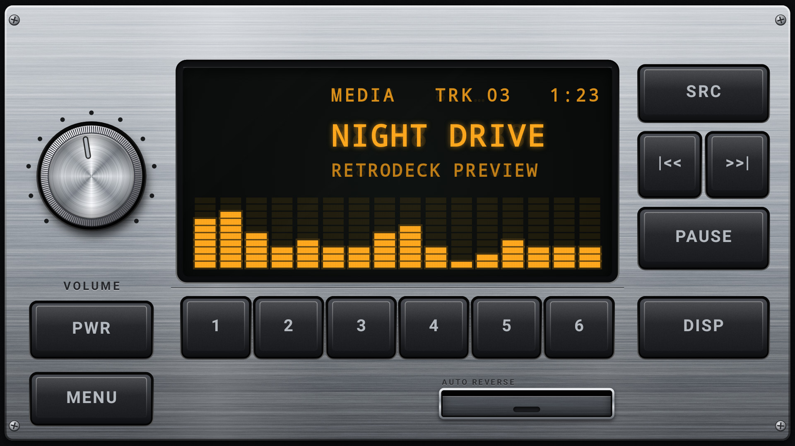

# Classic 1985

**Era:** 1980s  ·  **Display:** Vacuum fluorescent  ·  **Skin id:** `classic85`

A brushed-aluminium single-DIN unit with black keys, a big spun-metal volume knob, a fluorescent display and a cassette door with AUTO REVERSE printed above it. Corner screws hold the plate.

## Screenshots

Taken from the running app on an Android TV box at 1920×1080 (240 dpi), branded with the made-up Halcyon Mesa GT from [docs/demo](../../../docs/demo/). Taken with v0.1.0. That was before key lighting, so the keys are lit with the faceplate in daylight; current versions look like the day and night renders below.

Branded with the demo car, playing

## Day and night

Drawn by the render tests (Android's own graphics on a computer, no logos), not taken on a device. At night the key legends are backlit and the faceplate goes dark; by day the legends are printed paint. See Key Lighting in the [main README](../../../README.md).

| Night | Day |
|---|---|
|  |  |

## Keys

**Working:**

- PWR, MENU, SRC, |<< and >>|, PLAY/PAUSE, DISP
- Presets 1 to 6
- The volume knob, with a lit dial of dots

## Branding zones

Header (top centre), LCD, faceplate (bottom left), corner (bottom right), visualizer. A logo stays inside its zone and never covers a key.
