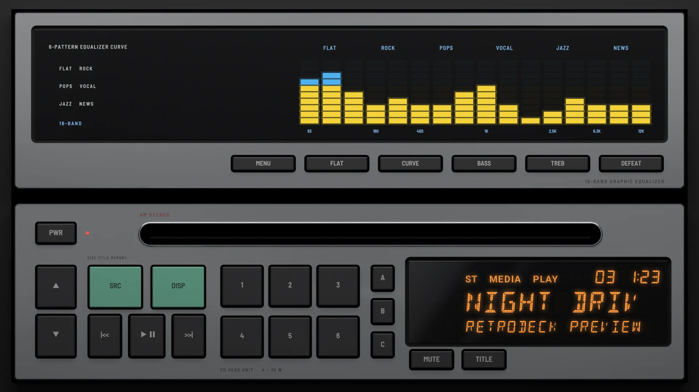
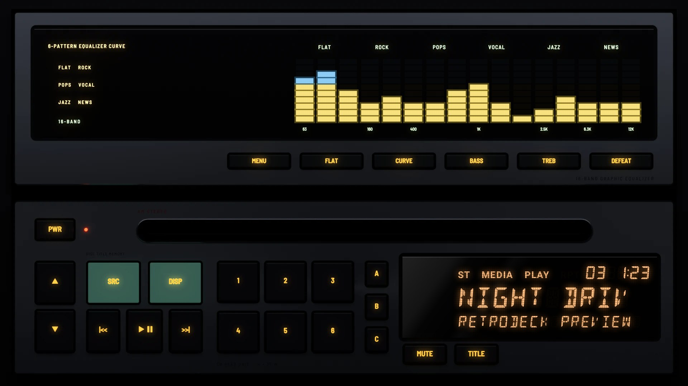

# EQ Stack 1989

**Era:** 1980s  ·  **Size:** Double DIN  ·  **Display:** Vacuum fluorescent: an equaliser window whose bars are yellow under blue with red peaks, and an orange 14-segment display, whatever the dash lighting  ·  **Skin id:** `eqstack89`

A late-1980s silver stack of two units: a graphic equaliser over a CD head unit. The equaliser's window has its six curves and the frequency marks printed on the glass, and its bars light yellow under blue with red peaks. The CD unit below has the slot across the top, a volume rocker, mint green SRC and DISP keys, two rows of presets, A·B·C keys and an orange fluorescent display in 14-segment characters. Modelled in 3D and rendered with Blender (tools/blender/skins.py). Like every RetroDeck skin, it copies no real unit and has no brand names on it.

## Day and night

Rendered, not taken on a device: the faceplate is modelled in 3D in Blender, and the display and knob pointer are drawn by the app on top in the render tests (no logos). Screenshots from a device will follow.

| Day | Night |
|---|---|
|  |  |

## Keys

**Working:**

- The ▲ and ▼ rocker: volume up and down
- PWR
- SRC and DISP (the mint green keys)
- |<<, PLAY/PAUSE and >>|
- Presets 1 to 6
- MENU (on the equaliser)

**For the look only** (they do nothing):

- FLAT, CURVE, BASS, TREB and DEFEAT on the equaliser
- A, B and C, MUTE and TITLE on the CD unit

## Branding zones

Header (the equaliser, left of its keys), corner (right of the CD slot), faceplate (under the display), LCD, visualizer (in the equaliser window). A logo stays inside its zone and never covers a key.
