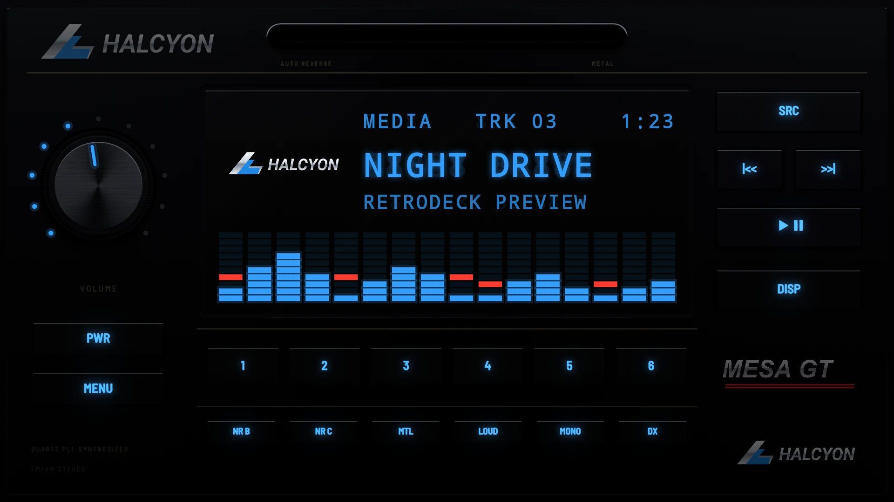
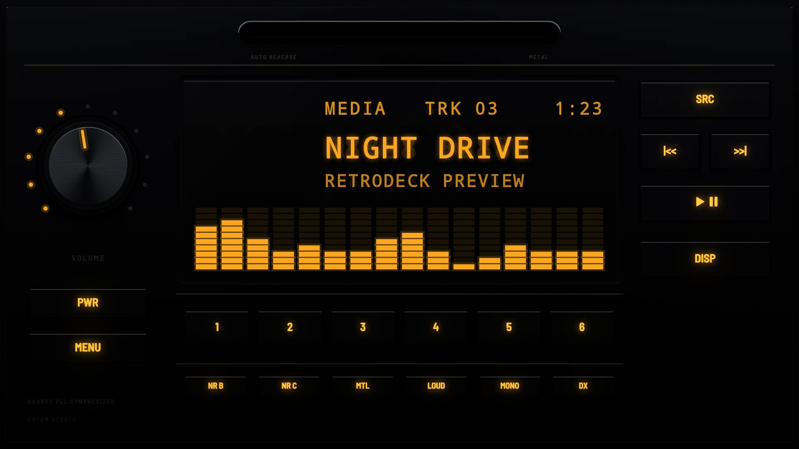
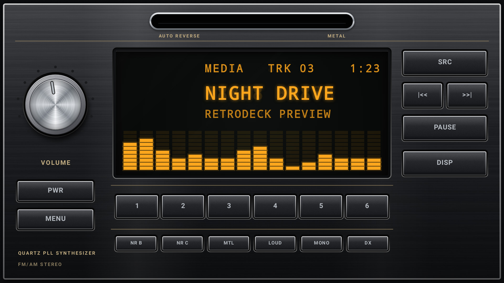

# Hi-Fi 1984

**Era:** 1980s  ·  **Display:** Vacuum fluorescent (lit segments behind a fine mesh)  ·  **Skin id:** `hifi84`

A Japanese hi-fi car deck from the mid-1980s: a black anodised aluminium plate with diamond-cut bright edges, champagne pinstripes and print, slim keys, a small spun-aluminium volume knob, an amber fluorescent display and a chrome-lipped tape slot.

## Screenshots

Taken from the running app (v0.5.0) on an Android TV box at 1920×1080 (240 dpi), branded with the made-up Halcyon Mesa GT from [docs/demo](../../../docs/demo/), with the dash lit blue. The faceplate is a 3D render; the display, logos and knob pointer are drawn live on top.

By day (Key Lighting Off): legends printed on the keys

At night (Key Lighting on Auto, 20:10): the faceplate dark, the legends backlit in the dash colour

## Day and night

Rendered, not taken on a device: the faceplate is modelled in 3D in Blender, and the display, knob pointer and dial are drawn by the app on top in the render tests (no logos). At night the key legends are backlit and the faceplate goes dark; by day the legends are printed paint. See Key Lighting in the [main README](../../../README.md).

| Night | Day |
|---|---|
|  |  |

## Keys

**Working:**

- PWR, MENU, SRC, |<< and >>|, PLAY/PAUSE, DISP
- Presets 1 to 6
- The volume knob, with a lit dial of dots

**For the look only** (they do nothing):

- The tape switches NR B, NR C, MTL, LOUD, MONO and DX

## Branding zones

Header (top left), LCD, faceplate and corner (right column), visualizer. A logo stays inside its zone and never covers a key.
