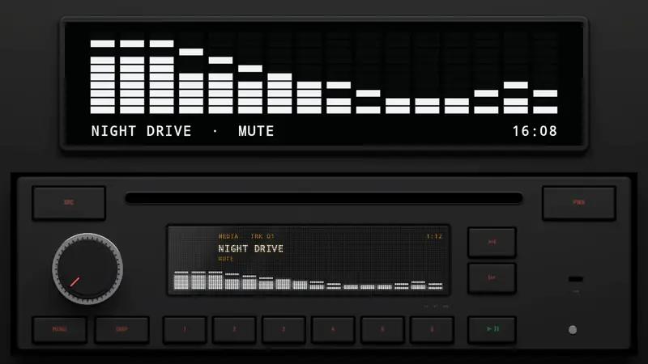
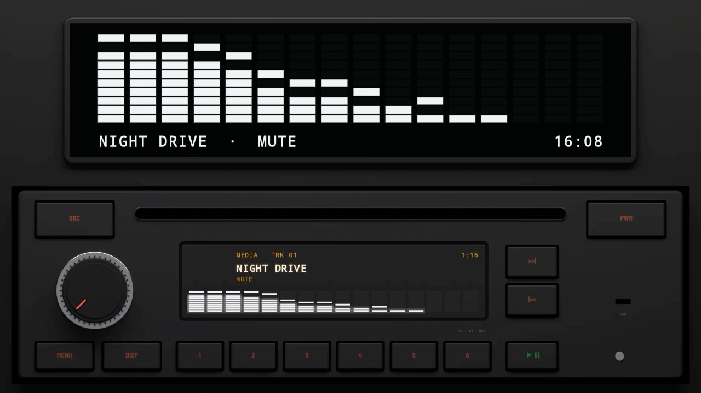
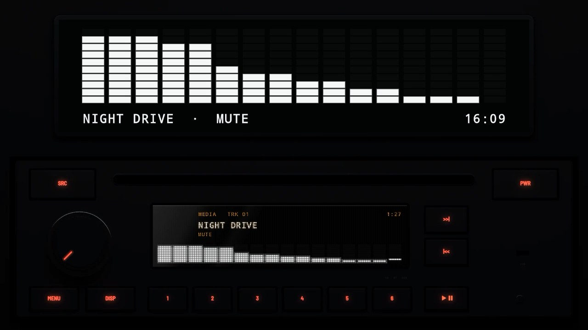
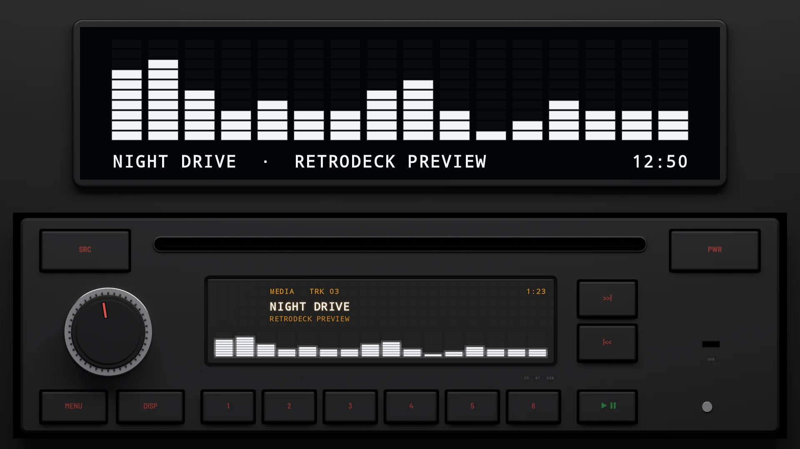
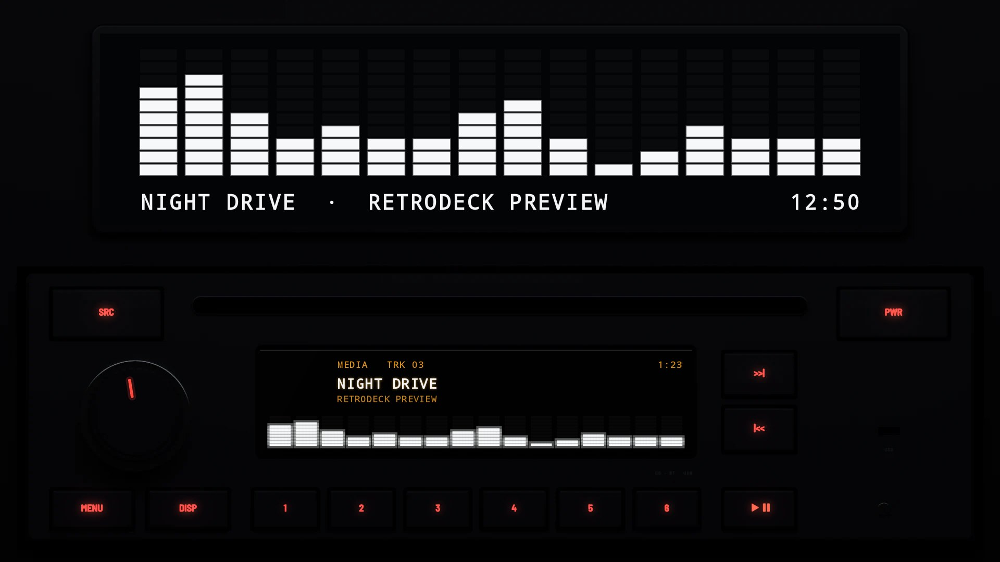
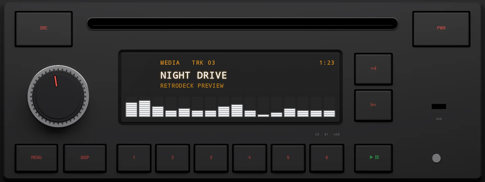
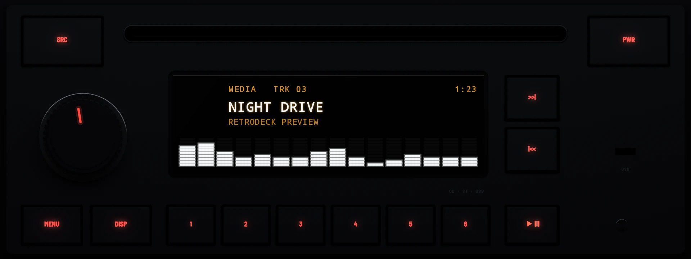

# Matte CD 1988

**Era:** 1980s  ·  **Size:** Single DIN  ·  **Display:** Dot matrix lit white, whatever the dash lighting  ·  **Skin id:** `cd20`

A CD unit in one DIN, in the style of the late 1980s: matt black, a CD slot across the top, a knob in a chrome ring, a white dot-matrix display, a USB port and an aux jack, and a row of keys along the foot with red legends that light red at night. Modelled in 3D and rendered with Blender (tools/blender/skins.py). Like every RetroDeck skin, it copies no real unit and has no brand names on it.

On a single-DIN head unit's own wide screen (about 8:3) the radio fills the screen; on a bigger one it sits across the lower half under a screen for the visualizer, the song and the clock.

## Screenshots

Recorded from the running app (v0.15.0) on an Android TV box at 1920×1080 (240 dpi), playing a song with the TV muted: the visualizer follows the music, and the display shows MUTE where the artist would be. The faceplate is the 3D render; the display and knob pointer are drawn live on top.

By day (Key Lighting Off)

At night (Key Lighting Always on)

## Day and night

Rendered, not taken on a device: the faceplate is modelled in 3D in Blender, and the display and knob pointer are drawn by the app on top in the render tests (no logos).

| Day | Night |
|---|---|
|  |  |

On a single-DIN unit's own wide screen (1920×720):

| Day | Night |
|---|---|
|  |  |

## Keys

**Working:**

- The knob: volume
- SRC and PWR (either end of the slot)
- >>| and |<< (beside the display)
- MENU, DISP, presets 1 to 6 and PLAY/PAUSE (along the foot)

## Branding zones

Header (under the display), faceplate (above the display), corner (right of the display), LCD, visualizer. A logo stays inside its zone and never covers a key.
