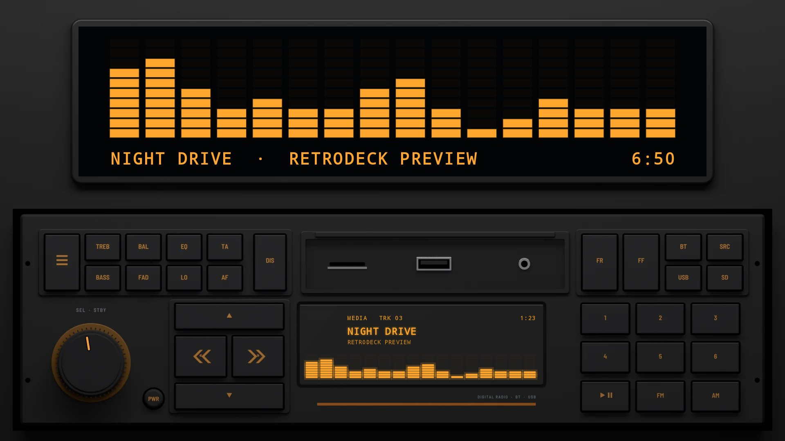
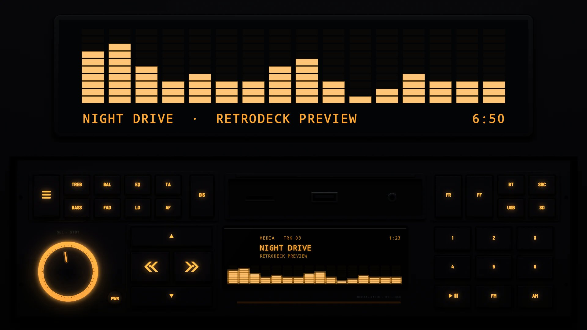
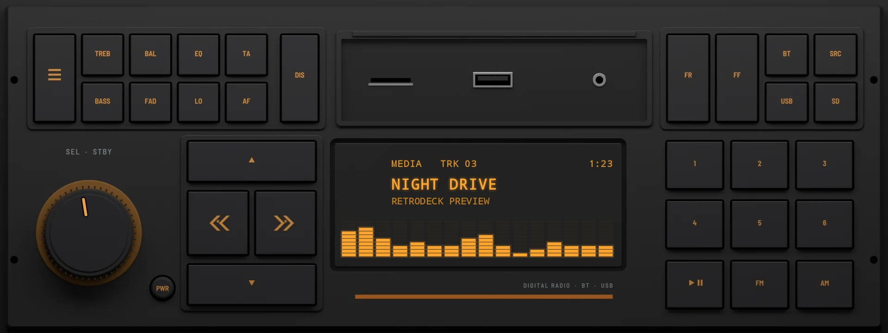
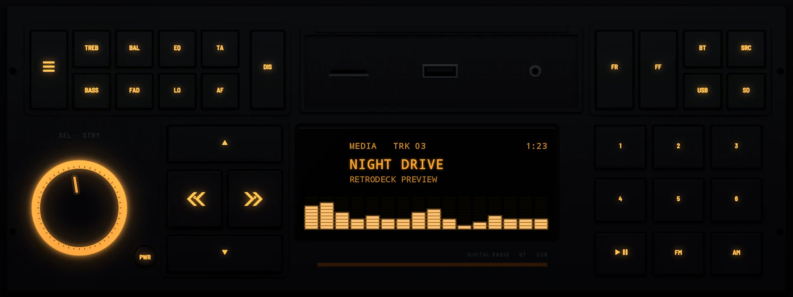

# Split Tone 1986

**Era:** 1980s  ·  **Size:** Single DIN  ·  **Display:** Dot matrix lit amber, whatever the dash lighting  ·  **Skin id:** `dab22`

A unit in one DIN in the style of the mid-1980s: black, split tone keys (TREB and BASS, BAL and FAD, EQ and LO, TA and AF) either side of an open cover over a card slot, a USB port and an aux jack, a knob in a ring lit amber, a four-way pad, an amber dot-matrix display with a stripe under it, and a block of square keys on the right. Every legend is amber, printed by day and backlit at night. Modelled in 3D and rendered with Blender (tools/blender/skins.py). Like every RetroDeck skin, it copies no real unit and has no brand names on it.

On a single-DIN head unit's own wide screen (about 8:3) the radio fills the screen; on a bigger one it sits across the lower half under a screen for the visualizer, the song and the clock.

## Day and night

Rendered, not taken on a device: the faceplate is modelled in 3D in Blender, and the display and knob pointer are drawn by the app on top in the render tests (no logos).

| Day | Night |
|---|---|
|  |  |

On a single-DIN unit's own wide screen (1920×720):

| Day | Night |
|---|---|
|  |  |

## Keys

**Working:**

- The knob: volume
- PWR (the small round key beside the knob)
- ≡ (top left): menu
- DIS: display (DISP)
- SRC (top right)
- « and » on the pad: |<< and >>|
- Presets 1 to 6
- PLAY/PAUSE (under the presets)

**For the look only** (they do nothing):

- The split tone keys, FR, FF, BT, USB and SD
- ▲ and ▼ on the pad, FM and AM

## Branding zones

Header (under the display, over its stripe), faceplate (above the knob), corner (over the cover), LCD, visualizer. A logo stays inside its zone and never covers a key.
