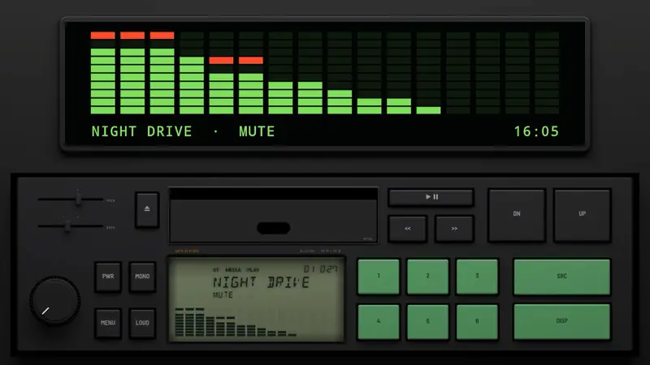
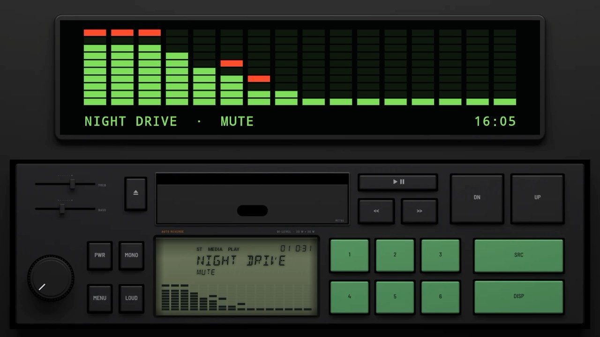
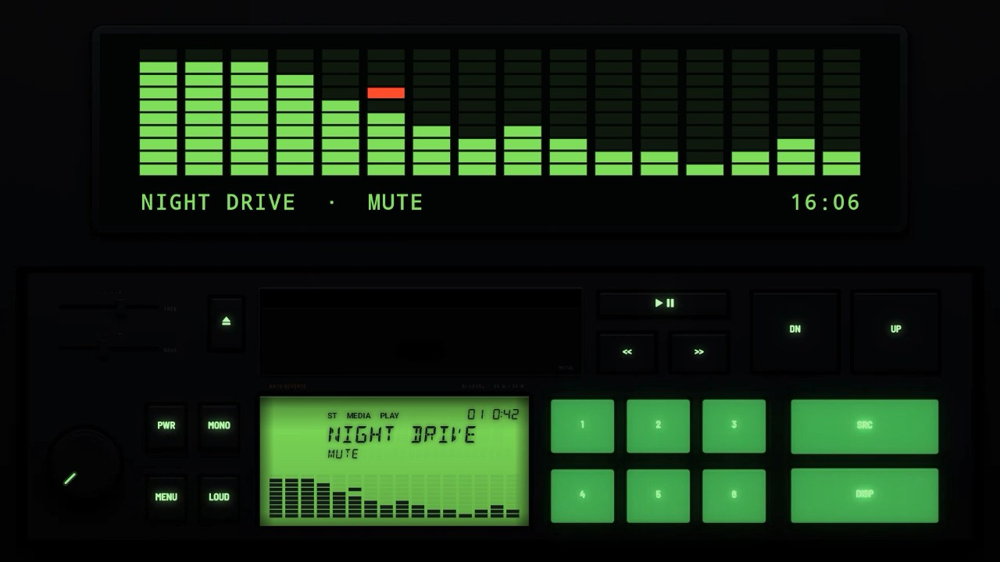
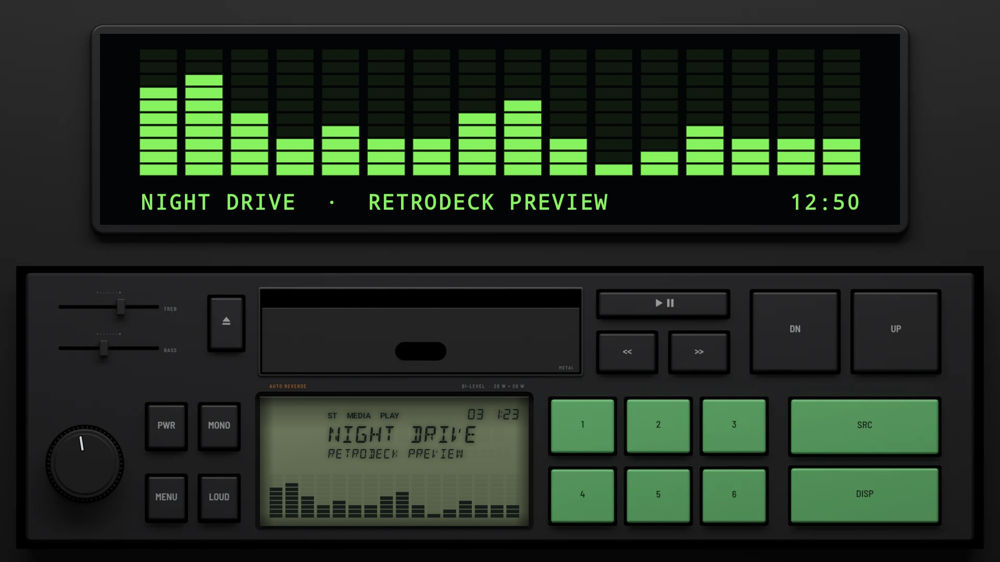
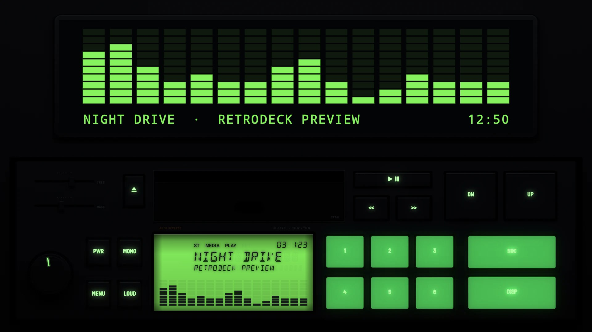
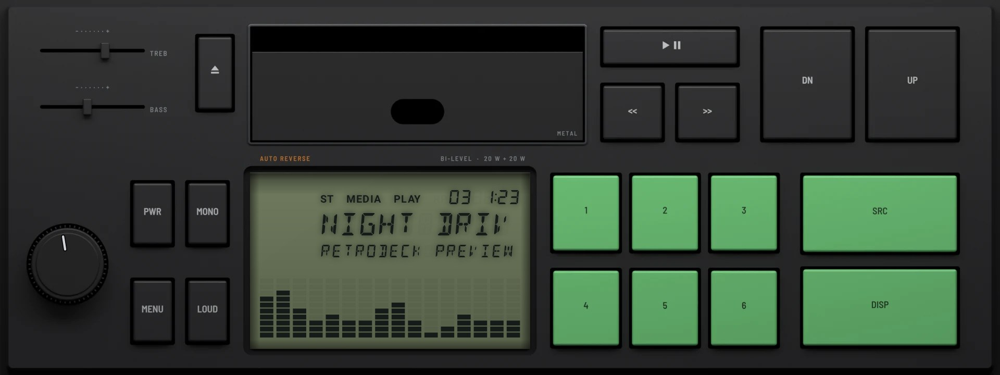
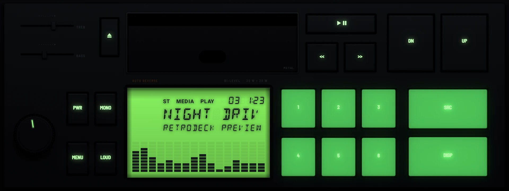

# Tape Deck 1987

**Era:** 1980s  ·  **Size:** Single DIN  ·  **Display:** Reflective LCD: dark segments on a panel lit green, whatever the dash lighting; olive grey by day  ·  **Skin id:** `tape87`

A late-1980s cassette deck in one DIN: black, a tape door across the top with treble and bass sliders beside it, DN and UP keys, a green-lit LCD with dark digits, and presets moulded in clear plastic that glow green at night. The legends light green too. Modelled in 3D and rendered with Blender (tools/blender/skins.py). Like every RetroDeck skin, it copies no real unit and has no brand names on it.

On a single-DIN head unit's own wide screen (about 8:3) the radio fills the screen; on a bigger one it sits across the lower half under a screen for the visualizer, the song and the clock.

## Screenshots

Recorded from the running app (v0.15.0) on an Android TV box at 1920×1080 (240 dpi), playing a song with the TV muted: the visualizer follows the music, and the display shows MUTE where the artist would be. The faceplate is the 3D render; the display and knob pointer are drawn live on top.

By day (Key Lighting Off)

At night (Key Lighting Always on)

## Day and night

Rendered, not taken on a device: the faceplate is modelled in 3D in Blender, and the display and knob pointer are drawn by the app on top in the render tests (no logos).

| Day | Night |
|---|---|
|  |  |

On a single-DIN unit's own wide screen (1920×720):

| Day | Night |
|---|---|
|  |  |

## Keys

**Working:**

- The knob: volume
- DN and UP: previous and next track
- PLAY/PAUSE (above << and >>)
- PWR and MENU (beside the knob)
- Presets 1 to 6
- SRC and DISP (right)

**For the look only** (they do nothing):

- Eject, << and >> (by the tape door), MONO and LOUD

## Branding zones

Header (on the tape door), faceplate (under the sliders), corner (under DN and UP), LCD, visualizer. A logo stays inside its zone and never covers a key.
