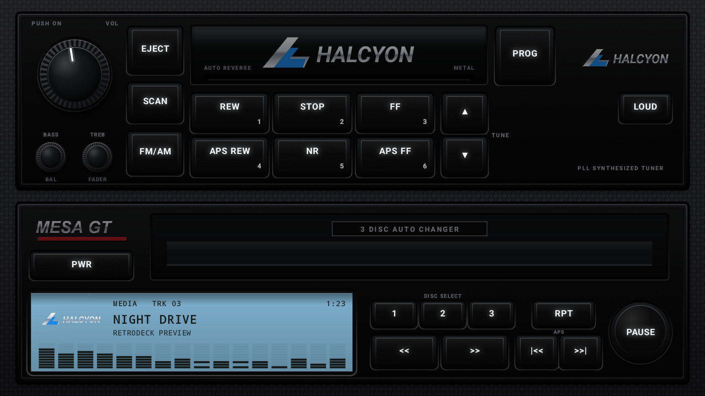
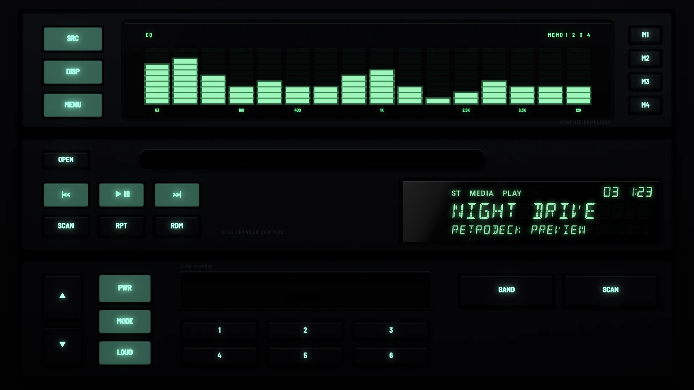
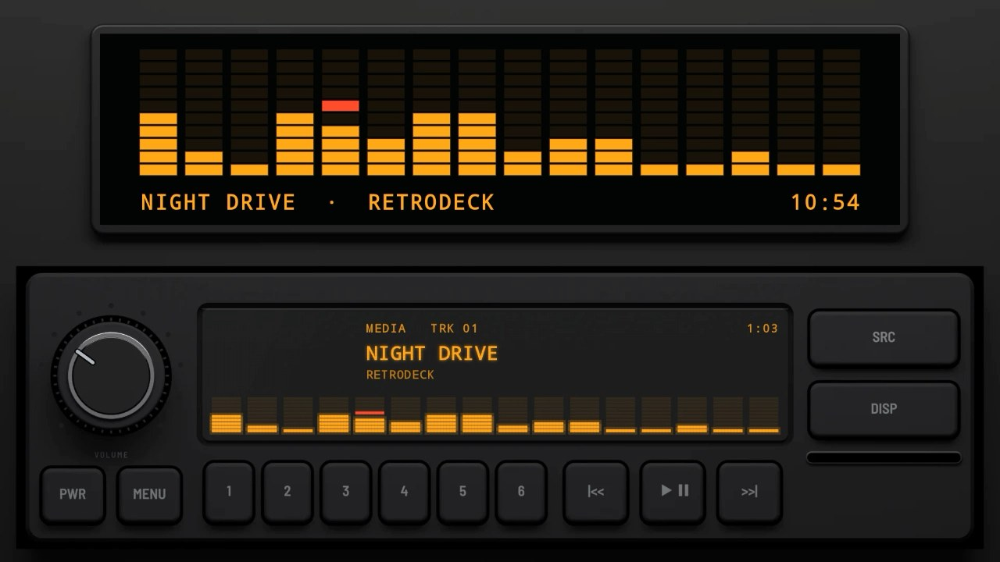
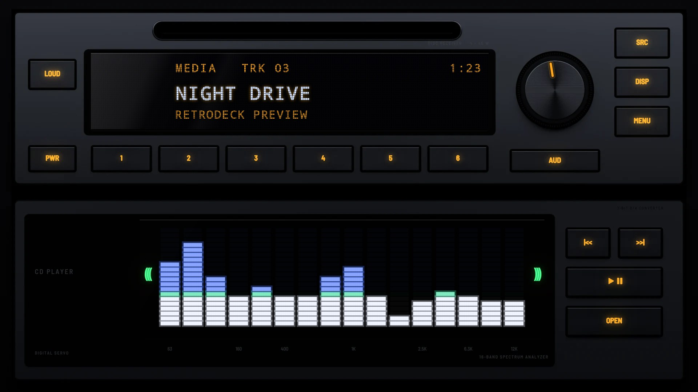

# The 1990s

## [Z32 Factory 1990](z32-factory-1990/)

A car maker's factory stack from around 1990: a tuner and tape deck over a three-disc changer, in near-black satin plastic set into a carbon-look dash. Modelled on the factory tape deck and changer fitted to the Z32. The legends are white: printed paint by day, backlit at night.

## [Level Meter 1991](level-meter-1991/)

An early-1990s black head unit with one big window: an orange readout over a cyan spectrum analyser whose bars turn orange at the top, between columns of slim keys.

## [Trio Stack 1993](trio-stack-1993/)

An early-1990s stack of three black units: an equaliser with green bars, a disc changer controller and a head unit with a tape door, their main keys moulded in mint green.

## [Digital 1996](digital-1996/)

A mid-1990s deck in grained black plastic with soft rubber keys, a ribbed volume knob with a silver ring, a glossy dot-matrix display and a CD slot along the bottom.

## [Detachable 1998](detachable-1998/)

A late-1990s detachable faceplate: curved graphite with chrome trim along the top and under the display, a big encoder in a chrome ring, round keys down the side and a deep blue-black display whose bars shade from the illumination colour into the accent.

## [Spectrum 1997](spectrum-1997/)

A late-1990s silver stack: a receiver with a blue-white dot-matrix display and a knob, over a CD player whose window is a spectrum analyser, its fine bars white under a green line and blue above.
