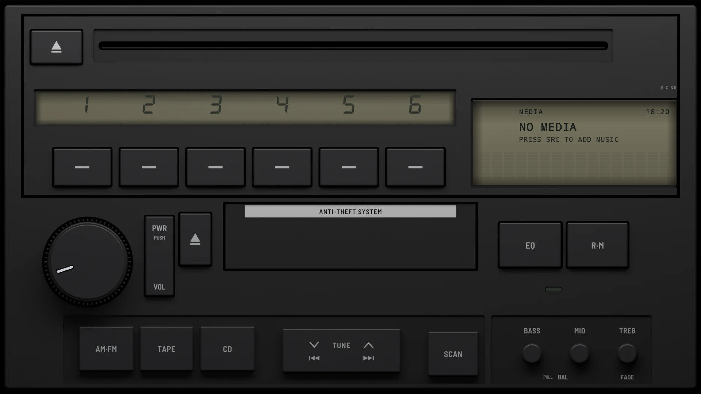
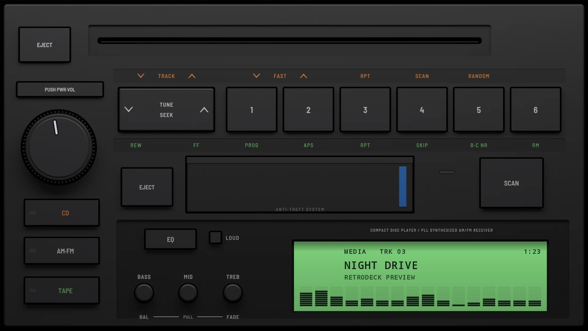
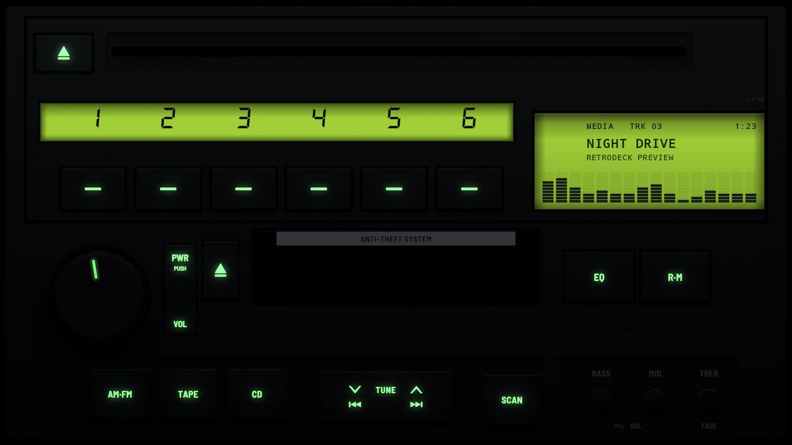

# A80 Factory 1994

**Era:** 1990s  ·  **Size:** Double DIN  ·  **Display:** Reflective LCD: dark segments on olive grey by day, lit lime green from behind at night, whatever the dash lighting  ·  **Skin id:** `a80factory94`

A car maker's factory CD and tape unit from the mid-1990s, in charcoal plastic: a CD slot across the top over a strip display that numbers the six preset keys, the main display beside them, the volume knob next to a cassette door, and AM·FM, TAPE, CD, a TUNE rocker and SCAN along the foot beside BASS, MID and TREB knobs. Modelled in 3D and rendered with Blender (see tools/blender/a80.py), on the factory unit fitted to the A80. Both displays are olive grey by day and lit lime green at night, and the legends light green with them, whatever colour the dash is set to.

## Screenshots

Taken from the running app (v0.10.0) on an Android TV box at 1920×1080 (240 dpi). The faceplate is the 3D render; the display, logos and knob pointer are drawn live on top.

By day (Key Lighting Off): white print on charcoal plastic, the displays olive grey

At night (Key Lighting Always on, 18:19): the legends and both displays lit lime green

## Day and night

Rendered, not taken on a device: the faceplate is modelled in 3D in Blender, and the display and knob pointer are drawn by the app on top in the render tests (no logos).

| Day | Night |
|---|---|
|  |  |

## Keys

**Working:**

- PWR (the PWR·PUSH / VOL key beside the knob): power
- The VOL knob
- TUNE: |◀◀ and ▶▶|, previous and next track
- Presets 1–6 (numbered on the strip display above them)
- CD opens your music (SRC)
- TAPE plays and pauses
- SCAN cycles the visualizer (DISP)
- EQ opens the menu

**For the look only** (they do nothing):

- Both eject keys, R·M, AM·FM
- The BASS, MID and TREB knobs

## Branding zones

Header (on the cassette door), corner (top right, beside the CD slot), faceplate (the brand line above the main display), LCD, visualizer. A logo stays inside its zone and never covers a key.
