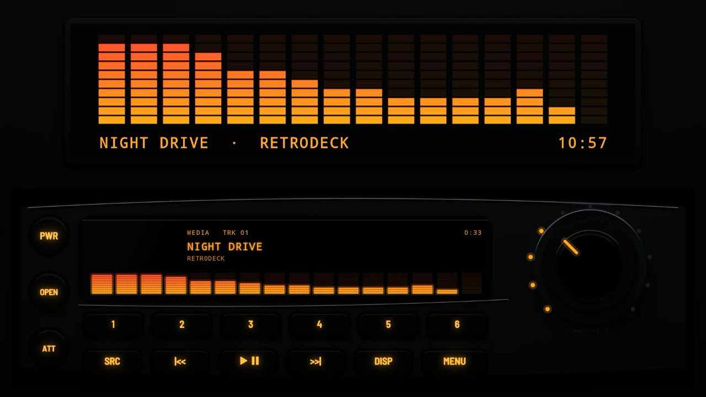
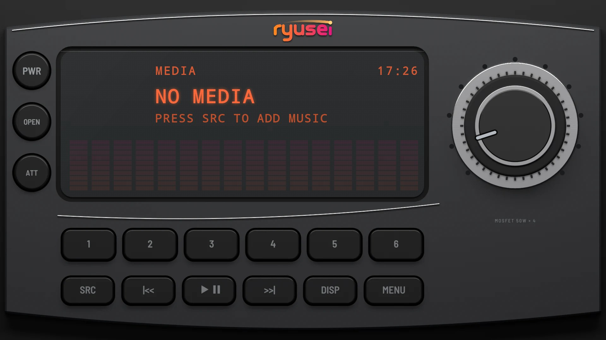

# Detachable 1998

**Era:** 1990s  ·  **Size:** Single DIN  ·  **Display:** Dot matrix, with colour bars  ·  **Skin id:** `detach98`

A late-1990s detachable faceplate: curved graphite with chrome trim along the top and under the display, a big encoder in a chrome ring, round keys down the side and a deep blue-black display whose bars shade from the illumination colour into the accent.

## Screenshots

Taken from the running app (v0.5.0) on an Android TV box at 1920×1080 (240 dpi), branded with the made-up Halcyon Mesa GT from [docs/demo](../../../docs/demo/), with the dash lit blue. The faceplate is a 3D render; the display, logos and knob pointer are drawn live on top.

By day (Key Lighting Off): legends printed on the keys

At night (Key Lighting on Auto, 20:10): the faceplate dark, the legends backlit in the dash colour

With the demo pack: the made-up stereo maker ryusei, the dash lit sunset orange (v0.9.0)

## Day and night

Rendered, not taken on a device: the faceplate is modelled in 3D in Blender, and the display, knob pointer and dial are drawn by the app on top in the render tests (no logos). At night the key legends are backlit and the faceplate goes dark; by day the legends are printed paint. See Key Lighting in the [main README](../../../README.md).

| Day | Night |
|---|---|
|  |  |

## Keys

**Working:**

- The round PWR key
- SRC, |<< and >>|, PLAY/PAUSE, DISP, MENU
- Presets 1 to 6
- The big encoder, with a lit dial of dots

**For the look only** (they do nothing):

- The round OPEN and ATT keys

## Branding zones

Header (top centre), LCD, faceplate and corner (under the encoder), visualizer. A logo stays inside its zone and never covers a key.
