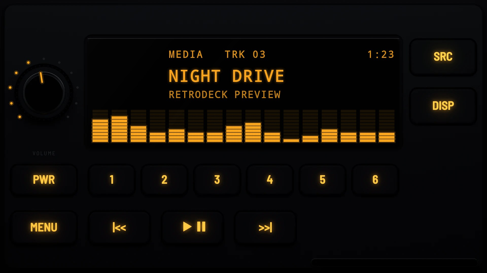
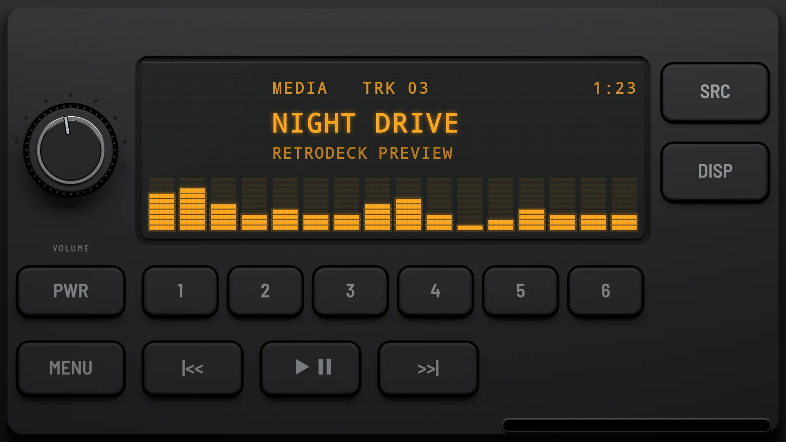

# Digital 1996

**Era:** 1990s  ·  **Display:** Dot matrix  ·  **Skin id:** `digital96`

A mid-1990s deck in grained black plastic with soft rubber keys, a ribbed volume knob with a silver ring, a glossy dot-matrix display and a CD slot along the bottom.

## Screenshots

Taken from the running app on an Android TV box at 1920×1080 (240 dpi), branded with the made-up Halcyon Mesa GT from [docs/demo](../../../docs/demo/). Taken with v0.1.0. That was before key lighting, so the keys are lit with the faceplate in daylight; current versions look like the day and night renders below.

Branded with the demo car, playing

## Day and night

Rendered, not taken on a device: the faceplate is modelled in 3D in Blender, and the display, knob pointer and dial are drawn by the app on top in the render tests (no logos). At night the key legends are backlit and the faceplate goes dark; by day the legends are printed paint. See Key Lighting in the [main README](../../../README.md).

| Night | Day |
|---|---|
|  |  |

## Keys

**Working:**

- PWR, MENU, SRC, |<< and >>|, PLAY/PAUSE, DISP
- Presets 1 to 6
- The volume knob, with a lit dial of dots

## Branding zones

Header (top centre), LCD, faceplate and corner (bottom right), visualizer. A logo stays inside its zone and never covers a key.
