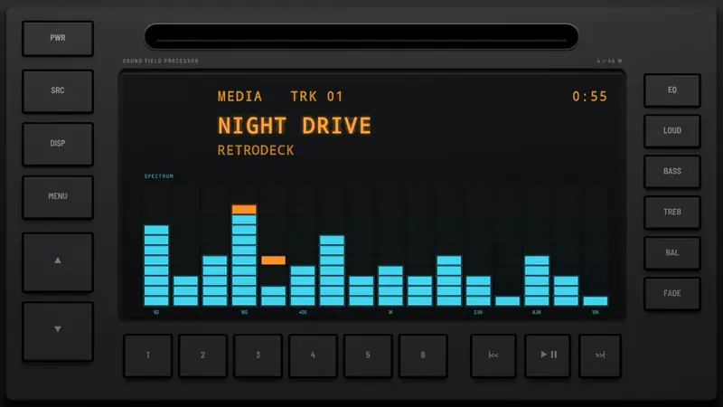
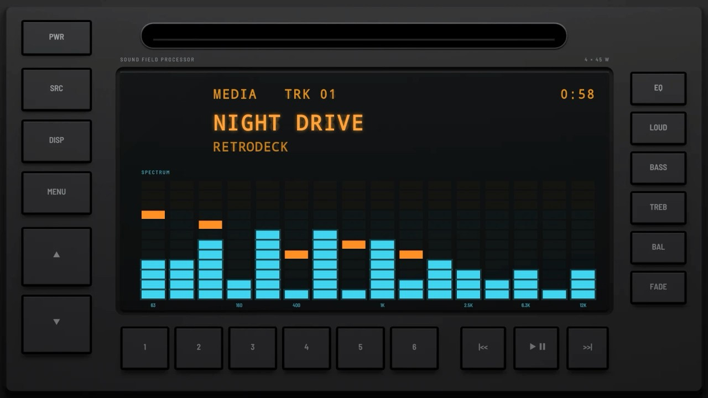
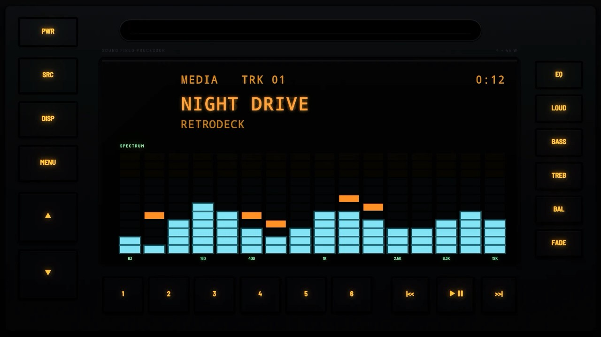
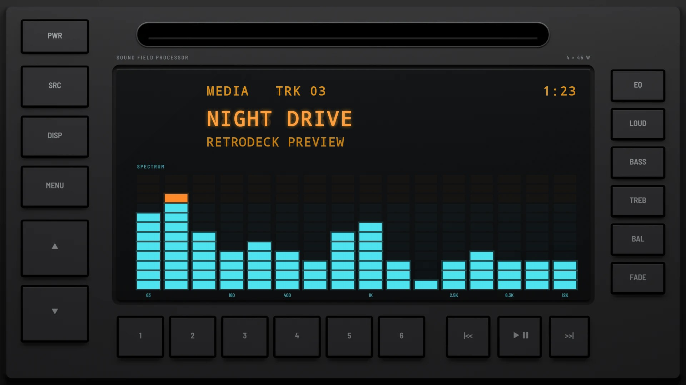
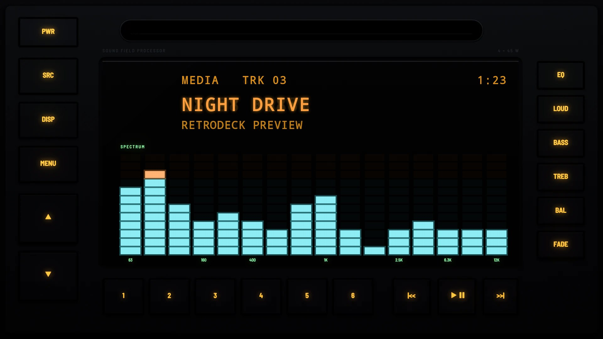

# Level Meter 1991

**Era:** 1990s  ·  **Size:** Double DIN  ·  **Display:** Vacuum fluorescent: an orange readout over a cyan spectrum analyser whose bars turn orange at the top, whatever the dash lighting  ·  **Skin id:** `level91`

An early-1990s black head unit with one big window: an orange readout over a cyan spectrum analyser, its bands marked on the glass, between a column of keys down each side. A slot runs across the top and the presets and transport keys along the foot. Modelled in 3D and rendered with Blender (tools/blender/skins.py). Like every RetroDeck skin, it copies no real unit and has no brand names on it.

## Screenshots

Recorded from the running app (v0.14.0) on an Android TV box at 1920×1080 (240 dpi), playing a song: the visualizer follows the music. The faceplate is the 3D render; the display and knob pointer are drawn live on top.

By day (Key Lighting Off)

At night (Key Lighting Always on)

## Day and night

Rendered, not taken on a device: the faceplate is modelled in 3D in Blender, and the display and knob pointer are drawn by the app on top in the render tests (no logos).

| Day | Night |
|---|---|
|  |  |

## Keys

**Working:**

- PWR, SRC, DISP and MENU (left column)
- The ▲ and ▼ keys: volume up and down
- Presets 1 to 6
- |<<, PLAY/PAUSE and >>|

**For the look only** (they do nothing):

- EQ, LOUD, BASS, TREB, BAL and FADE (right column)

## Branding zones

Header (right of the slot), corner (under the left column), faceplate (under the right column), LCD, visualizer. A logo stays inside its zone and never covers a key.
