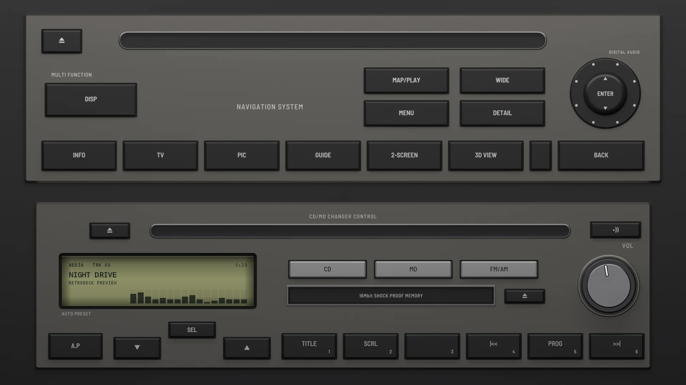
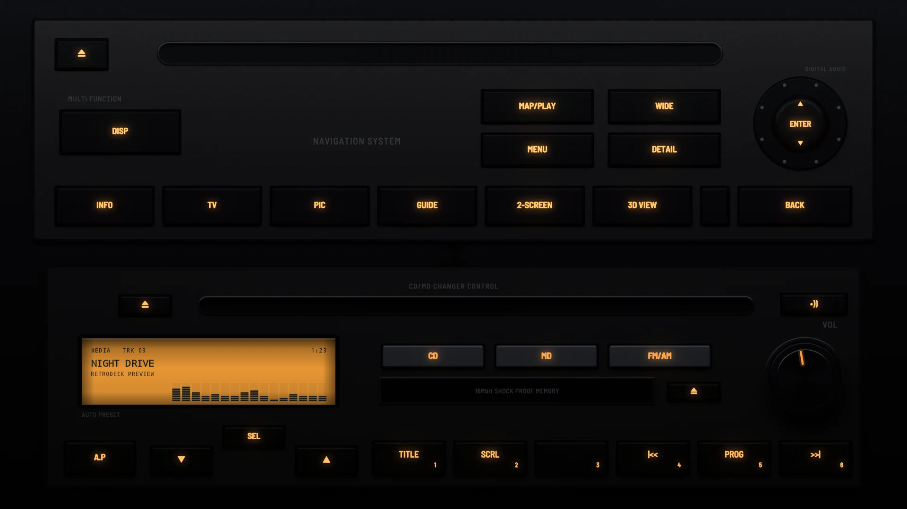

# R34 Factory 1999

**Era:** 1990s  ·  **Size:** Double DIN  ·  **Display:** Reflective LCD: dark segments on olive by day, lit amber from behind at night, whatever the dash lighting  ·  **Skin id:** `r34factory99`

A car maker's factory pair from the late 1990s, set in a dark brushed panel that fills the screen: a navigation unit over a CD and MD changer control, both in titanium grey. The navigation unit has a disc slot across the top, a big DISP key, the map keys round a joystick and a row of keys along its foot. The radio has a CD slot, a small reflective LCD beside light grey CD, MD and FM/AM keys over a MD slot, a knurled volume knob, and A.P, the ∨ SEL ∧ rocker and six preset keys along its foot. The display is olive by day and lit amber at night, and the legends light amber with it. Modelled in 3D and rendered with Blender (tools/blender/skins.py). Like every RetroDeck skin, it copies no real unit and has no brand names on it.

## Day and night

Rendered, not taken on a device: the faceplate is modelled in 3D in Blender, and the display and knob pointer are drawn by the app on top in the render tests (no logos). Not yet recorded on a device.

| Day | Night |
|---|---|
|  |  |

## Keys

**Working:**

- The VOL knob
- •)) (top right of the radio): power
- ∨ and ∧: previous and next track
- Presets 1–6
- CD plays and pauses
- FM/AM opens your music (SRC)
- DISP (on the navigation unit) changes the visualizer
- MENU (on the navigation unit) opens the menu

**For the look only** (they do nothing):

- Both eject keys on the radio and the one on the navigation unit, MD, A.P and SEL
- MAP/PLAY, WIDE, DETAIL, the joystick, and the row along the navigation unit's foot (INFO, TV, PIC, GUIDE, 2-SCREEN, 3D VIEW, BACK)

## Branding zones

Header (on the navigation unit, left of its name), corner (top right of the navigation unit), faceplate (top left of the radio, beside its eject key), LCD and visualizer (along the foot of the display). A logo stays inside its zone and never covers a key.
