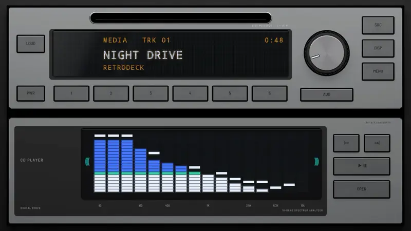
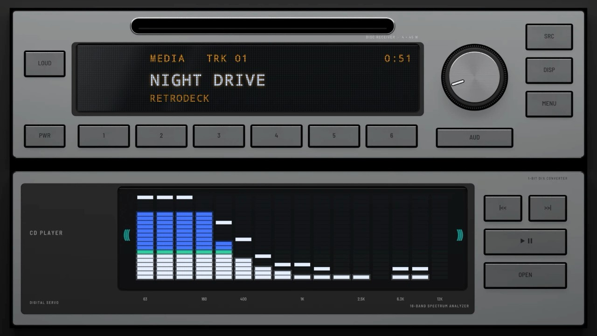
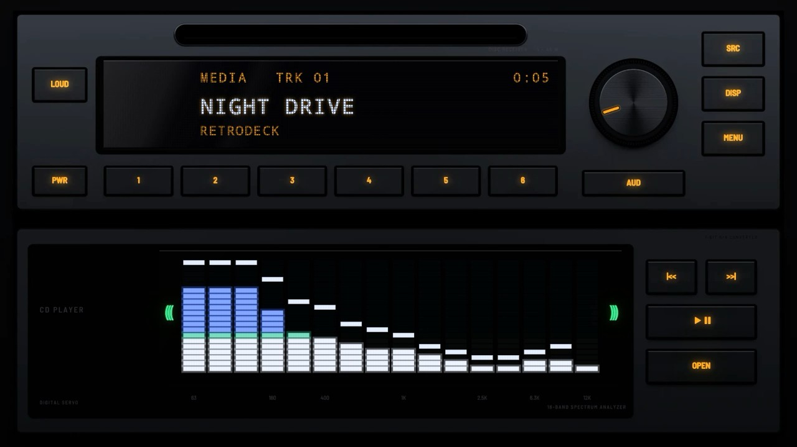

# Spectrum 1997

**Era:** 1990s  ·  **Size:** Double DIN  ·  **Display:** Dot matrix, blue-white: a display on the receiver and a spectrum analyser on the CD player, its fine bars white under a green line and blue above, whatever the dash lighting  ·  **Skin id:** `spectrum97`

A late-1990s silver stack: a receiver with a slot, a blue-white dot-matrix display and a knob, over a CD player whose window is nearly all spectrum analyser, set in black glass with its bands printed beneath. Modelled in 3D and rendered with Blender (tools/blender/skins.py). Like every RetroDeck skin, it copies no real unit and has no brand names on it.

## Screenshots

Recorded from the running app (v0.14.0) on an Android TV box at 1920×1080 (240 dpi), playing a song: the visualizer follows the music. The faceplate is the 3D render; the display and knob pointer are drawn live on top.

By day (Key Lighting Off)

At night (Key Lighting Always on)

## Day and night

Rendered, not taken on a device: the faceplate is modelled in 3D in Blender, and the display and knob pointer are drawn by the app on top in the render tests (no logos).

| Day | Night |
|---|---|
|  |  |

## Keys

**Working:**

- The knob: volume
- PWR, SRC, DISP and MENU
- Presets 1 to 6
- |<<, PLAY/PAUSE and >>| (on the CD player)

**For the look only** (they do nothing):

- LOUD, AUD and OPEN

## Branding zones

Header (top left of the receiver), corner (under the CD player's keys), faceplate (left of the analyser), LCD, visualizer (in the analyser window). A logo stays inside its zone and never covers a key.
