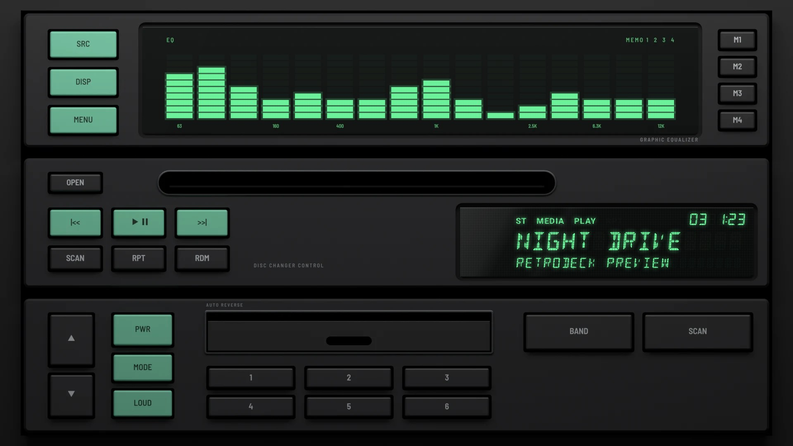

# Trio Stack 1993

**Era:** 1990s  ·  **Size:** Double DIN  ·  **Display:** Vacuum fluorescent, green: an equaliser window and a 14-segment display, whatever the dash lighting  ·  **Skin id:** `trio93`

An early-1990s stack of three black units: a graphic equaliser with green bars, a disc changer controller with its slot and display, and a head unit with a tape door. Their main keys are moulded in mint green, which glows at night. Modelled in 3D and rendered with Blender (tools/blender/skins.py). Like every RetroDeck skin, it copies no real unit and has no brand names on it.

## Day and night

Rendered, not taken on a device: the faceplate is modelled in 3D in Blender, and the display and knob pointer are drawn by the app on top in the render tests (no logos). Screenshots from a device will follow.

| Day | Night |
|---|---|
|  |  |

## Keys

**Working:**

- SRC, DISP and MENU (on the equaliser)
- |<<, PLAY/PAUSE and >>| (on the changer controller)
- PWR, and the ▲ and ▼ keys for volume (on the head unit)
- Presets 1 to 6

**For the look only** (they do nothing):

- M1 to M4 on the equaliser
- OPEN, SCAN, RPT and RDM on the changer controller
- MODE, LOUD, BAND and SCAN on the head unit

## Branding zones

Header (on the changer controller, between its keys and display), corner (right of the slot), faceplate (on the head unit, bottom right), LCD, visualizer (in the equaliser window). A logo stays inside its zone and never covers a key.
