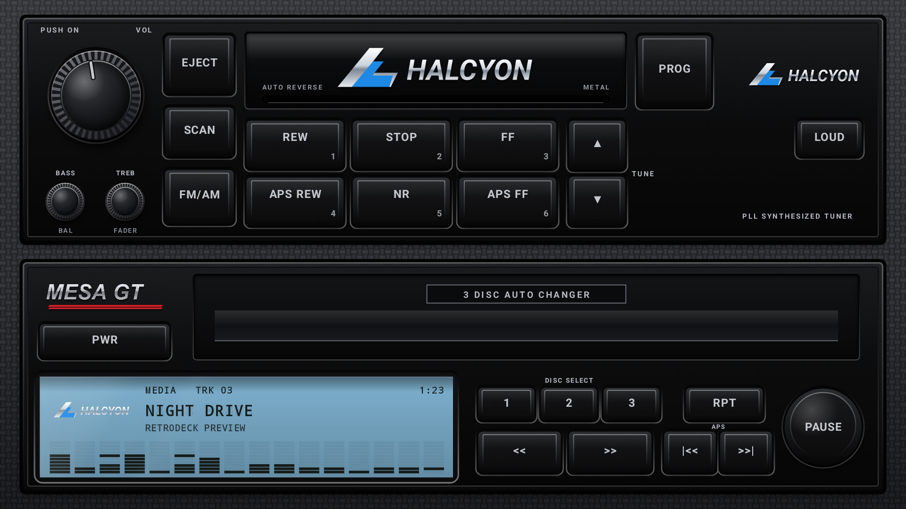
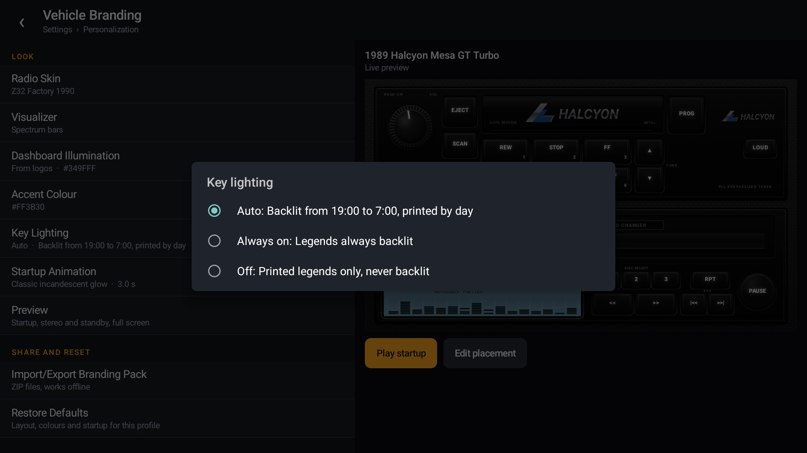
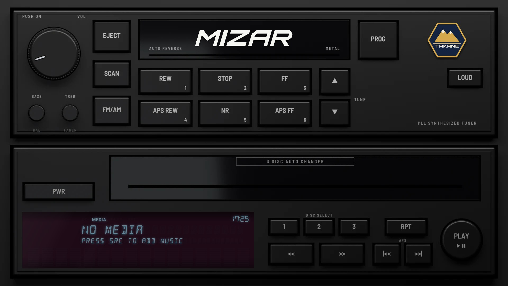
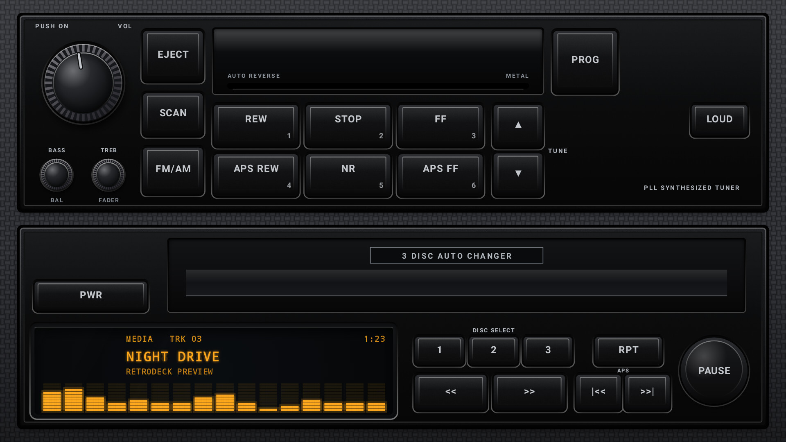
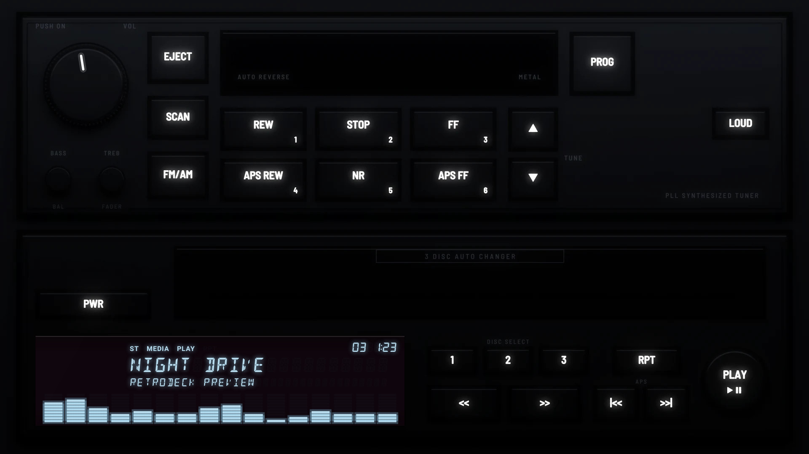

# Z32 Factory 1990

**Era:** 1990s  ·  **Size:** Double DIN  ·  **Display:** Vacuum fluorescent: pale blue segments behind plum-red filter glass and smoked black, muted by day and bright at night, whatever the dash lighting  ·  **Skin id:** `z32factory90`

A car maker's factory stack from around 1990: a tuner and tape deck over a three-disc changer, in near-black satin plastic set into the dash. Modelled in 3D and rendered with Blender (see tools/blender). Modelled on the factory tape deck and changer fitted to the Z32. The legends are white: printed paint by day, backlit at night.

## Screenshots

Taken from the running app (v0.4.0) on an Android TV box at 1920×1080 (240 dpi), branded with the made-up Halcyon Mesa GT from [docs/demo](../../../docs/demo/). The faceplate is the 3D render; the display, logos and knob pointer are drawn live on top.

By day (Key Lighting Off): satin black plastic, gloss doors, printed legends, the display muted under the smoked glass

At night (Key Lighting on Auto, 19:24): the cabin dark, the legends backlit, the display bright behind smoked plum glass

The Key Lighting setting (v0.3.0)

With the demo pack: the made-up stereo maker MIZAR on the tape door and the made-up Takane Motors badge in the corner, the way factory decks carried the audio brand and the car maker's badge (v0.9.0)

## Day and night

Rendered, not taken on a device: the faceplate is modelled in 3D in Blender, and the display, knob pointer and dial are drawn by the app on top in the render tests (no logos). At night the key legends are backlit and the faceplate goes dark; by day the legends are printed paint. See Key Lighting in the [main README](../../../README.md).

| Day | Night |
|---|---|
|  |  |

## Keys

**Working:**

- EJECT opens your music (SRC)
- SCAN cycles the visualizer (DISP)
- PROG opens the menu
- PWR
- APS |<< and >>|
- The round PLAY/PAUSE key
- The tape keys, which double as presets: REW 1, STOP 2, FF 3, APS REW 4, NR 5, APS FF 6
- The VOL knob

**For the look only** (they do nothing):

- FM/AM, TUNE ▲ ▼, LOUD
- DISC SELECT 1 2 3, RPT, << and >>
- The BASS/BAL and TREB/FADER knobs

## Branding zones

Header (on the tape door), corner (top right), faceplate (top left of the changer), LCD, visualizer. A logo stays inside its zone and never covers a key.
