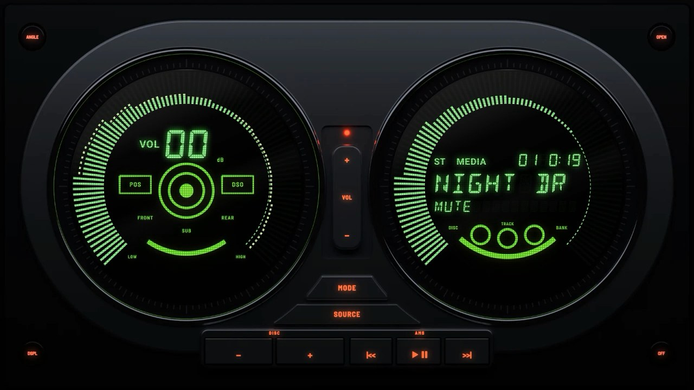
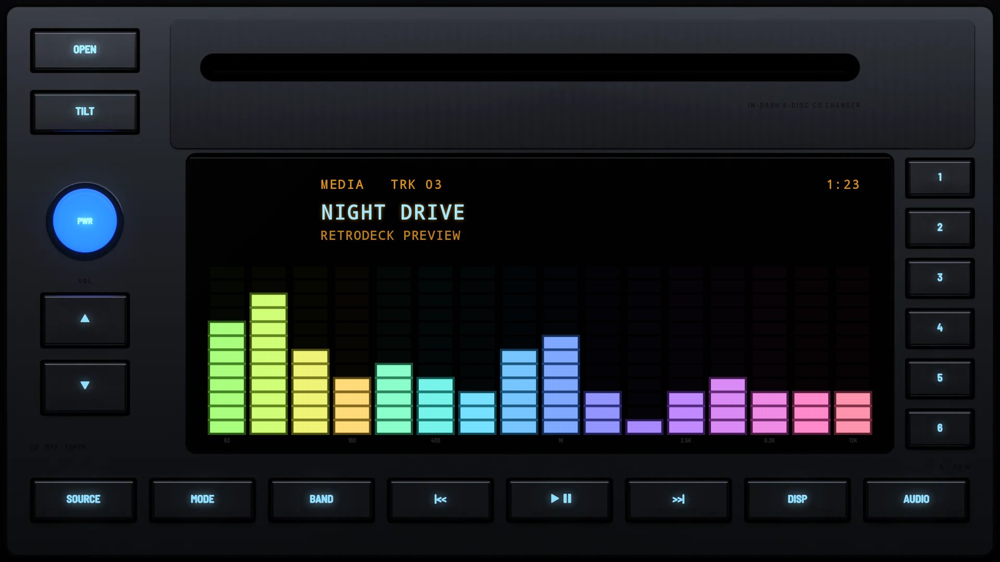
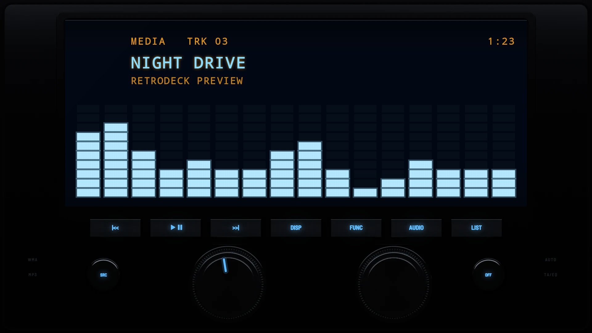
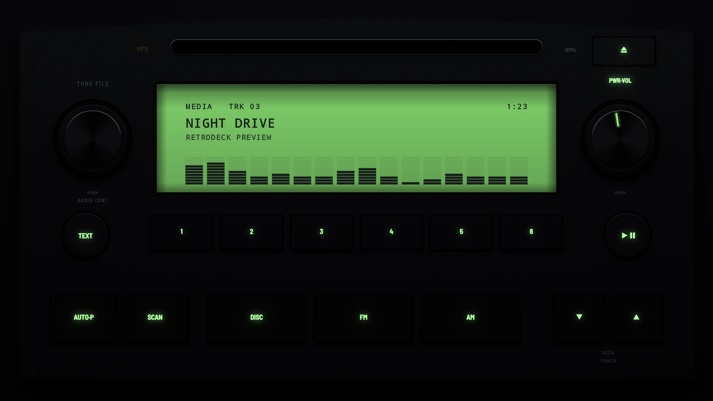
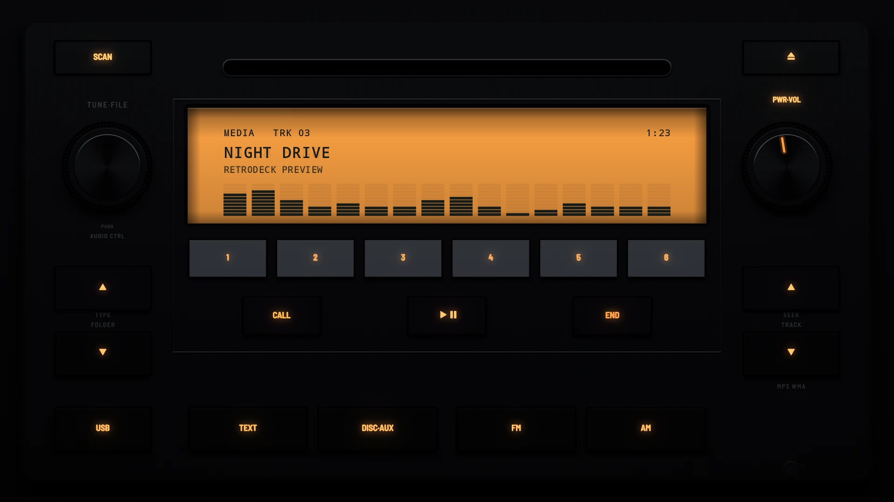
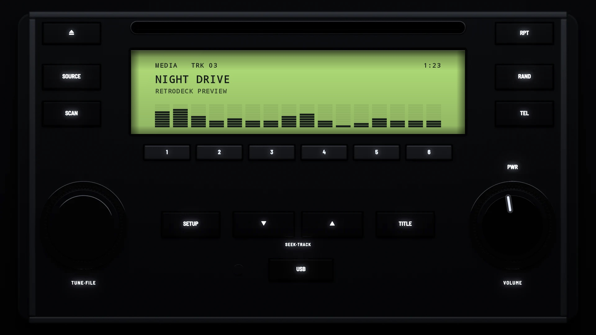

# The 2000s

## [Multi Control 2000](multi-control-2000/)

A double-DIN unit from around 2000 that is nearly all display: a big blue fluorescent window whose bars fan round a half circle, keys down both sides and a chrome volume lever.

## [Twin Dial 2001](twin-dial-2001/)

A double-DIN unit from around 2001 with two round green dials in a wide silver frame, each ringed with fine spokes that follow the music: the volume on the left, the track on the right.

## [Rainbow 2002](rainbow-2002/)

A silver double-DIN unit from around 2002 with an in-dash CD changer, its wide window's bars running through the rainbow from the bass to the treble.

## [Blue Matrix 2004](blue-matrix-2004/)

A dark chrome double-DIN unit from around 2004 that is nearly all display: a big blue dot-matrix window, a strip of slim keys and two big polished knobs.

## [N70 Factory 2005](n70-factory-2005/)

A 2005 factory CD unit: black, a big reflective LCD lit green between two knobs, presets, and a row of source keys with a track rocker.

## [E150 Factory 2008](e150-factory-2008/)

A 2008 factory CD unit: black, an amber-lit LCD between two knobs, white presets, phone keys and rockers down both sides.

## [XP90 Factory 2009](xp90-factory-2009/)

A 2009 factory CD unit in silver grey: a green-lit LCD, slim silver presets, and two big knobs in chrome rings at the foot.
