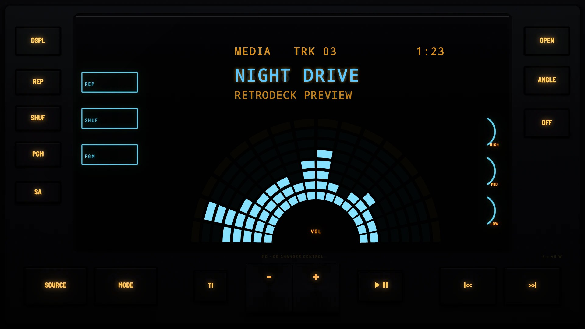

# The 2000s

## [Multi Control 2000](multi-control-2000/)

A double-DIN unit from around 2000 that is nearly all display: a big blue fluorescent window whose bars fan round a half circle, keys down both sides and a chrome volume lever.
