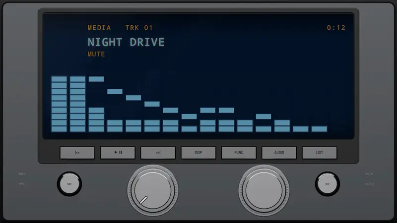
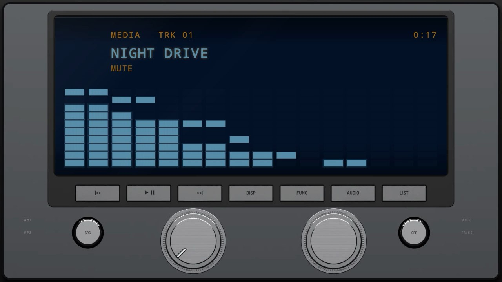
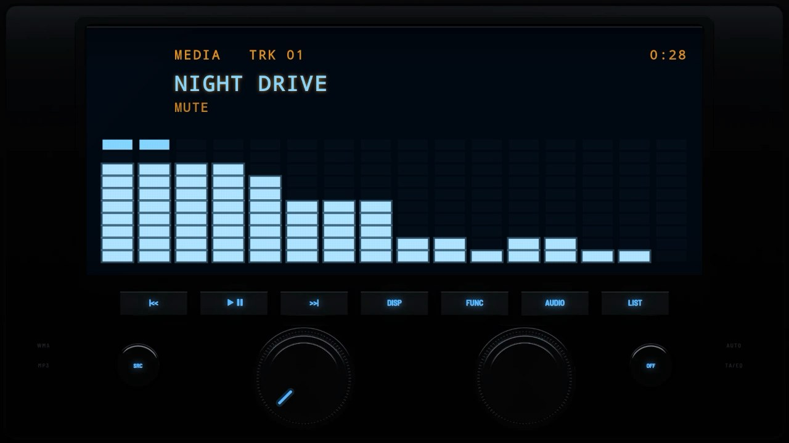
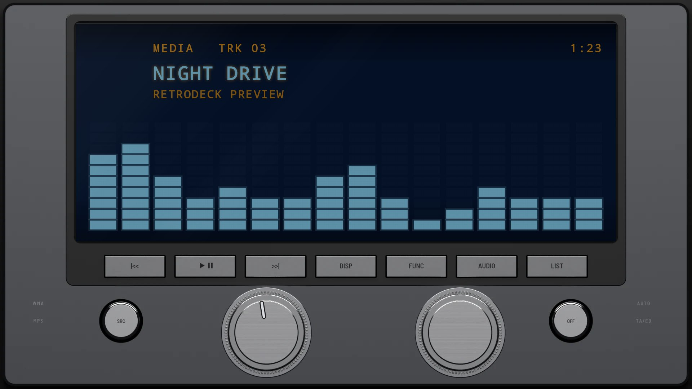
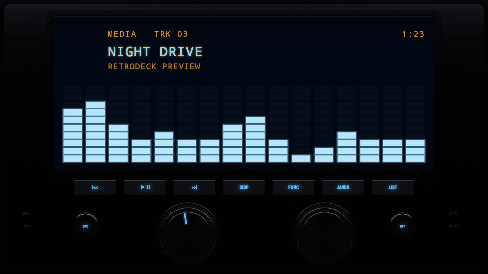

# Blue Matrix 2004

**Era:** 2000s  ·  **Size:** Double DIN  ·  **Display:** Dot matrix lit ice blue behind navy glass, whatever the dash lighting  ·  **Skin id:** `matrix04`

A double-DIN unit from around 2004 in dark chrome that is nearly all display: a big blue dot-matrix window behind navy glass, a black strip of slim silver keys under it, two big polished knobs (the volume and a multi-control) and a small round chrome key at each end. The legends are dark on the silver keys by day and backlit blue at night. Modelled in 3D and rendered with Blender (tools/blender/skins.py). Like every RetroDeck skin, it copies no real unit and has no brand names on it.

## Screenshots

Recorded from the running app (v0.17.0) on an Android TV box at 1920×1080 (240 dpi), playing a song with the TV muted: the blue dot-matrix bars follow the music. The display says MUTE because the TV was muted. The faceplate is the 3D render; the display and knob pointer are drawn live on top.

By day (Key Lighting Off)

At night (Key Lighting Always on)

## Day and night

Rendered, not taken on a device: the faceplate is modelled in 3D in Blender, and the display and knob pointer are drawn by the app on top in the render tests (no logos).

| Day | Night |
|---|---|
|  |  |

## Keys

**Working:**

- The left knob: volume
- SRC (round, left) and OFF (round, right): source and power
- Under the display: |<<, PLAY/PAUSE, >>|, DISP and FUNC (menu)

**For the look only** (they do nothing):

- The right knob (multi-control), AUDIO and LIST

## Branding zones

Header (on the frame, top centre), faceplate (lower left), corner (lower right), LCD, visualizer. A logo stays inside its zone and never covers a key or the track text.
