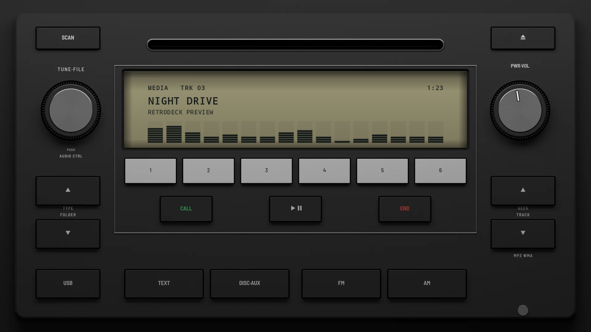
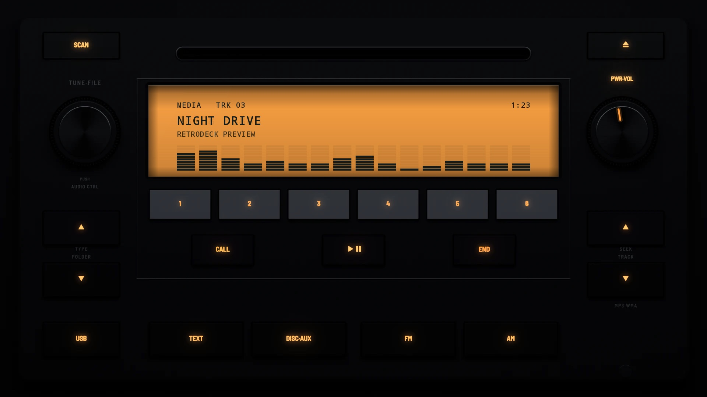

# Factory CD 2007

**Era:** 2000s  ·  **Size:** Double DIN  ·  **Display:** A reflective LCD, olive grey by day and lit amber at night  ·  **Skin id:** `factory07`

A late-2000s factory CD unit: black, a reflective LCD between a TUNE·FILE knob and a PWR·VOL knob, a row of white presets under it, call and end keys for the phone, TYPE·FOLDER and SEEK·TRACK rockers down the sides, and TEXT, DISC·AUX, FM and AM keys along the foot. Modelled in 3D and rendered with Blender (tools/blender/skins.py). Like every RetroDeck skin, it copies no real unit and has no brand names on it: the places where the maker's badge and marks sat are branding zones for your own logos.

## Day and night

Rendered, not taken on a device: the faceplate is modelled in 3D in Blender, and the display is drawn by the app on top in the render tests (no logos). Not yet recorded on a device.

| Day | Night |
|---|---|
|  |  |

## Keys

**Working:**

- PWR·VOL above the right knob (power), the right knob (volume)
- The left knob, pushed (the menu)
- ▶‖ between the phone keys (play/pause), the SEEK·TRACK rocker ∧ ∨ (next and previous track)
- TEXT (the visualizer, DISP), DISC·AUX (your music, SRC), presets 1–6

**For the look only:** SCAN, eject, CALL, END, the TYPE·FOLDER rocker, USB, FM and AM.

## Branding zones

Header (above the slot, in the middle), LCD (the left end of the display), visualizer (the lower part of the display), faceplate (the right, under SEEK·TRACK, where the format marks are), corner (the bottom right). A logo stays inside its zone and never covers a key.
