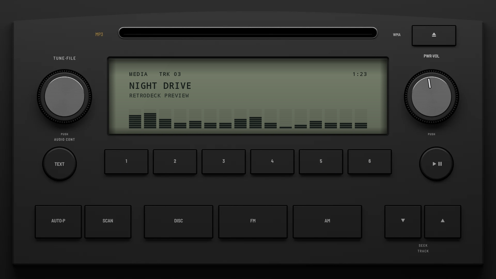
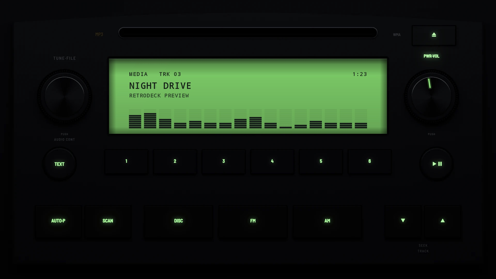

# Factory MP3 2005

**Era:** 2000s  ·  **Size:** Double DIN  ·  **Display:** A big reflective LCD, olive grey by day and lit green at night  ·  **Skin id:** `factory05`

A mid-2000s factory CD unit: black, its top arched over the disc slot, a TUNE·FILE knob and a PWR·VOL knob either side of a big reflective LCD, a row of presets under it with round TEXT and MUTE keys at its ends, and a row of source keys with a track rocker along the foot. Modelled in 3D and rendered with Blender (tools/blender/skins.py). Like every RetroDeck skin, it copies no real unit and has no brand names on it: the places where the maker's badge and marks sat are branding zones for your own logos.

## Day and night

Rendered, not taken on a device: the faceplate is modelled in 3D in Blender, and the display is drawn by the app on top in the render tests (no logos). Not yet recorded on a device.

| Day | Night |
|---|---|
|  |  |

## Keys

**Working:**

- PWR·VOL above the right knob (power), the right knob (volume)
- The left knob, pushed (the menu)
- TEXT (the visualizer, DISP), MUTE (play/pause), DISC (your music, SRC)
- The SEEK·TRACK rocker ∨ ∧ (previous and next track), presets 1–6

**For the look only:** eject, AUTO·P, SCAN, FM and AM.

## Branding zones

Header (under the presets, in the middle, where the maker's badge sat), LCD (the left end of the display), visualizer (the lower part of the display), faceplate (the foot, under the source keys), corner (the top left, beside the slot). A logo stays inside its zone and never covers a key.
