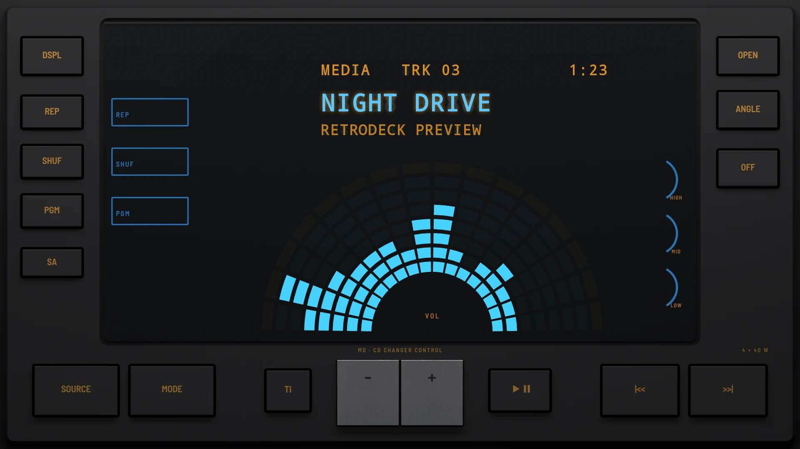

# Multi Control 2000

**Era:** 2000s  ·  **Size:** Double DIN  ·  **Display:** Vacuum fluorescent, blue: one big window, its bars fanned round a half circle, whatever the dash lighting  ·  **Skin id:** `multi2000`

A double-DIN unit from around 2000 that is nearly all display: a big blue fluorescent window with framed legends and three dials printed on the glass, its visualizer bars fanned round a half circle. Keys run down both sides and along the foot, with a chrome lever for the volume. The legends are amber, printed by day and backlit at night. Modelled in 3D and rendered with Blender (tools/blender/skins.py). Like every RetroDeck skin, it copies no real unit and has no brand names on it.

## Day and night

Rendered, not taken on a device: the faceplate is modelled in 3D in Blender, and the display and knob pointer are drawn by the app on top in the render tests (no logos). Screenshots from a device will follow.

| Day | Night |
|---|---|
|  |  |

## Keys

**Working:**

- DSPL: display (DISP)
- OFF: power
- SOURCE and MODE (menu)
- The chrome lever: − and + for volume
- PLAY/PAUSE, |<< and >>|

**For the look only** (they do nothing):

- REP, SHUF, PGM and SA down the left
- OPEN and ANGLE down the right, and TI

## Branding zones

Header (on the glass, top centre), corner (under the right column), faceplate (under the left column), LCD, visualizer. A logo stays inside its zone and never covers a key.
