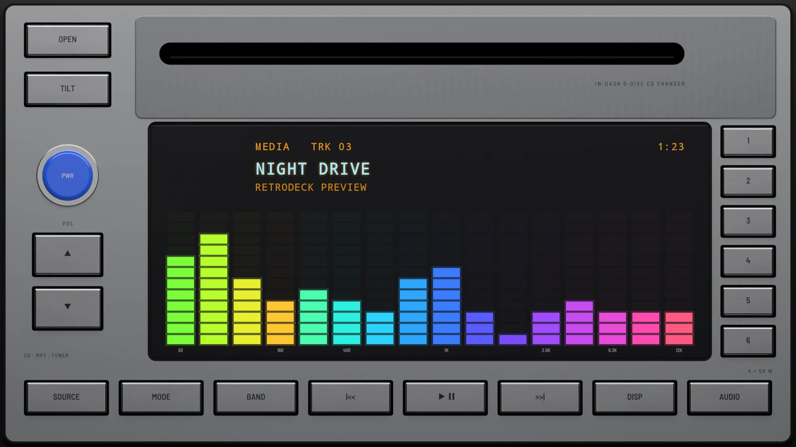
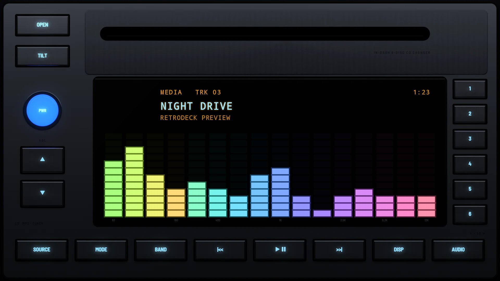

# Rainbow 2002

**Era:** 2000s  ·  **Size:** Double DIN  ·  **Display:** Dot matrix, its bars running through the rainbow from the bass to the treble, whatever the dash lighting  ·  **Skin id:** `rainbow02`

A satin silver double-DIN unit from around 2002 with an in-dash CD changer: a slot across the top, and a wide black window whose analyser runs from green and yellow in the bass through cyan and blue to purple and pink in the treble, with white peaks and the bands printed under it. A round blue key (power) and the volume keys run down the left, the presets down the right, and a row of silver keys along the foot. The legends are dark on the silver keys by day and backlit ice blue at night. Modelled in 3D and rendered with Blender (tools/blender/skins.py). Like every RetroDeck skin, it copies no real unit and has no brand names on it.

## Day and night

Rendered, not taken on a device: the faceplate is modelled in 3D in Blender, and the display is drawn by the app on top in the render tests (no logos).

| Day | Night |
|---|---|
|  |  |

## Keys

**Working:**

- PWR (the round blue key)
- ▲ and ▼ under it: volume
- Presets 1 to 6, down the right
- Along the foot: SOURCE, MODE (menu), |<<, PLAY/PAUSE, >>| and DISP

**For the look only** (they do nothing):

- OPEN and TILT (top left), BAND and AUDIO

## Branding zones

Header (under the CD slot, on the right), faceplate (under the volume keys), corner (along the foot, lower left), LCD, visualizer. A logo stays inside its zone and never covers a key or the track text.
