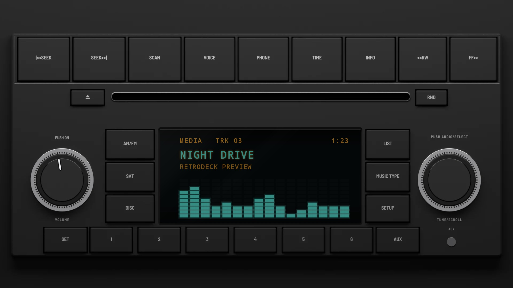
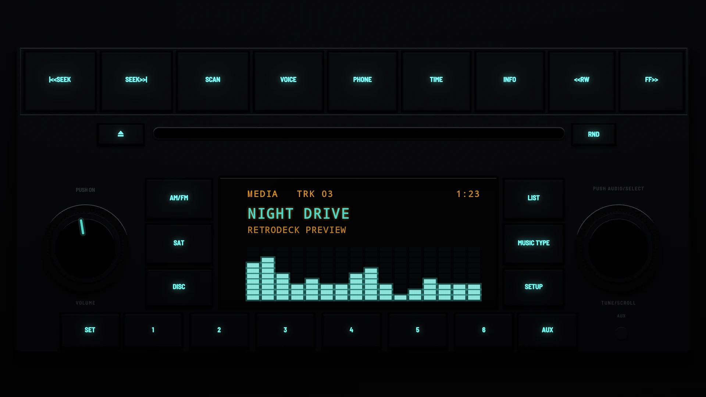

# RES Factory 2008

**Era:** 2000s  ·  **Size:** Double DIN  ·  **Display:** A dot-matrix display lit teal  ·  **Skin id:** `resfactory08`

A 2008 factory radio, named after its radio code: one unit fitted to many models from 2008 to 2013, with a single-disc CD and MP3 player, satellite radio and an aux input. A wide black face with a row of nine keys across the top (seek, scan, voice, phone, time, info, rewind and fast forward), a disc slot between eject and RND, a knurled knob with a chrome rim each side (PUSH ON·VOLUME and PUSH AUDIO/SELECT·TUNE/SCROLL), source keys either side of a dot-matrix display, and the presets along the foot. Keys and display light teal at night. Modelled in 3D and rendered with Blender (tools/blender/skins.py). Like every RetroDeck skin, it copies no real unit and has no brand names on it: the places where the satellite radio and disc logos sat are left plain.

## Day and night

Rendered, not taken on a device: the faceplate is modelled in 3D in Blender, and the display is drawn by the app on top in the render tests (no logos). Not yet recorded on a device.

| Day | Night |
|---|---|
|  |  |

## Keys

**Working:**

- PUSH ON above the left knob (power), the left knob (volume)
- |<<SEEK and SEEK>>| (previous and next track), presets 1–6
- AM/FM (your music and the head unit's radio and music apps, SRC), DISC (play/pause), INFO (the visualizer, DISP), SETUP (the menu)

**For the look only:** SCAN, VOICE, PHONE, TIME, <<RW, FF>>, eject, RND, SAT, LIST, MUSIC TYPE, the right knob, SET and AUX.

## Branding zones

Header (under the slot, in the middle), LCD (the left end of the display), visualizer (the lower part of the display), faceplate (right of RND), corner (left of eject). A logo stays inside its zone and never covers a key.
