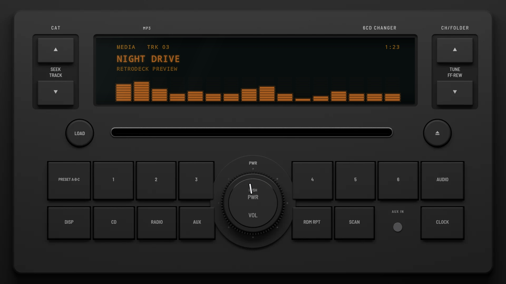
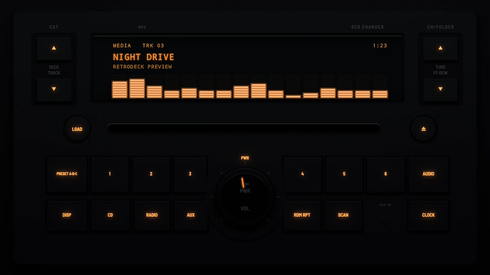

# S35 Factory 2008

**Era:** 2000s  ·  **Size:** Double DIN  ·  **Display:** An orange segment display behind dark glass  ·  **Skin id:** `s35factory08`

A 2008 factory unit with a 6-disc changer and a premium sound system: charcoal plastic, a wide display lit orange under a row of format marks, SEEK·TRACK and TUNE·FF·REW rockers in wells either side of it, LOAD and eject keys either side of the disc slot, and a raised housing round a chrome-ringed PUSH PWR·VOL knob that splits the presets and the source keys under them. Modelled in 3D and rendered with Blender (tools/blender/skins.py). Like every RetroDeck skin, it copies no real unit and has no brand names on it: the places where the sound system's name and the format logos sat are branding zones for your own logos.

## Day and night

Rendered, not taken on a device: the faceplate is modelled in 3D in Blender, and the display is drawn by the app on top in the render tests (no logos). Not yet recorded on a device.

| Day | Night |
|---|---|
|  |  |

## Keys

**Working:**

- PWR on the knob's housing (power), the knob (volume)
- The SEEK·TRACK rocker ∧ ∨ (next and previous track), presets 1–6
- CD (play/pause), RADIO (your music and the head unit's radio and music apps, SRC), DISP (the visualizer), AUDIO (the menu)

**For the look only:** the TUNE·FF·REW rocker, LOAD, eject, PRESET A·B·C, AUX, RDM RPT, SCAN and CLOCK.

## Branding zones

Header (above the display, in the middle, where the sound system's name sat), LCD (the left end of the display), visualizer (the lower part of the display), faceplate (above the display on the left, where the format logos sat), corner (the bottom right). A logo stays inside its zone and never covers a key.
