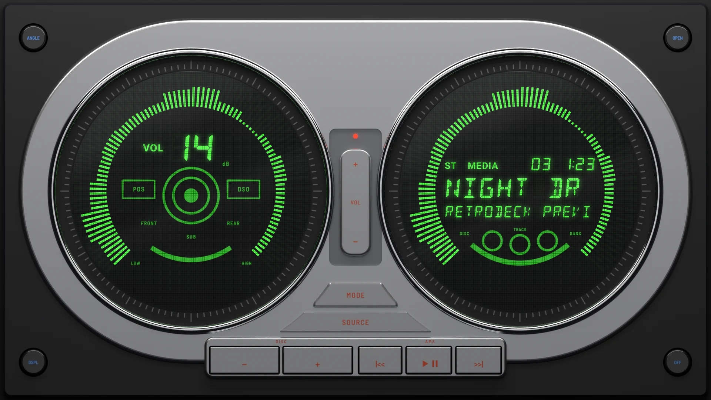
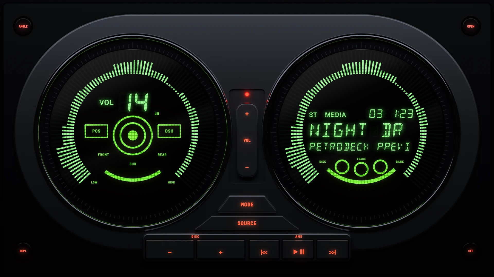

# Twin Dial 2001

**Era:** 2000s  ·  **Size:** Double DIN  ·  **Display:** Vacuum fluorescent, green: two round dials, whatever the dash lighting  ·  **Skin id:** `twin01`

A double-DIN unit from around 2001, nearly filled by a satin silver frame that holds two round green fluorescent dials. Each dial sits in a polished ring and a black collar ticked in grey, ringed with fine spokes that follow the music, from the bass at the lower left over the top to the treble. The left dial shows the volume over a printed hub with POS, DSO, FRONT, REAR and SUB, like the original's sound settings. The right dial shows the track over three printed disc rings. Between the dials a recessed panel holds a slim VOL rocker under a red lamp. Under them are curved MODE and SOURCE keys and a bar of silver keys, and there is a small black round key in each corner. The legends are red on the silver keys and blue on the black ones, printed by day and backlit at night. Modelled in 3D and rendered with Blender (tools/blender/skins.py). Like every RetroDeck skin, it copies no real unit and has no brand names on it.

## Day and night

Rendered, not taken on a device: the faceplate is modelled in 3D in Blender, and the dials are drawn by the app on top in the render tests (no logos).

| Day | Night |
|---|---|
|  |  |

## Keys

**Working:**

- The VOL rocker between the dials: + and − for volume
- MODE (menu) and SOURCE
- On the bar: |<<, PLAY/PAUSE and >>|
- DSPL (lower left): display (DISP)
- OFF (lower right): power

**For the look only** (they do nothing):

- DISC − and + on the bar
- ANGLE and OPEN, the upper corner keys

## Branding zones

Header (on the silver frame, top centre), corner (under the right dial), faceplate (under the left dial), LCD (in the right dial, above the track), visualizer (the left dial). A logo stays inside its zone and never covers a key or the track text.
