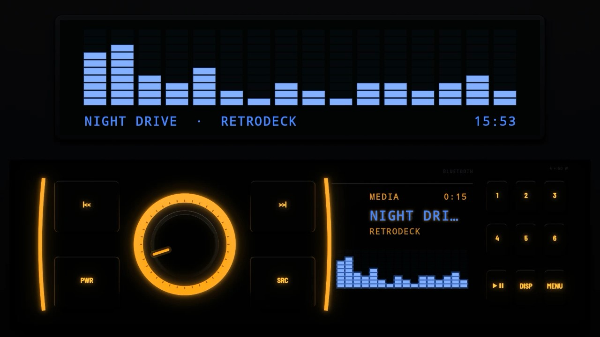
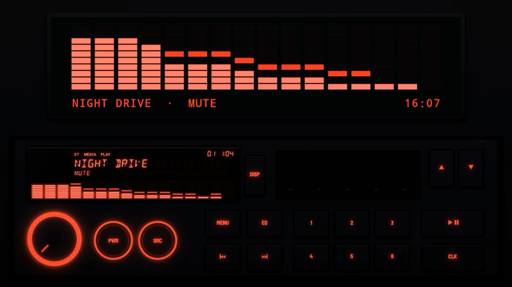
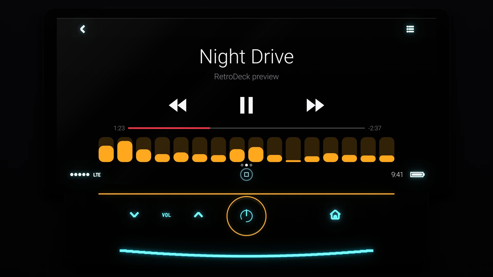
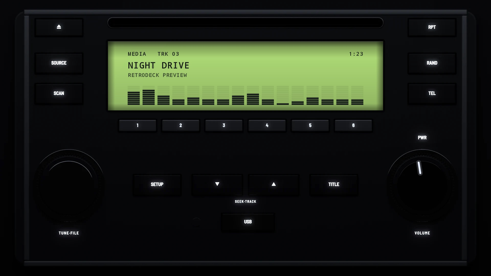
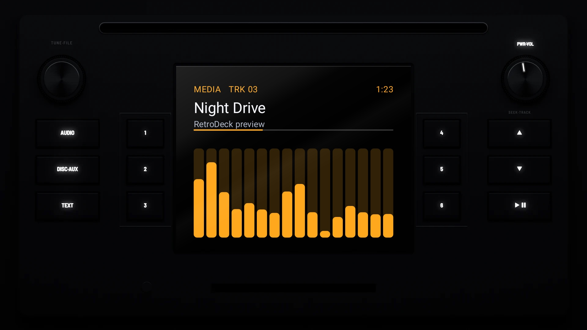
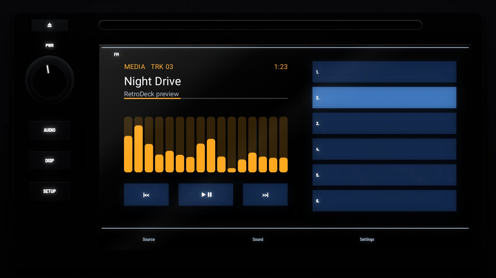

# The 2010s

## [Bluetooth 2016](bluetooth-2016/)

A budget Bluetooth unit in one DIN: gloss black, a big knob in a lit ring, curved keys edged with light strips and a blue segment display.

## [Red Line 2019](red-line-2019/)

A budget media unit in one DIN: matt black, a red segment display, a knob in a red ring, round power and source keys ringed in red, and keys with red legends.

## [CP 2013](cp-2013/)

A touch-screen head unit as the first phone-driven car screens were shown in 2013: a glossy black tablet with the song in thin white type on black glass, and a shelf of cyan VOL keys, an amber-ringed power knob and a home key.

## [Factory Silver 2010](factory-silver-2010/)

A 2010 factory CD unit in silver grey: a green-lit LCD, slim silver presets, and two big knobs in chrome rings at the foot.

## [Factory Screen 2012](factory-screen-2012/)

A 2012 factory unit: black, a colour screen between columns of presets, knobs in the top corners.

## [Factory Touch 2014](factory-touch-2014/)

A 2014 factory touch-screen unit: gloss black, a volume knob and keys down the left, the presets as a list on the screen.
