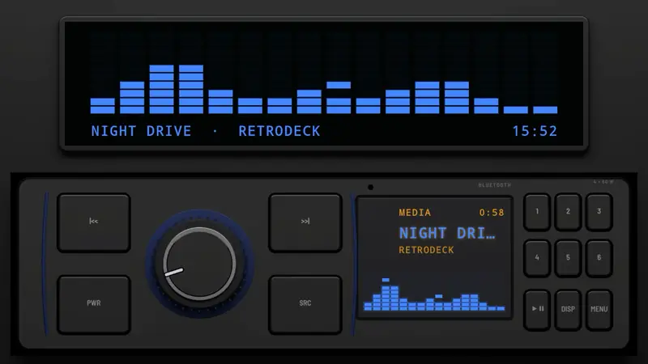
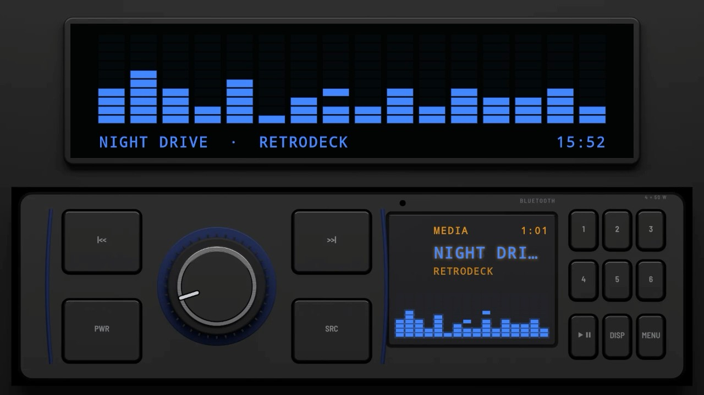
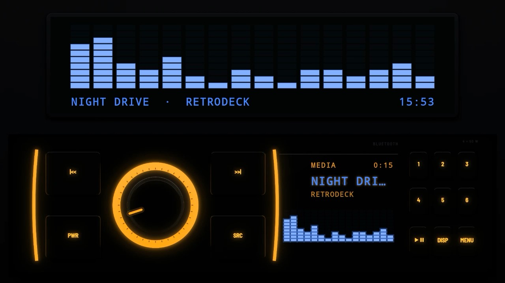
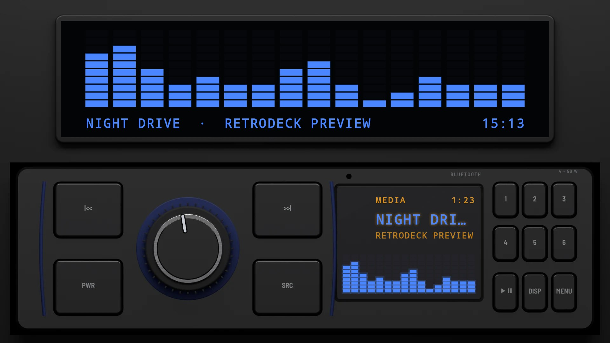
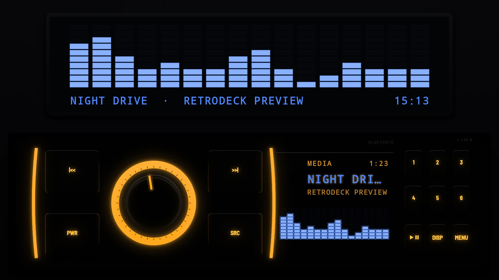
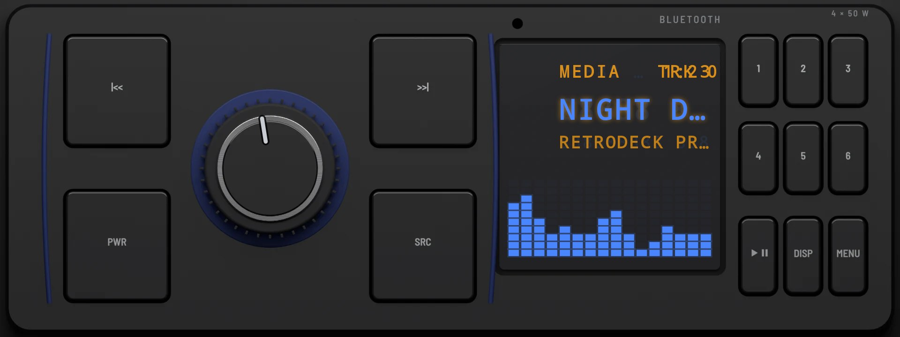
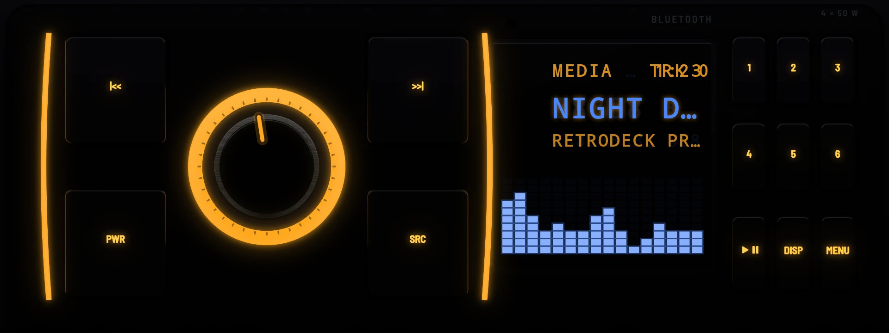

# Bluetooth 2016

**Era:** 2010s  ·  **Size:** Single DIN  ·  **Display:** Segment display lit blue, whatever the dash lighting  ·  **Skin id:** `bt16`

A budget Bluetooth unit of the 2010s in one DIN: gloss black, a big knob in a lit ring, curved keys either side of it edged with light strips, a mic hole and a blue segment display. The light strips and the ring glow in the dash colour at night. Modelled in 3D and rendered with Blender (tools/blender/skins.py). Like every RetroDeck skin, it copies no real unit and has no brand names on it.

On a single-DIN head unit's own wide screen (about 8:3) the radio fills the screen; on a bigger one it sits across the lower half under a screen for the visualizer, the song and the clock.

## Screenshots

Recorded from the running app (v0.14.0) on an Android TV box at 1920×1080 (240 dpi), playing a song: the visualizer follows the music. The faceplate is the 3D render; the display and knob pointer are drawn live on top.

By day (Key Lighting Off)

At night (Key Lighting Always on)

## Day and night

Rendered, not taken on a device: the faceplate is modelled in 3D in Blender, and the display and knob pointer are drawn by the app on top in the render tests (no logos).

| Day | Night |
|---|---|
|  |  |

On a single-DIN unit's own wide screen (1920×720):

| Day | Night |
|---|---|
|  |  |

## Keys

**Working:**

- The knob: volume
- |<< and >>|, PWR and SRC (beside the knob)
- Presets 1 to 6
- PLAY/PAUSE, DISP and MENU

## Branding zones

Header (above the display), corner (bottom right), faceplate (under the display), LCD, visualizer. A logo stays inside its zone and never covers a key.
