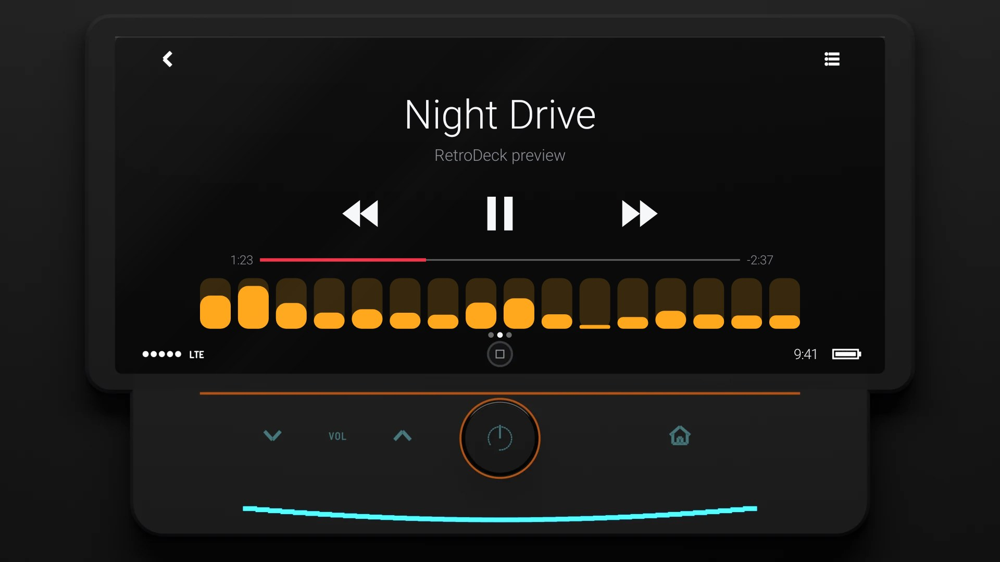
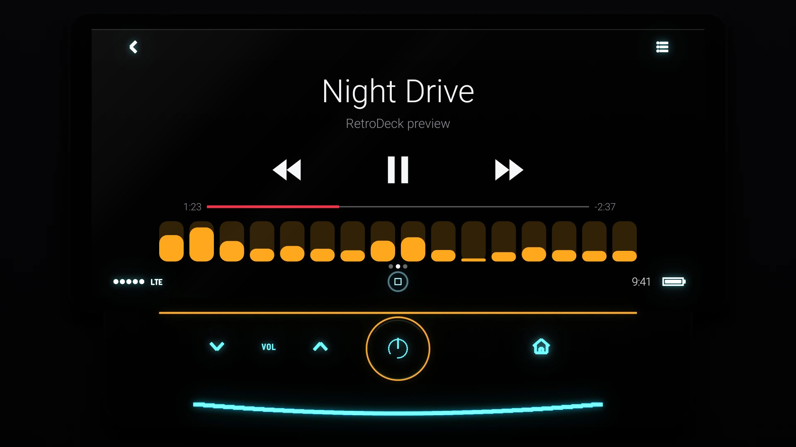

# CP 2013

**Era:** 2010s  ·  **Size:** Double DIN  ·  **Display:** A touch screen: the song in thin white type on black glass, with transport keys, a progress bar and a status bar  ·  **Skin id:** `cp13`

A touch-screen head unit as the first phone-driven car screens were shown in 2013: a glossy black tablet in a dark knit surround, its screen flat and black, and under it a shelf with backlit cyan VOL keys, a round power knob with an amber glow round its edge, a home key, and a blue light strip along the foot. On the glass, the song's title is large and thin in the middle with the artist in grey under it, then ◀◀, play or pause, and ▶▶, a progress bar with a red fill between the time played and the time left, the visualizer, page dots, and a status bar with the clock and a round home button. Modelled in 3D and rendered with Blender (tools/blender/skins.py); the song, keys, bar and clock are drawn live by the app. Like every RetroDeck skin, it copies no real unit and has no brand names on it.

## Day and night

Rendered, not taken on a device: the faceplate is modelled in 3D in Blender, and the screen is drawn by the app on top in the render tests (no logos). Not yet recorded on a device.

| Day | Night |
|---|---|
|  |  |

## Keys

**Working:**

- On the shelf: VOL ∨ and ∧ (volume down and up), the round knob (power), the home key (the menu)
- On the screen: ◀◀ and ▶▶ (previous and next track), play/pause, the list icon at the top right (your music, SRC), the round home button in the status bar (the visualizer, DISP)

**For the look only:** the back arrow at the top left.

## Branding zones

Header (the top of the screen, between the back arrow and the list icon), LCD (the status bar, left of the home button), visualizer (under the progress bar), faceplate (the shelf, left of the VOL keys), corner (the shelf, right of the home key). A logo stays inside its zone and never covers a key.
