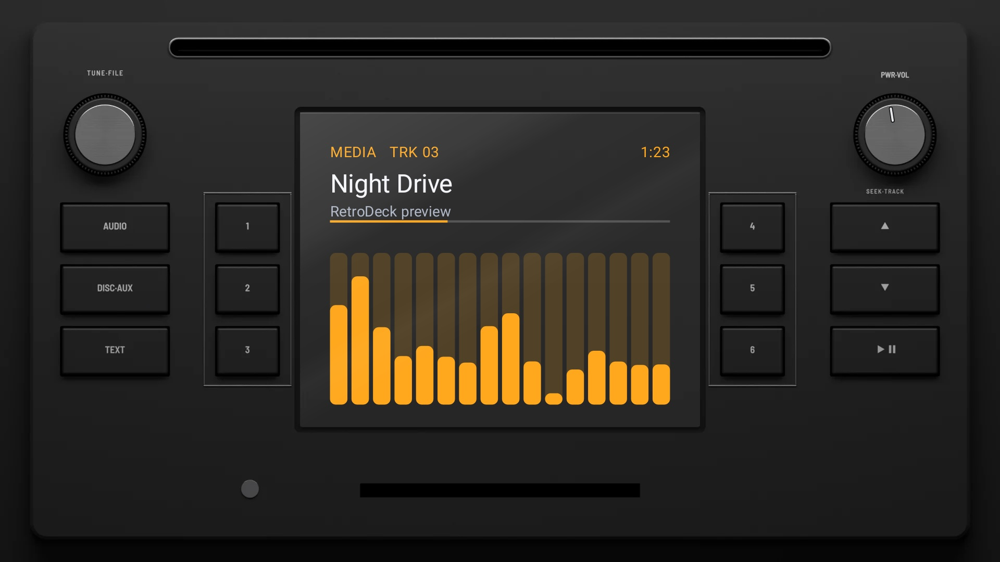
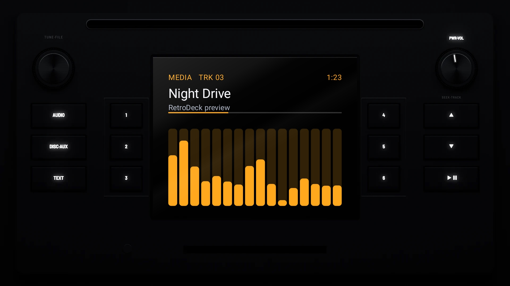

# Factory Screen 2012

**Era:** 2010s  ·  **Size:** Double DIN  ·  **Display:** A colour screen  ·  **Skin id:** `factory12`

A 2012 factory unit: black, a disc slot across the top, a TUNE·FILE knob and a PWR·VOL knob in the top corners, a colour screen in the middle with presets 1–3 and 4–6 either side of it in thin silver frames, keys outside them, and a card slot and aux jack along the foot. Modelled in 3D and rendered with Blender (tools/blender/skins.py). Like every RetroDeck skin, it copies no real unit and has no brand names on it: the places where the maker's badge and marks sat are branding zones for your own logos.

## Day and night

Rendered, not taken on a device: the faceplate is modelled in 3D in Blender, and the display is drawn by the app on top in the render tests (no logos). Not yet recorded on a device.

| Day | Night |
|---|---|
|  |  |

## Keys

**Working:**

- PWR·VOL above the right knob (power), the right knob (volume)
- AUDIO (the menu), DISC·AUX (your music, SRC), TEXT (the visualizer, DISP)
- SEEK·TRACK ∧ ∨ (next and previous track), ▶‖ (play/pause), presets 1–6

**For the look only:** the TUNE·FILE knob.

## Branding zones

Header (between the slot and the screen), LCD (the left edge of the screen), visualizer (the lower part of the screen), faceplate (the bottom left), corner (the bottom right). A logo stays inside its zone and never covers a key.
