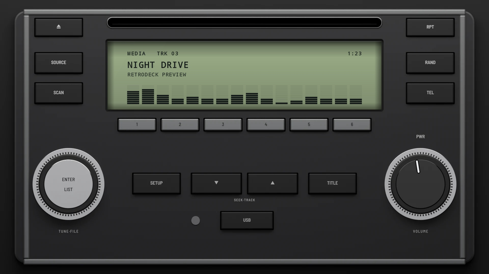
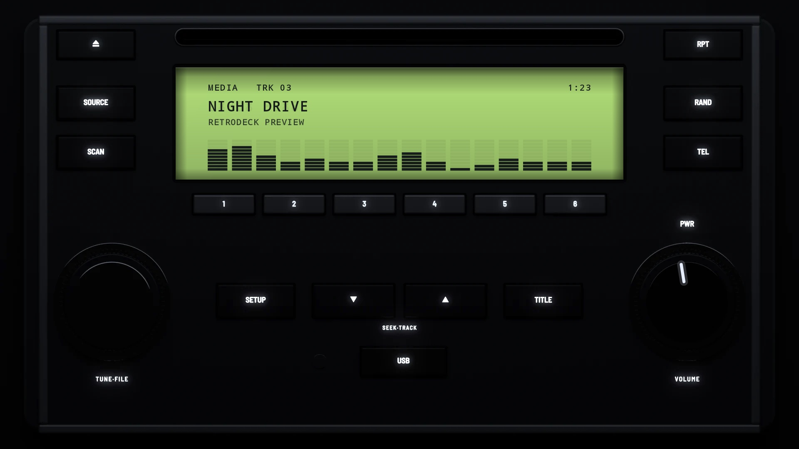

# Factory Silver 2010

**Era:** 2010s  ·  **Size:** Double DIN  ·  **Display:** A reflective LCD, pale green by day and lit green at night  ·  **Skin id:** `factory10`

A 2010 factory CD unit in silver grey: a dark inner panel in a silver frame, a reflective LCD under the disc slot, slim silver presets, keys down both sides, and two big knobs in knurled chrome rings at the foot, ENTER·LIST and VOLUME, with SETUP, the track keys and TITLE between them. Modelled in 3D and rendered with Blender (tools/blender/skins.py). Like every RetroDeck skin, it copies no real unit and has no brand names on it: the places where the maker's badge and marks sat are branding zones for your own logos.

## Day and night

Rendered, not taken on a device: the faceplate is modelled in 3D in Blender, and the display is drawn by the app on top in the render tests (no logos). Not yet recorded on a device.

| Day | Night |
|---|---|
|  |  |

## Keys

**Working:**

- PWR above the right knob (power), the right knob (volume)
- The ENTER·LIST knob, pushed (play/pause)
- SOURCE (your music, SRC), SETUP (the menu), TITLE (the visualizer, DISP)
- ∨ ∧ (previous and next track), presets 1–6

**For the look only:** eject, SCAN, RPT, RAND, TEL and USB.

## Branding zones

Header (between the slot and the display, in the middle), LCD (the left end of the display), visualizer (the lower part of the display), faceplate (the foot, left of the jack), corner (the foot, right of USB). A logo stays inside its zone and never covers a key.
