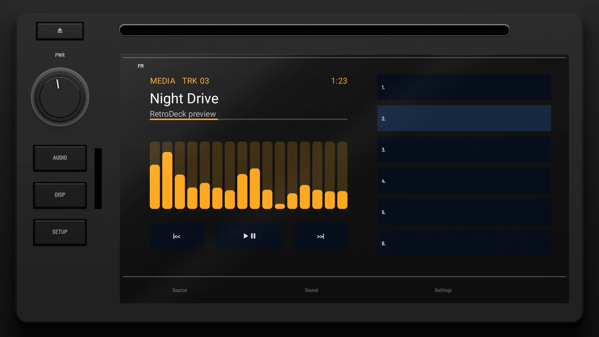
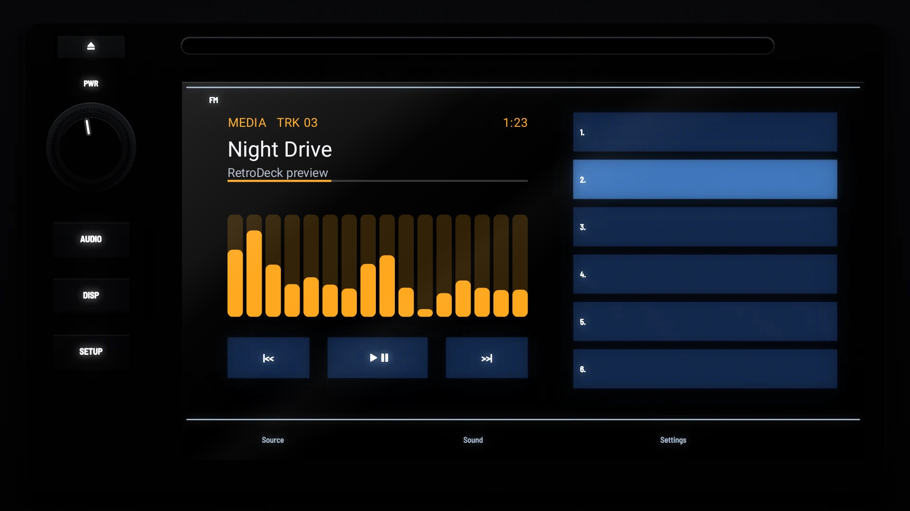

# N70 Factory 2012

**Era:** 2010s  ·  **Size:** Double DIN  ·  **Display:** A touch screen, with the presets as a list  ·  **Skin id:** `n70factory12`

A 2012 factory touch-screen unit: gloss black, a disc slot across the top, a volume knob and AUDIO, DISP and SETUP keys down the left beside a card slot, and a wide touch screen with the song on the left, |<< ▶‖ >>| buttons under it, and the six presets as a list on the right. Modelled in 3D and rendered with Blender (tools/blender/skins.py). Like every RetroDeck skin, it copies no real unit and has no brand names on it: the places where the maker's badge and marks sat are branding zones for your own logos.

## Day and night

Rendered, not taken on a device: the faceplate is modelled in 3D in Blender, and the display is drawn by the app on top in the render tests (no logos). Not yet recorded on a device.

| Day | Night |
|---|---|
|  |  |

## Keys

**Working:**

- PWR above the knob (power), the knob (volume)
- AUDIO (your music, SRC), DISP (the visualizer), SETUP (the menu)
- On the screen: |<< ▶‖ >>| (previous, play/pause, next) and presets 1–6

**For the look only:** eject; the Source, Sound and Settings tabs printed along the foot of the screen.

## Branding zones

Header (above the screen, in the middle), LCD (the left edge of the screen), visualizer (the screen, under the song), faceplate (the bottom left, under the keys), corner (the top right, beside the slot). A logo stays inside its zone and never covers a key.
