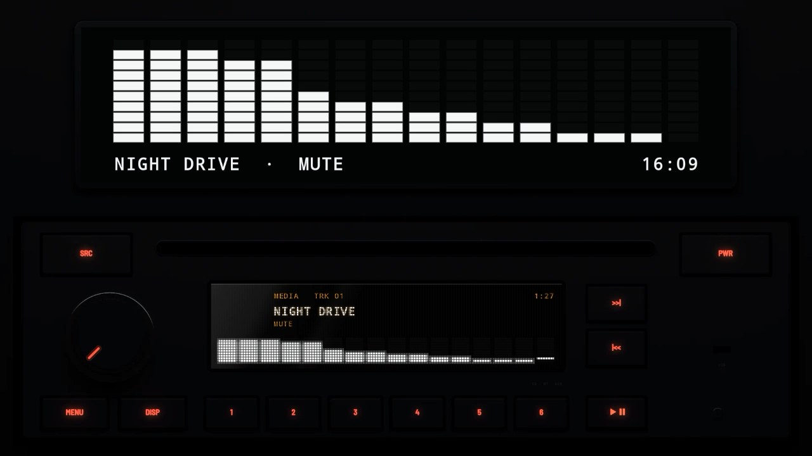
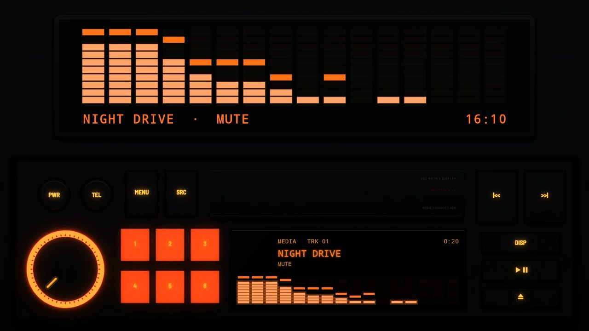
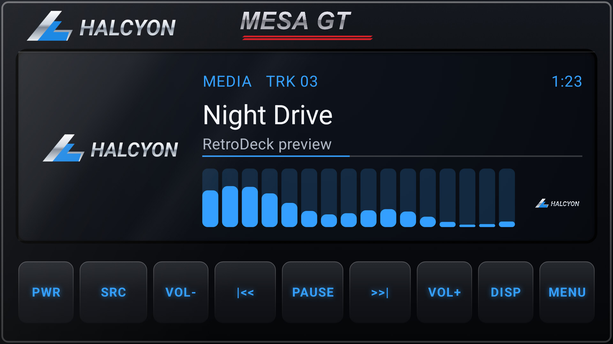

# The 2020s

## [Matte CD 2020](matte-cd-2020/)

A CD and Bluetooth unit in one DIN: matt black, a CD slot, a knob in a chrome ring, a white dot-matrix display and keys with red legends.

## [Heritage 2023](heritage-2023/)

A unit styled after the 1980s in one DIN: square keys, a knob in a ring lit red, presets in clear red that glow, and a flip-down cover above an orange dot-matrix display.

## [Modern Glass](modern-glass/)

A current head unit: one sheet of black glass with a bonded display and a row of touch keys. Volume is on VOL- and VOL+ keys instead of a knob.
