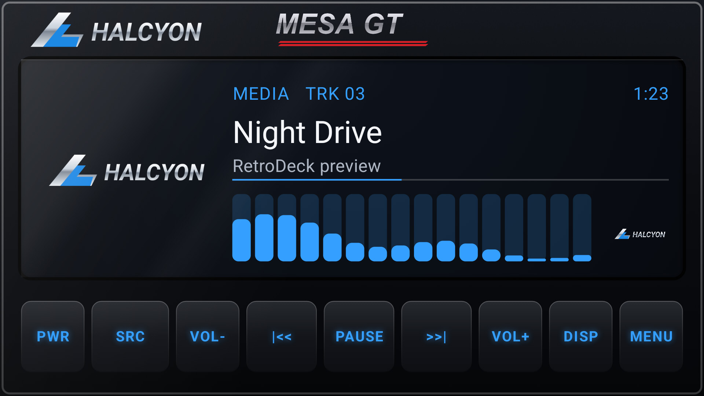
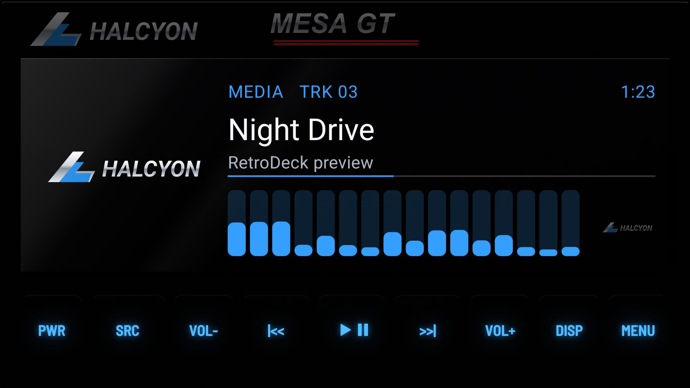
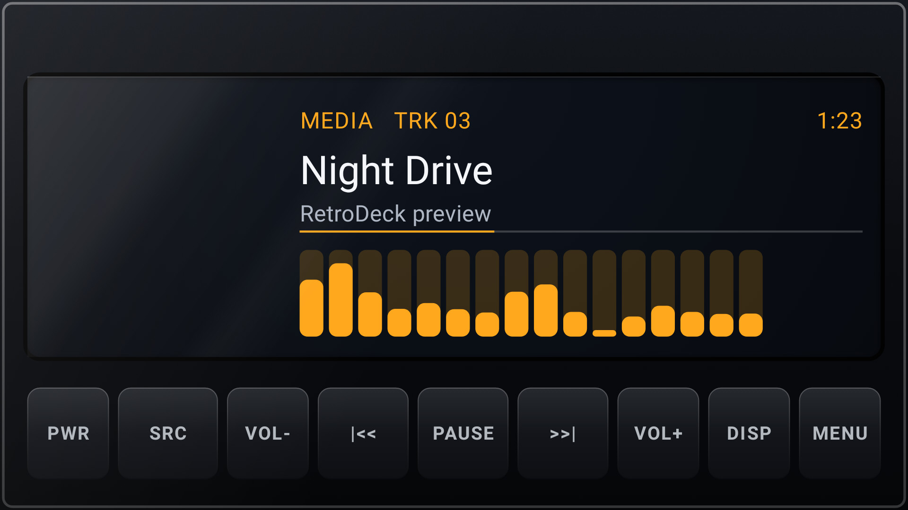
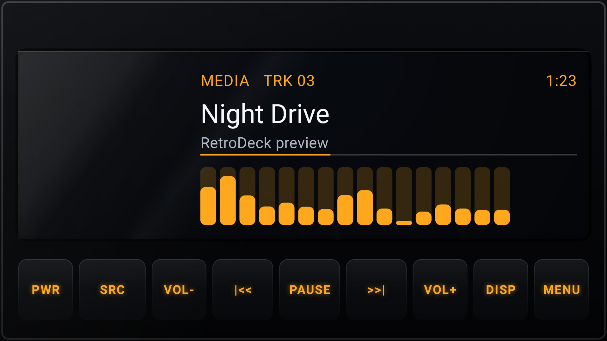

# Modern Glass

**Era:** 2020s  ·  **Size:** Double DIN  ·  **Display:** Modern screen  ·  **Skin id:** `modern`

A current head unit: one sheet of black glass with a bonded display and a row of touch keys. Volume is on VOL- and VOL+ keys instead of a knob.

## Screenshots

Taken from the running app (v0.5.0) on an Android TV box at 1920×1080 (240 dpi), branded with the made-up Halcyon Mesa GT from [docs/demo](../../../docs/demo/), with the dash lit blue. The faceplate is a 3D render; the display, logos and knob pointer are drawn live on top.

By day (Key Lighting Off): legends printed on the keys

At night (Key Lighting on Auto, 20:10): the faceplate dark, the legends backlit in the dash colour

## Day and night

Rendered, not taken on a device: the faceplate is modelled in 3D in Blender, and the display, knob pointer and dial are drawn by the app on top in the render tests (no logos). At night the key legends are backlit and the faceplate goes dark; by day the legends are printed paint. See Key Lighting in the [main README](../../../README.md).

| Day | Night |
|---|---|
|  |  |

## Keys

**Working:**

- PWR, SRC, VOL- and VOL+, |<< and >>|, PLAY/PAUSE, DISP, MENU

## Branding zones

Header and faceplate (top), LCD, corner, visualizer. A logo stays inside its zone and never covers a key.
