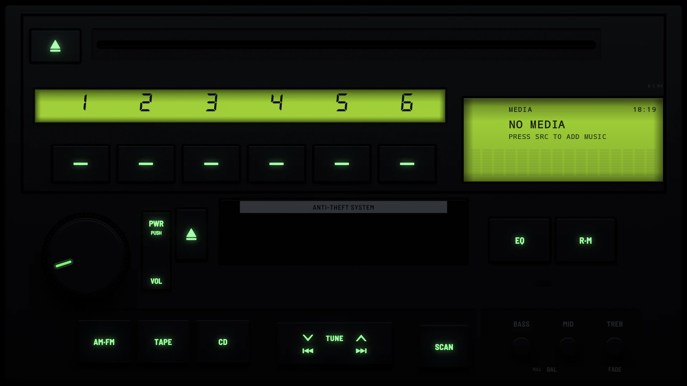

# Themes

Every RetroDeck skin, by era. Each page has screenshots from a real device, day and night renders, and which keys do what. Choose a skin in Settings → Personalization → Vehicle Branding → Radio Skin.

## [The 1980s](1980s/)

<table>
  <tr>
    <td width="50%" valign="top"> <b><a href="1980s/hi-fi-1984/">Hi-Fi 1984</a></b> Vacuum fluorescent (lit segments behind a fine mesh)</td>
    <td width="50%" valign="top"> <b><a href="1980s/classic-1985/">Classic 1985</a></b> Vacuum fluorescent</td>
  </tr>
</table>

## [The 1990s](1990s/)

<table>
  <tr>
    <td width="50%" valign="top"> <b><a href="1990s/z32-factory-1990/">Z32 Factory 1990</a></b> Vacuum fluorescent behind black glass, lit the same by day and night, glowing cyan whatever the dash lighting, like the real unit</td>
    <td width="50%" valign="top"> <b><a href="1990s/digital-1996/">Digital 1996</a></b> Dot matrix</td>
  </tr>
  <tr>
    <td width="50%" valign="top"> <b><a href="1990s/a80-factory-1994/">A80 Factory 1994</a></b> Reflective LCDs, olive grey by day and lit lime green at night with the legends, like the real unit</td>
    <td width="50%" valign="top"> <b><a href="1990s/detachable-1998/">Detachable 1998</a></b> Dot matrix, with colour bars</td>
  </tr>
</table>

## [The 2020s](2020s/)

<table>
  <tr>
    <td width="50%" valign="top"> <b><a href="2020s/modern-glass/">Modern Glass</a></b> Modern screen</td>
    <td width="50%"></td>
  </tr>
</table>
