# Themes

Every RetroDeck skin, by size, fading between its day and night looks. Each page has screenshots from a real device, day and night renders, and which keys do what. Choose a skin in Settings → Personalization → Vehicle Branding → Radio Skin.

## Single DIN

One-slot radios. On a single-DIN head unit's own wide screen (about 8:3, such as 1280×480 or 1920×720) the radio fills the screen. On a bigger screen RetroDeck draws it at a real one's shape, about 3.5 times as wide as it is tall, across the lower half and set into the dash, with a screen above it for the visualizer, the song and the clock.

<table>
  <tr>
    <td width="50%" valign="top"><a href="1960s/chrome-1965/">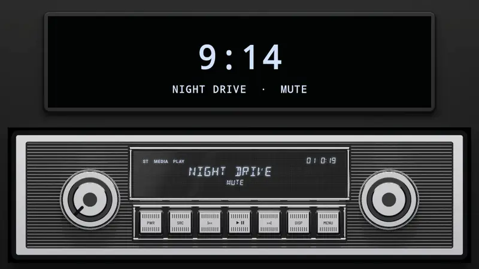</a> <b><a href="1960s/chrome-1965/">Chrome 1965</a></b> 1960s · no visualizer, the song centred in a window lit blue-white</td>
    <td width="50%" valign="top"><a href="1960s/chrome-1965-modern/">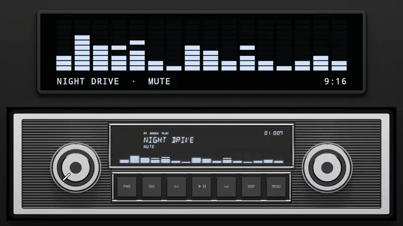</a> <b><a href="1960s/chrome-1965-modern/">Chrome 1965 Modern</a></b> 1960s · the same radio with a visualizer</td>
  </tr>
  <tr>
    <td width="50%" valign="top"><a href="1970s/b110-factory-1971/">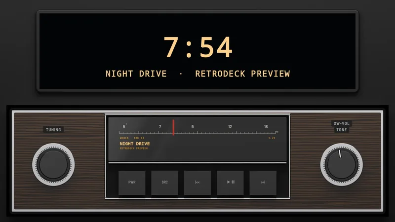</a> <b><a href="1970s/b110-factory-1971/">B110 Factory 1971</a></b> 1970s · a slide-rule dial lit warm, its red needle moving with the song, no visualizer</td>
    <td width="50%" valign="top"><a href="1970s/b110-factory-1971-modern/">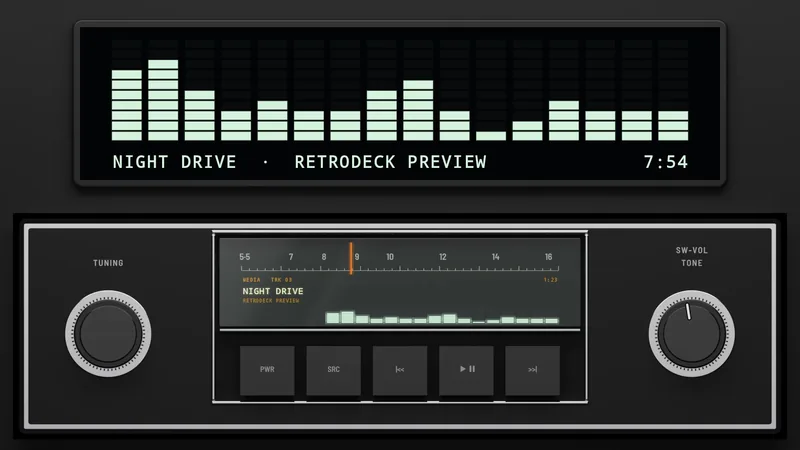</a> <b><a href="1970s/b110-factory-1971-modern/">B110 Factory 1971 Modern</a></b> 1970s · the same radio made again today, in black, with a visualizer</td>
  </tr>
  <tr>
    <td width="50%" valign="top"><a href="1980s/amber-glow-1982/">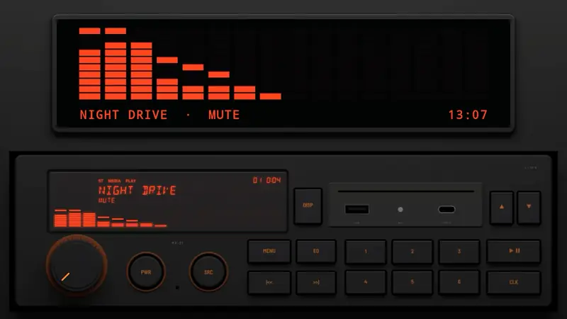</a> <b><a href="1980s/amber-glow-1982/">Amber Glow 1982</a></b> 1980s · segment display lit red, orange legends</td>
    <td width="50%" valign="top"><a href="1980s/heritage-1983/">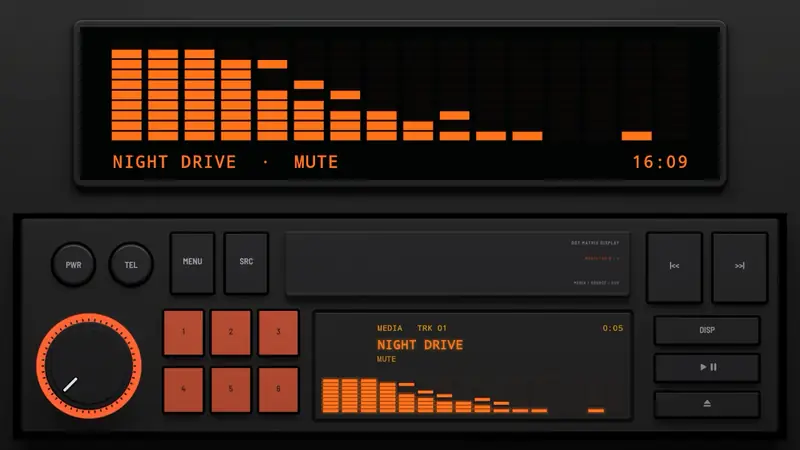</a> <b><a href="1980s/heritage-1983/">Heritage 1983</a></b> 1980s · dot matrix lit orange</td>
  </tr>
  <tr>
    <td width="50%" valign="top"><a href="1980s/hi-fi-1984/">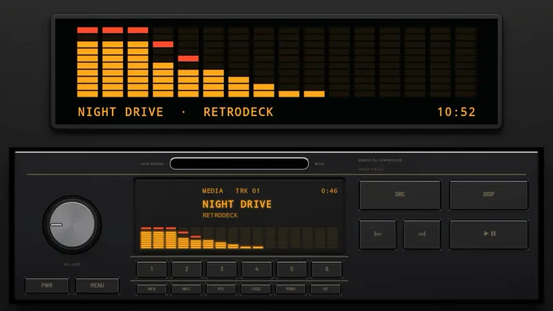</a> <b><a href="1980s/hi-fi-1984/">Hi-Fi 1984</a></b> 1980s · vacuum fluorescent (lit segments behind a fine mesh)</td>
    <td width="50%" valign="top"><a href="1980s/classic-1985/">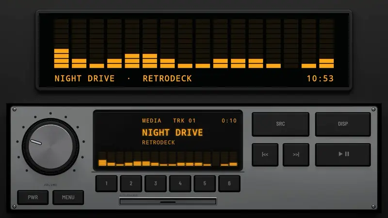</a> <b><a href="1980s/classic-1985/">Classic 1985</a></b> 1980s · vacuum fluorescent</td>
  </tr>
  <tr>
    <td width="50%" valign="top"><a href="1980s/split-tone-1986/">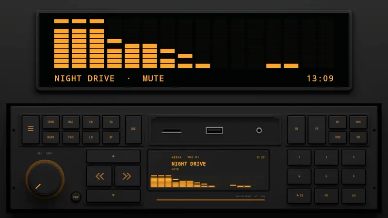</a> <b><a href="1980s/split-tone-1986/">Split Tone 1986</a></b> 1980s · dot matrix lit amber</td>
    <td width="50%" valign="top"><a href="1980s/tape-deck-1987/">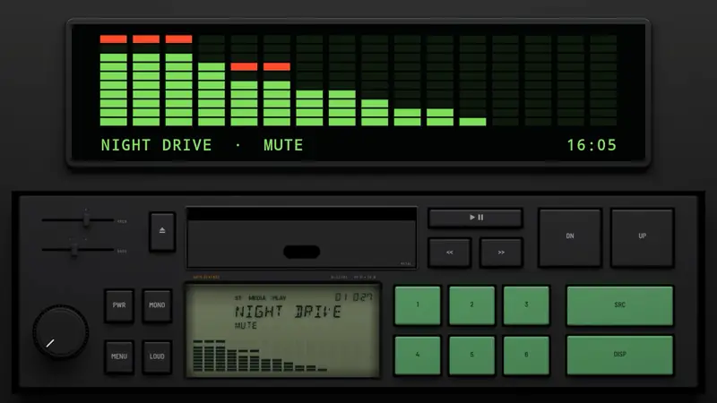</a> <b><a href="1980s/tape-deck-1987/">Tape Deck 1987</a></b> 1980s · reflective LCD lit green, dark digits</td>
  </tr>
  <tr>
    <td width="50%" valign="top"><a href="1980s/matte-cd-1988/">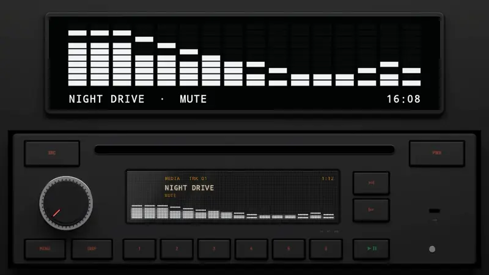</a> <b><a href="1980s/matte-cd-1988/">Matte CD 1988</a></b> 1980s · dot matrix lit white</td>
    <td width="50%" valign="top"><a href="1990s/digital-1996/">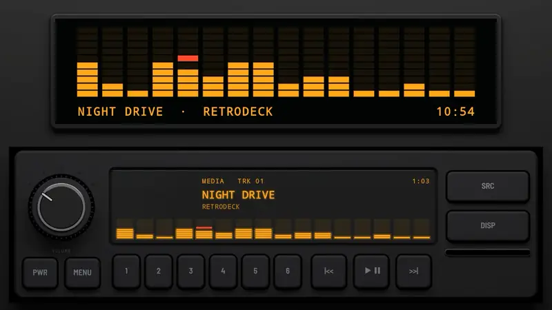</a> <b><a href="1990s/digital-1996/">Digital 1996</a></b> 1990s · dot matrix</td>
  </tr>
  <tr>
    <td width="50%" valign="top"><a href="1990s/detachable-1998/">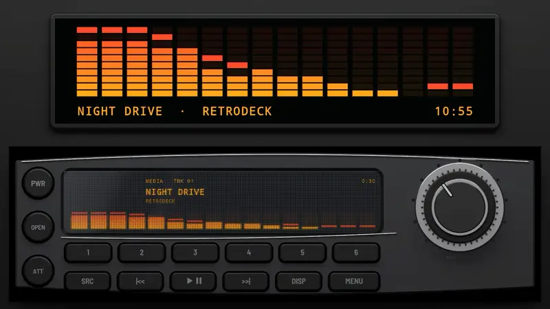</a> <b><a href="1990s/detachable-1998/">Detachable 1998</a></b> 1990s · dot matrix, with colour bars</td>
    <td width="50%" valign="top"><a href="2010s/bluetooth-2016/">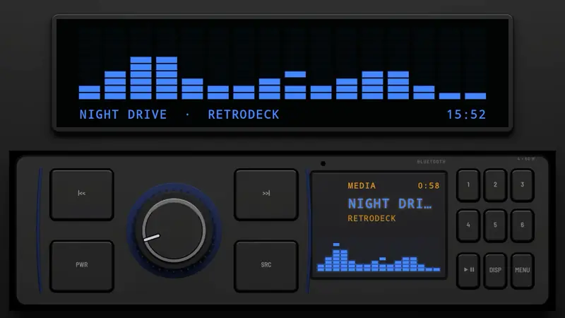</a> <b><a href="2010s/bluetooth-2016/">Bluetooth 2016</a></b> 2010s · segment display lit blue</td>
  </tr>
  <tr>
    <td width="50%" valign="top"><a href="2010s/red-line-2019/">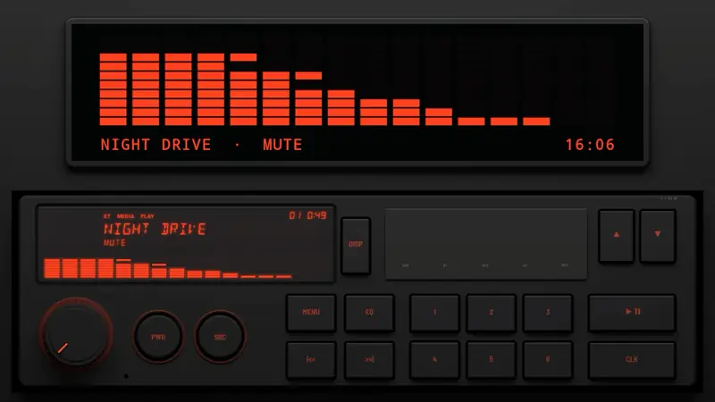</a> <b><a href="2010s/red-line-2019/">Red Line 2019</a></b> 2010s · segment display lit red</td>
  </tr>
</table>

## Double DIN

Two-slot units: stacks of units and screens that fill the whole display.

<table>
  <tr>
    <td width="50%" valign="top"><a href="1980s/eq-stack-1989/">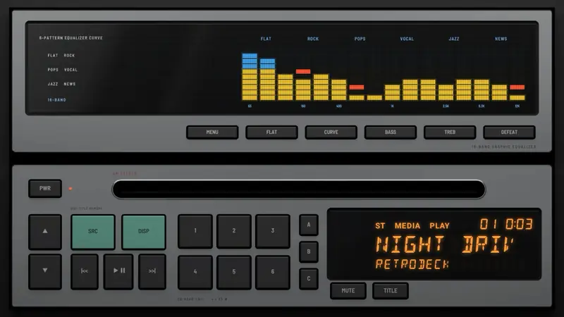</a> <b><a href="1980s/eq-stack-1989/">EQ Stack 1989</a></b> 1980s · equaliser bars yellow under blue, orange 14-segment display</td>
    <td width="50%" valign="top"><a href="1990s/z32-factory-1990/">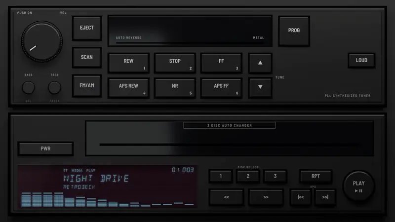</a> <b><a href="1990s/z32-factory-1990/">Z32 Factory 1990</a></b> 1990s · vacuum fluorescent behind black glass, glowing icy blue whatever the dash lighting, like the real unit</td>
  </tr>
  <tr>
    <td width="50%" valign="top"><a href="1990s/level-meter-1991/">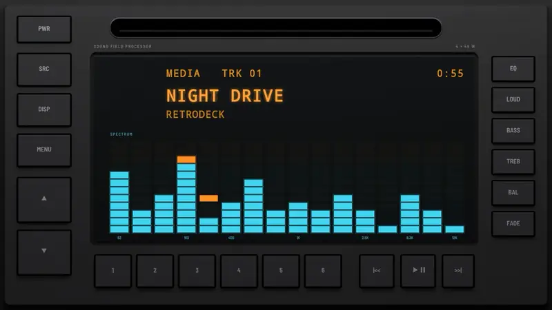</a> <b><a href="1990s/level-meter-1991/">Level Meter 1991</a></b> 1990s · orange readout over a cyan spectrum analyser</td>
    <td width="50%" valign="top"><a href="1990s/trio-stack-1993/">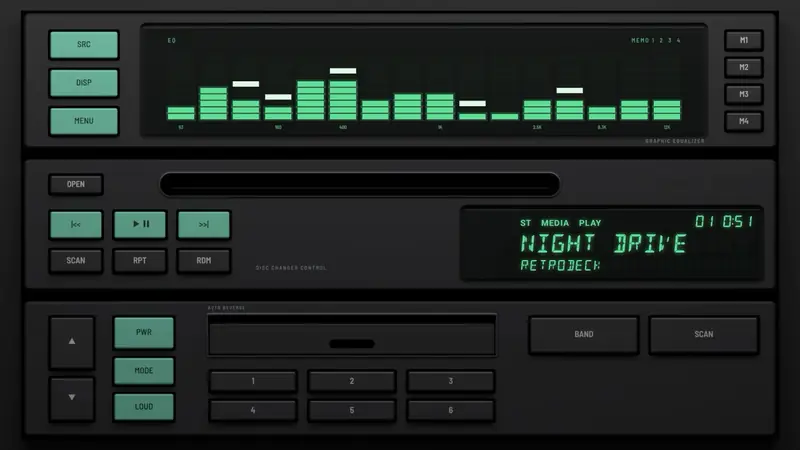</a> <b><a href="1990s/trio-stack-1993/">Trio Stack 1993</a></b> 1990s · green fluorescent equaliser and display, mint keys</td>
  </tr>
  <tr>
    <td width="50%" valign="top"><a href="1990s/a80-factory-1994/">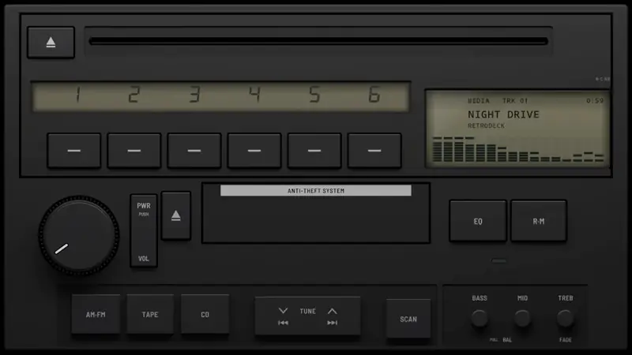</a> <b><a href="1990s/a80-factory-1994/">A80 Factory 1994</a></b> 1990s · reflective LCDs, olive grey by day and lit lime green at night with the legends, like the real unit</td>
    <td width="50%" valign="top"><a href="1990s/spectrum-1997/">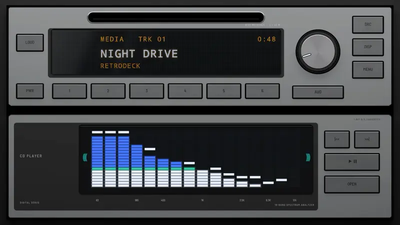</a> <b><a href="1990s/spectrum-1997/">Spectrum 1997</a></b> 1990s · blue-white dot matrix and spectrum analyser</td>
  </tr>
  <tr>
    <td width="50%" valign="top"><a href="1990s/r34-factory-1999/">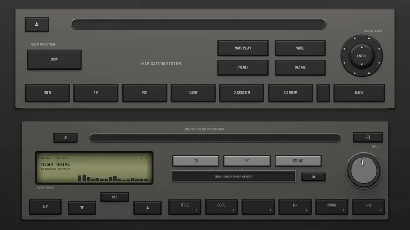</a> <b><a href="1990s/r34-factory-1999/">R34 Factory 1999</a></b> 1990s · navigation over a CD and MD changer control, a reflective LCD olive by day and lit amber at night</td>
    <td width="50%" valign="top"><a href="2000s/multi-control-2000/">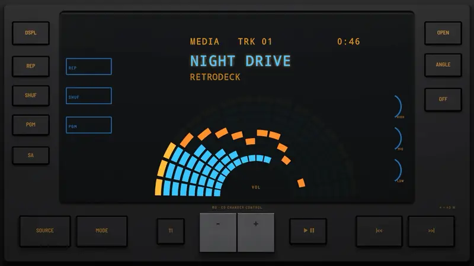</a> <b><a href="2000s/multi-control-2000/">Multi Control 2000</a></b> 2000s · big blue fluorescent window, bars fanned round a half circle</td>
  </tr>
  <tr>
    <td width="50%" valign="top"><a href="2000s/twin-dial-2001/">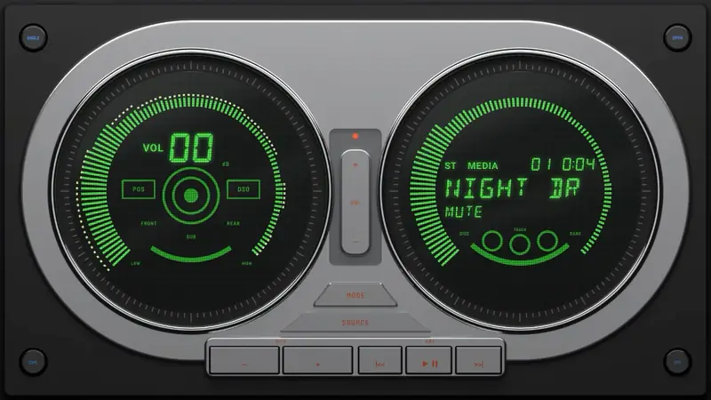</a> <b><a href="2000s/twin-dial-2001/">Twin Dial 2001</a></b> 2000s · two round green dials ringed with spokes, in a silver frame</td>
    <td width="50%" valign="top"><a href="2000s/rainbow-2002/">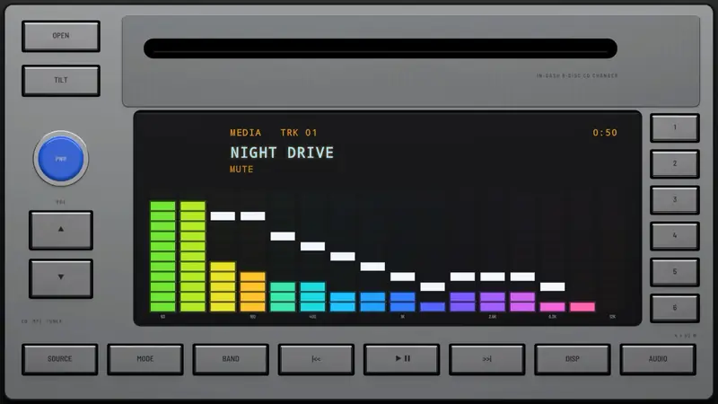</a> <b><a href="2000s/rainbow-2002/">Rainbow 2002</a></b> 2000s · silver CD changer, bars through the rainbow</td>
  </tr>
  <tr>
    <td width="50%" valign="top"><a href="2000s/blue-matrix-2004/">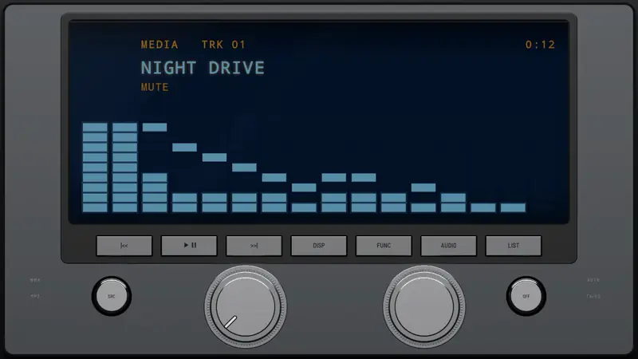</a> <b><a href="2000s/blue-matrix-2004/">Blue Matrix 2004</a></b> 2000s · big blue dot matrix in dark chrome</td>
    <td width="50%" valign="top"><a href="2000s/n70-factory-2005/">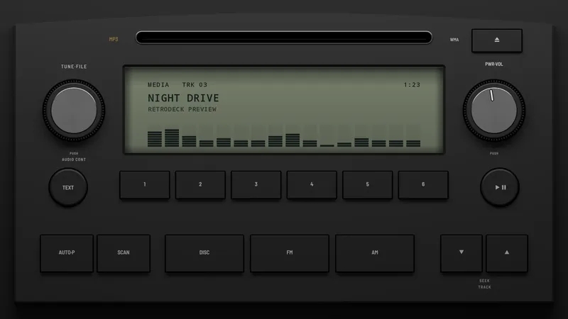</a> <b><a href="2000s/n70-factory-2005/">N70 Factory 2005</a></b> 2000s · a big reflective LCD lit green, between two knobs</td>
  </tr>
  <tr>
    <td width="50%" valign="top"><a href="2000s/e150-factory-2008/">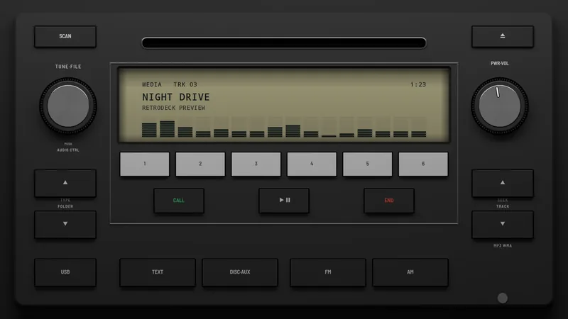</a> <b><a href="2000s/e150-factory-2008/">E150 Factory 2008</a></b> 2000s · an amber-lit LCD, white presets, two knobs</td>
    <td width="50%" valign="top"><a href="2000s/xp90-factory-2009/">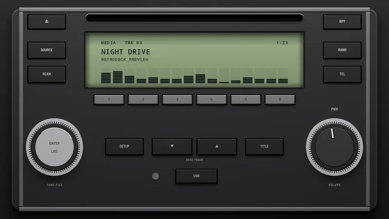</a> <b><a href="2000s/xp90-factory-2009/">XP90 Factory 2009</a></b> 2000s · silver grey, a green-lit LCD, knobs in chrome rings</td>
  </tr>
  <tr>
    <td width="50%" valign="top"><a href="2010s/n70-factory-2011/">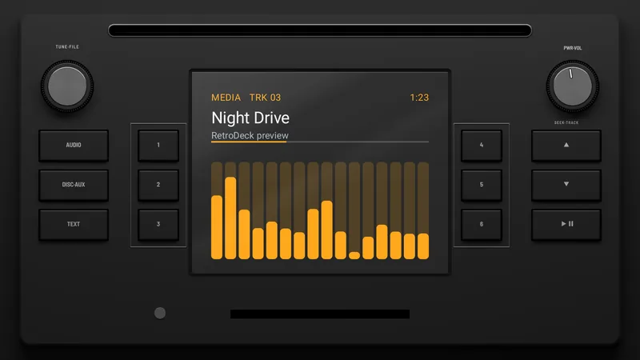</a> <b><a href="2010s/n70-factory-2011/">N70 Factory 2011</a></b> 2010s · a colour screen between columns of presets</td>
    <td width="50%" valign="top"><a href="2010s/n70-factory-2012/">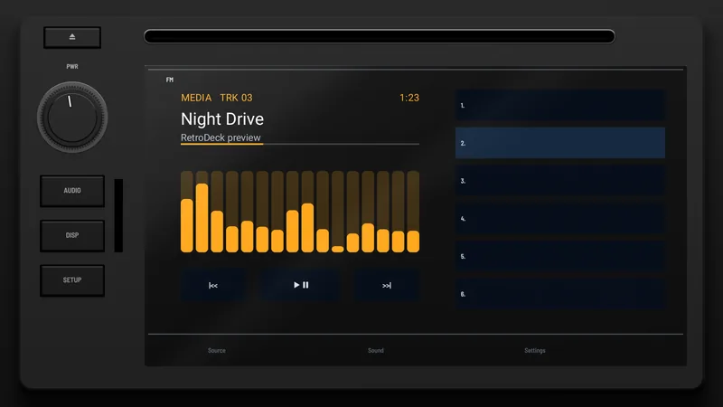</a> <b><a href="2010s/n70-factory-2012/">N70 Factory 2012</a></b> 2010s · a touch screen, the presets as a list</td>
  </tr>
  <tr>
    <td width="50%" valign="top"><a href="2010s/cp-2013/">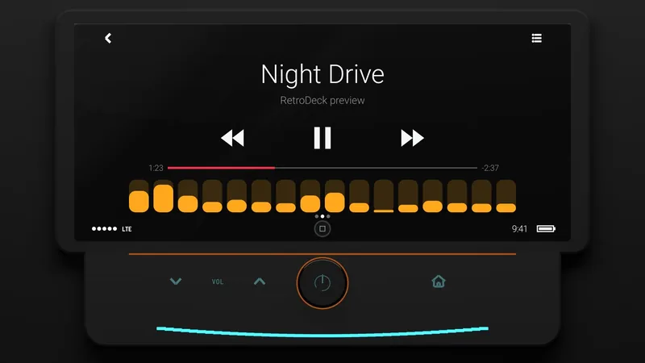</a> <b><a href="2010s/cp-2013/">CP 2013</a></b> 2010s · a touch screen, the song in thin white type, cyan keys on the shelf</td>
    <td width="50%" valign="top"><a href="2020s/modern-glass/">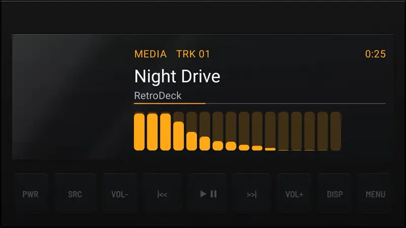</a> <b><a href="2020s/modern-glass/">Modern Glass</a></b> 2020s · modern screen</td>
  </tr>
</table>

The pages are also listed by era: [the 1960s](1960s/), [the 1970s](1970s/), [the 1980s](1980s/), [the 1990s](1990s/), [the 2000s](2000s/), [the 2010s](2010s/) and [the 2020s](2020s/).
